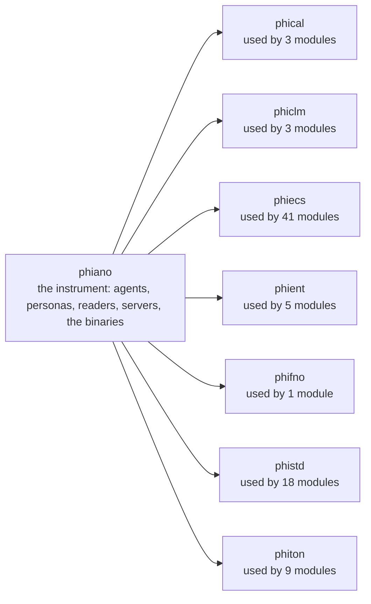
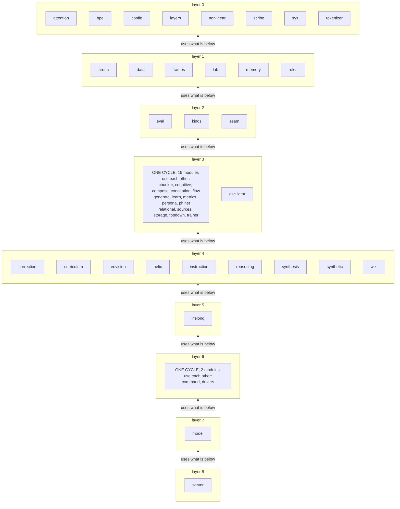
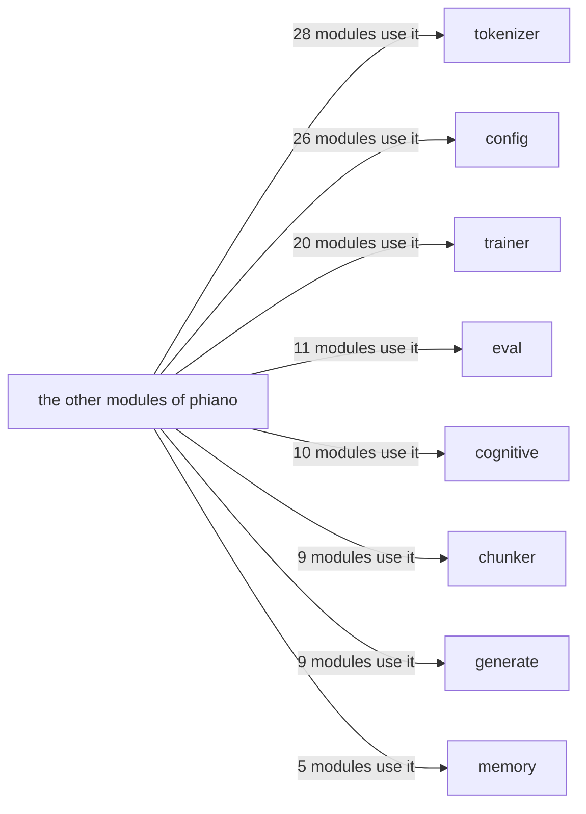

# phiano — architecture

## The crates it stands on

## The modules in layers (a module sits above all it uses)

## The hubs (most used inside the crate)

## Modules, one diagram each

- [arena](../../docs/phiano/arena.md)
- [attention](../../docs/phiano/attention.md)
- [bpe](../../docs/phiano/bpe.md)
- [chunker](../../docs/phiano/chunker.md)
- [cognitive](../../docs/phiano/cognitive.md)
- [command](../../docs/phiano/command.md)
- [compose](../../docs/phiano/compose.md)
- [conception](../../docs/phiano/conception.md)
- [config](../../docs/phiano/config.md)
- [correction](../../docs/phiano/correction.md)
- [curriculum](../../docs/phiano/curriculum.md)
- [data](../../docs/phiano/data.md)
- [drivers](../../docs/phiano/drivers.md)
- [envision](../../docs/phiano/envision.md)
- [eval](../../docs/phiano/eval.md)
- [flow](../../docs/phiano/flow.md)
- [frames](../../docs/phiano/frames.md)
- [generate](../../docs/phiano/generate.md)
- [helix](../../docs/phiano/helix.md)
- [instruction](../../docs/phiano/instruction.md)
- [kinds](../../docs/phiano/kinds.md)
- [lab](../../docs/phiano/lab.md)
- [layers](../../docs/phiano/layers.md)
- [learn](../../docs/phiano/learn.md)
- [lifelong](../../docs/phiano/lifelong.md)
- [memory](../../docs/phiano/memory.md)
- [metrics](../../docs/phiano/metrics.md)
- [model](../../docs/phiano/model.md)
- [nonlinear](../../docs/phiano/nonlinear.md)
- [oscillator](../../docs/phiano/oscillator.md)
- [persona](../../docs/phiano/persona.md)
- [phinet](../../docs/phiano/phinet.md)
- [reasoning](../../docs/phiano/reasoning.md)
- [relational](../../docs/phiano/relational.md)
- [roles](../../docs/phiano/roles.md)
- [scribe](../../docs/phiano/scribe.md)
- [seam](../../docs/phiano/seam.md)
- [server](../../docs/phiano/server.md)
- [sources](../../docs/phiano/sources.md)
- [storage](../../docs/phiano/storage.md)
- [synthesis](../../docs/phiano/synthesis.md)
- [synthetic](../../docs/phiano/synthetic.md)
- [sys](../../docs/phiano/sys.md)
- [tokenizer](../../docs/phiano/tokenizer.md)
- [topdown](../../docs/phiano/topdown.md)
- [trainer](../../docs/phiano/trainer.md)
- [wiki](../../docs/phiano/wiki.md)

What is left to do: [TODO.md](TODO.md)
