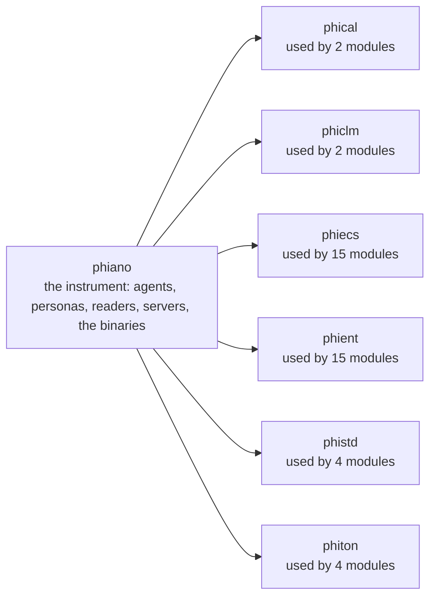
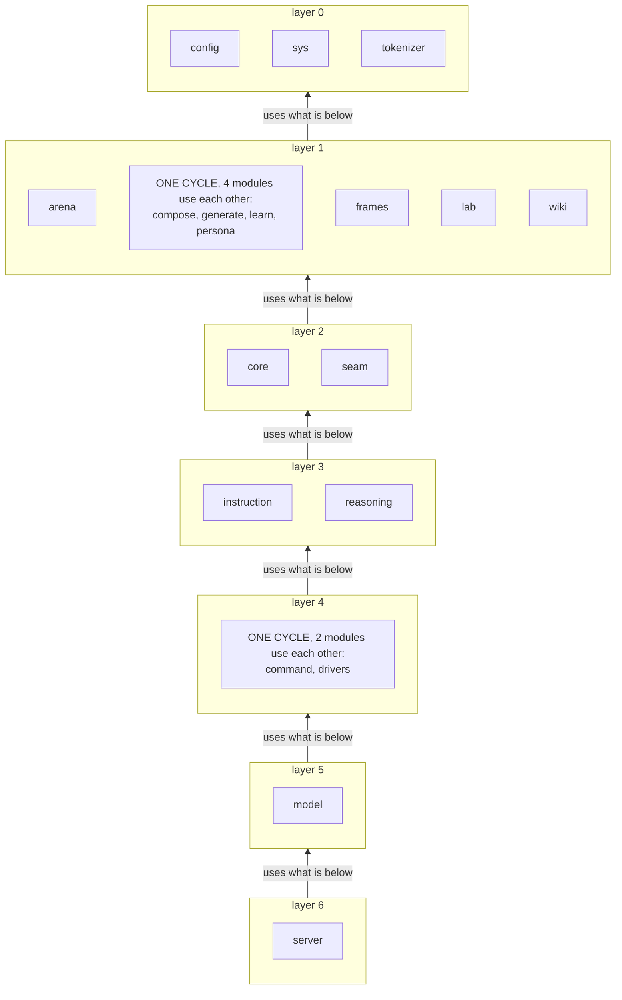
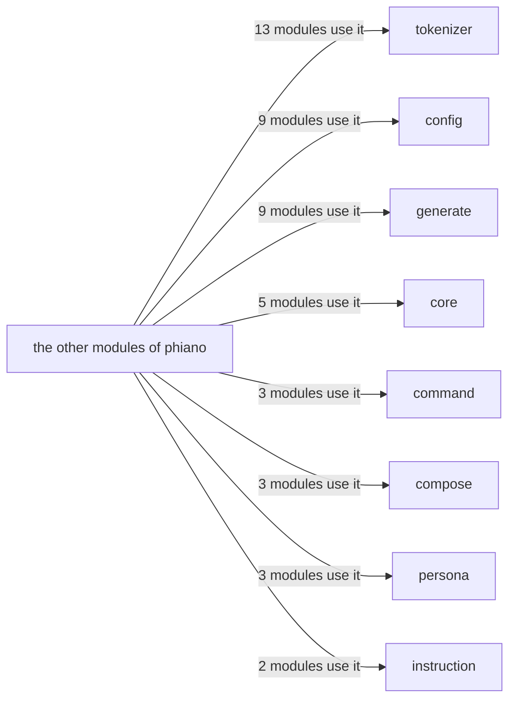

# phiano — architecture

## The crates it stands on

## The modules in layers (a module sits above all it uses)

## The hubs (most used inside the crate)

## Modules, one diagram each

- [arena](../../docs/phiano/arena.md)
- [command](../../docs/phiano/command.md)
- [compose](../../docs/phiano/compose.md)
- [config](../../docs/phiano/config.md)
- [core](../../docs/phiano/core.md)
- [drivers](../../docs/phiano/drivers.md)
- [frames](../../docs/phiano/frames.md)
- [generate](../../docs/phiano/generate.md)
- [instruction](../../docs/phiano/instruction.md)
- [lab](../../docs/phiano/lab.md)
- [learn](../../docs/phiano/learn.md)
- [model](../../docs/phiano/model.md)
- [persona](../../docs/phiano/persona.md)
- [reasoning](../../docs/phiano/reasoning.md)
- [seam](../../docs/phiano/seam.md)
- [server](../../docs/phiano/server.md)
- [sys](../../docs/phiano/sys.md)
- [tokenizer](../../docs/phiano/tokenizer.md)
- [wiki](../../docs/phiano/wiki.md)

What is left to do: [TODO.md](TODO.md)
