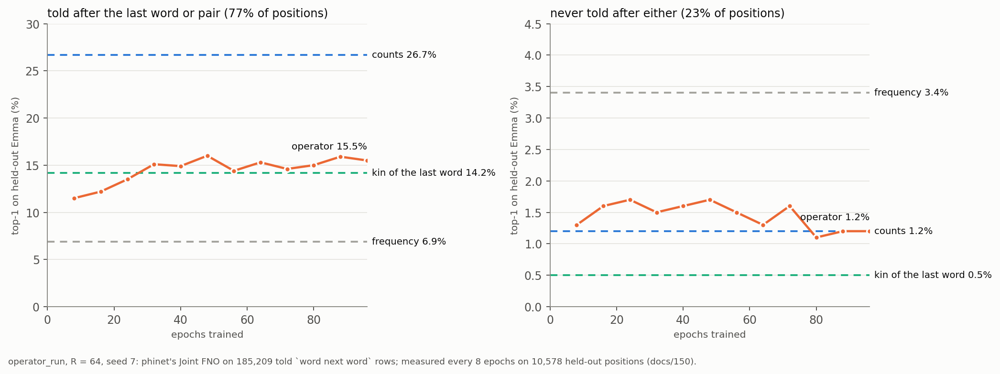

# 150 · The operator's long run: what hours of training buy, and what they do not

In Phient's world, a word (w) is a seed: what it relates to, under what conditions (c), grows from it. The Phical paradigm, X ⇒ Y, drives and composes Phient's Phasor Language Models: Phinet, Phiano, PhiTon. Phical stores no point: a word is 32–64 relations, each a complex phasor on a closed circle with a count; meaning is a side effect of pairs of words moving under a condition.

The user asked when the training would run for hours. The counts learn the moment a row is told, so there is nothing for them to train. The one part of the model that trains is the operator, phinet's Joint FNO, the slow speed (docs/113). Its place, if it has one, was named in docs/137–138: the 23% of held-out positions whose word was never told after the last word or pair. There the counts read 1.2% and frequency 3.4%, and nothing has beaten frequency yet. This run gives the operator twelve times the training it had in docs/137 and measures it the whole way.

## 1. The run (`operator_run`)

- **What it learns:** the 185,209 `word next word` rows of *Emma*'s told paragraphs; 5% of paragraphs are held out, seed 7, as in docs/135–149.
- **The model:** R = 64, width 16, two layers, hinge loss, Adam, 96 epochs.
- **Saves and measurements:** the operator is saved after every epoch. Every 8 epochs, its strata are measured on the 10,578 held-out positions.
- **Where it ran:** in the cloud workspace, 00:08–09:52 UTC on 2026-10-06, at 3–5 minutes an epoch.
- **Restarts:** the workspace was interrupted four times. The first interruption, the evening before, lost the first attempt entirely, which is why every epoch is now saved. The other three, after epochs 13, 73 and 74, each resumed from the last saved epoch and lost nothing. The optimiser's moments start afresh at a resume; the loss curve shows no step at those points.

`scripts/operator_run.ps1` runs the same thing on the user's machine (R = 128 by default), where a run of many hours does not depend on a session staying awake.

## 2. The curve

Top-1 · MRR on the held-out positions, by stratum:

| epoch | hinge loss | told after the last word or pair (8,147) | never told after either (2,431) |
|---|---|---|---|
| 1 (first attempt) | 0.056 | 4.0% · 0.122 | 1.9% · 0.045 |
| 8 | 0.0156 | 11.5% · 0.232 | 1.3% · 0.047 |
| 16 | 0.0122 | 12.2% · 0.235 | 1.6% · 0.048 |
| 24 | 0.0109 | 13.5% · 0.252 | 1.7% · 0.050 |
| 32 | 0.0099 | 15.1% · 0.264 | 1.5% · 0.050 |
| 48 | 0.0093 | 16.0% · 0.274 | 1.7% · 0.049 |
| 64 | 0.0088 | 15.3% · 0.269 | 1.3% · 0.047 |
| 80 | 0.0086 | 15.0% · 0.270 | 1.1% · 0.045 |
| 96 | 0.0083 | **15.5% · 0.276** | **1.2% · 0.048** |
| *references* | | counts 26.7% · kin 14.2% · frequency 6.9% | counts 1.2% · kin 0.5% · **frequency 3.4%** |

- **Where the counts know the answer, the training works.** Top-1 goes from 11.5% at epoch 8 (docs/137's figure, reproduced exactly) to about 15% by epoch 32, then holds there with swings of ±1 point. It ends at 15.5% · 0.276: above the kin reading and more than twice frequency. The loss keeps falling (0.0156 → 0.0083) long after the held-out words stop moving.
- **Where the counts know nothing, it does not.** The open stratum stays between 1.1% and 1.9% from the first epoch to the last, at a third to a half of frequency, and ends where the counts are (1.2%). Ninety-six epochs taught the operator more about what was told and nothing about what was not.

## 3. The operator as the base, after the run

docs/137 made the operator's distribution the base the levels move from: 159.0 → 155.4 in perplexity at 8 epochs, under the old breadth rule. Under the path form (docs/149) the base is a component of the mixture, weighted for the context, and the measurement is worth repeating with both checkpoints:

| reading (seed 7) | no operator | the epoch-8 operator as base | the epoch-96 operator as base |
|---|---|---|---|
| flat: the last word, then the last two | 137.0 | 130.4 | **128.0** |
| tree: the scopes a cast finds, then the words under them | 141.5 | 134.6 | **132.3** |
| top-1 (flat) | 20.8% | 20.9% | 20.7% |
| fit of the softened operator to told rows, mean ln p at T = 0.1 | — | −5.20 | **−4.82** |

- **The flat reading is now at 128.0**, the lowest perplexity on held-out *Emma* so far. The path started at 159.0 under breadth (docs/135); counted weights took it to 139.3, the path form to 137.0, and the operator as a base to 128.0.
- **Most of the operator's gain is the form, not the hours.** The epoch-8 operator already takes the flat reading from 137.0 to 130.4, against 159 → 155 under the old chain. The 88 further epochs add 130.4 → 128.0 (1.8%).
- **Top-1 does not move** (20.7–20.9%). The operator improves what is kept for the word that was not first.
- *Later (docs/151):* the epoch-32 checkpoint, read the same way, gives 127.6 flat and 131.9 in the tree, slightly below epoch 96. As a base, the epochs after 32 bought nothing.

## 4. What this says

Hours of training on these rows make the operator a better reader of what was told: 15.5% where the counts know the answer, and as a base it lowers perplexity to 128. Hours do not make it a reader of what was not told. That is what the paradigm's claim is about: a relation never told, reached through what else is known about the two words. The open stratum's word is, three times in five, an ordinary word the last word was never followed by (docs/138 §3). A model trained on `word next word` alone sees only pairs that happened; more epochs over the same pairs fit them better and reach no new ones. The next measurement has to change the input, not the length:

1. **The operator trained on more than the next word.** The rows the counts also hold — the word's companies under `says`, its scopes, the words two and three ahead (the eight offset channels of the 8M plan) — so that a function is shaped by what a word relates to, not only by what followed it.
2. **R = 128 on the user's machine** (`operator_run.ps1`), to see whether the told stratum's plateau at ~15% is the operator's size or the input's.
3. **The base as the default reading.** The epoch-96 operator, saved as `epoch_96.relate`, lowers perplexity by 6.6% at no cost to top-1. Making it the default base for the held-out prose readings is a decision about what the shipped model loads.

`operator_run data/text --in text/emma --r 64 --epochs 96 --every 8 --out data/runs/operator_r64_s7` (resumes from `latest.relate`) · `story data/text --in text/emma --held-out 0.05 --seed 7 --operator 64,8 --model data/runs/operator_r64_s7/epoch_96.relate` · `python3 docs/papers/figs150.py`. Outputs are in `data/runs/operator_r64_s7/`: `log.md`, `epoch_{8…96}.relate`, and `as_base_epoch{8,96}.txt`.
