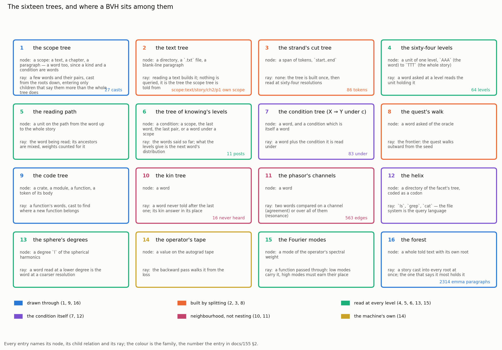

# 155 · A story as a forest of trees: the sixteen, and the one that is a BVH

In Phient's world, a word (w) is a seed: what it relates to, under what conditions (c), grows from it. The Phical paradigm, X ⇒ Y, drives and composes Phient's Phasor Language Models: Phinet, Phiano, PhiTon. Phical stores no point: a word is 32–64 relations, each a complex phasor on a closed circle with a count; meaning is a side effect of pairs of words moving under a condition.

The user told the system a new story — eighty-six tokens, written in capitals, with its own misspellings — and asked three things: which sixteen trees the system holds, and where a bounding-volume hierarchy sits among them; how the story is understood as a forest of trees; and whether that amounts to understanding language. This doc is the measurement; papers 28–35 are the long form; the Phiano app's new views are the same numbers on screen.

## 1. What was built (`bin/forest`)

One binary reads one told story with everything the system has, and writes a single `forest.json` the documents and the app both draw from. Nothing in it is generated except the two continuations, which say so.

- **`casts.rs`** — the scope tree the story was told into; how much of *Emma* holds each of its words (the bounding volumes); and each stretch of six words cast into *Emma* alone, with the path it entered.
- **`words.rs`** — per word: how often the language heard it, what it goes on to there and here, its kin, D2's post in nats, and, for a word never heard, what fills its place read from both sides.
- **`world.rs`** — the story told to a phiecs world: entities, `before` / `after` / `near` edges, each word's phasors, the two conditions the story turns under, and who resonates with whom.
- **`waves.rs`** — the trained readers (the Joint FNO of docs/152, the mirror of docs/153) reading every position forward and backwards.
- **`trees.rs`** — the sixteen trees, each with its node, its child relation, its ray, the code that holds it, and how a BVH maps onto it.

`strand data/text/story/ch2.txt --prior data/text/emma` writes the same story's sixty-four levels beside it.

## 2. The sixteen trees

| # | tree | node | ray | code |
|---|---|---|---|---|
| 1 | the scope tree | a scope (a text, chapter, paragraph — or a word, since a kind is a word) | a few words and their pairs | `phiplm::relate::tree` |
| 2 | the text tree | a directory, a file, a blank-line paragraph | none: it is what the scope tree is told from | `phiplm::prose::read_tree` |
| 3 | the strand's cut tree | a span of tokens | none: built once, read at 64 resolutions | `prose::strand::cut` |
| 4 | the sixty-four levels | a unit of one level, `AAA` to `TTT` | a word asked at a level | `prose::strand` |
| 5 | the reading path | a unit, from the word up to the whole story | the word being read | `prose::strand::path` |
| 6 | the tree of knowing's levels | a condition: a scope, the last word, the last pair | the words said so far | `relate::levels`, `relate::path` |
| 7 | the condition tree, X ⇒ Y under c | a word, and a condition which is a word | a word plus its condition | `phiecs::condition::Under` |
| 8 | the quest's walk | a word asked of the oracle | the frontier | `phiecs::quest` |
| 9 | the code tree | a crate, module, function, token | a function's words | `phiplm::code` |
| 10 | the kin tree | a word, and its neighbourhood | a word never told after the last | `relate::kin` |
| 11 | the phasor's channels | a word, with 64 angles | two words compared | `phiecs::phasor` |
| 12 | the helix | a directory coded as a codon | `ls`, `grep`, `cat` | `phiano::helix` |
| 13 | the sphere's degrees | a degree `l` and its orders | a word at a coarser resolution | `phifno::sphere` |
| 14 | the operator's tape | a value, and the op that made it | the backward pass | `phinet::tensor` |
| 15 | the Fourier modes | a mode of the spectral weight | a function passed through | `phical::operator` |
| 16 | the forest | a whole told text with its own root | a story cast into every root | `ScopeTree::roots` |

**The BVH is number 1, and the analogy is exact in five parts.** `relate::tree`'s own documentation has said so since docs/126: a node holds a *distribution* rather than a box; "contains" means a scope says everything its subtree says; the ray is a few words and their pairs; the hit test is D4's movement in nats, not an intersection; and the pruning is the beam. Number 3 is the BVH *builder* (a top-down split that maximises a gain, as SAH splits a scene), 4 and 13 are its levels of detail, 5 is the node stack a traversal keeps, and 16 is the top-level structure over several scenes. `trees.rs` holds the full table with what this story measured for each.

## 3. What the forest measured on this story

**The story.** 86 tokens, 58 distinct words, told as one paragraph, `scope:text/story/ch2/p1`. The language it joined: *Emma*, 2,314 paragraphs without it, 2,969,690 rows counted, 69,896 words in the tree.

**It is cast where its words were said, not where its meaning is.** Of 27 stretches of six words, two were drawn into the story's own earlier chapter (`text/story/ch1/p1`) and the rest into *Emma* — "it was on a sunday afternoon" into ch04/p8, which says *Mrs Goddard*; "onto his ego andn happened to" into ch49/p19, which says *I was and to a for*. The cast is attracted by what a paragraph says, and most of what these stretches say is `it`, `was`, `a`, `his`, `that`. That is honest and it is also the limit: a cast on function words finds paragraphs full of function words.

**Sixteen of its words *Emma* never heard**: finally, downed, exceeded, threshold, onto, ego, andn, position, launching, american, occured, evertihng, outcomes, loveful, machine, insulated. Two of those are the writer's misspellings (`andn`, `evertihng`), one is a coinage (`loveful`), and the rest are simply later English. Read from the left alone, the slot after "has exceeded the" offers *rest, idea, sort*; read from both sides, with `of` as the word that must follow, the same slot offers *rest, idea, sort* in that order. The system does not know what `threshold` means. It knows the shape of the hole.

**A word has no position.** Told to a phiecs world the story is 58 entities, 563 edges and 83 relations under a condition; each word carries angles on the channels it was related on, and nothing else. The most resonant pairs it finds are `the · of` (0.973), `holding · launching` (0.952), `moved · love` (0.952) and `senses · action` (0.948). The first is two function words that occur everywhere together; the other three are pairs the story itself put in the same company.

**The trained readers.** The Joint FNO (32 epochs) reads the next word first at 6 of 84 positions; the mirror (128 epochs) also 6. Read *backwards* — which word came before, by the conjugate filter, which was never trained for it — the FNO is first at 6 and the mirror at 4. On a story in a vocabulary it was not trained on, that is what a reader trained on *Emma* alone can do.

**Sixty-four levels.** The strand divides the story without being told where its parts are: `TTT` is one unit, "finally downed that exceeded threshold his"; at 12 units the clauses appear; at 32 the phrases. The division is made on information gained against the prior, so the words that carry each beat are the story's own.

## 4. What this shows, and what it does not

It shows that one told text enters the structures already there, and that each structure says something checkable about it: where it belongs, what its words have company with, which words are new, what would fill their place, how it divides, how it reads forward and backwards. The sixteen trees are not a taxonomy written for this doc — each is code with tests, and each gave a number here.

It does not show understanding. Three measurements say so plainly. The casts are drawn by function words, not by sense. The readers get 6 of 84 next words first on unfamiliar vocabulary. And the open stratum of docs/152 is unmoved: where a word was never told after the last, nothing yet beats frequency. What the system has is a structure in which a sentence has a place, a word has company, and both are counted. Wittgenstein's remark that meaning is use (PI §43) is the claim being tested, and this is the apparatus, not the verdict.

Papers 28–35 take the eight parts of this doc at length; the app's eight new views show the same numbers.

`forest data/text --story text/story/ch2` · `strand data/text/story/ch2.txt --prior data/text/emma --out data/forest/strand` · `python3 docs/papers/figs155.py`. Outputs are in `data/forest/` and `docs/papers/forest/FOREST_FACTS.md`.
