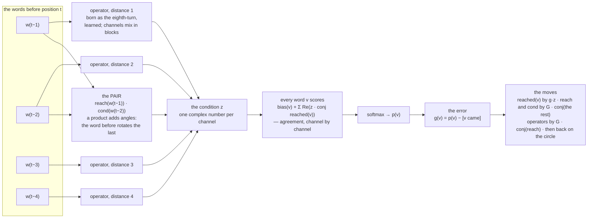

# 203 · The learner — the phasors corrected by their error, not counted

In Phient's world, a word (w) is a seed: what it relates to, under what conditions (c), grows from it. The Phical paradigm, X ⇒ Y, drives and composes Phient's Phasor Language Models: Phinet, Phiano, PhiTon. Phical stores no point: a word is 32–64 relations, each a complex phasor on a closed circle; meaning is a side effect of pairs of words moving under a condition, and they move by the error of what was expected — toward what came, away from what did not.

The ruling: the counting is not learning — fix it. Rounds 1–202 had one learning rule, `Phasor::couple`: each sighting of `a ⇒ b` moves `a`'s angle toward `b`'s, by `max(rate, 1/(n+1))`. That is a running mean. It is told, never corrected; nothing pushes a word away from what does NOT follow it; so a word reached from everywhere settles at the mean of everything — the crowd of docs/200–202, which three readouts could not type. This round keeps the representation and replaces the rule.

## The learner

`phiano::arena::learner::Learner`. A word holds `channels` unit phasors per role, born at `phistd::seed_angles` like every phasor in the workspace: `reach` (the word as the thing reaching), `reached` (as the thing reached — the domain/range split of docs/198) and `cond` (as the condition on the word after it).

The gradient is taken by hand; for any product `z ∋ a·x` the gradient of `x` is `G · conj(a)`, which is the whole algebra (`Learner::step`). Training contrasts the word that came with 128 words drawn by how often they were told (to the ¾ power), the draw corrected away (sampled softmax, Jean et al. 2015) — so a frequency chooses only which wrong answers to contrast, never the answer. Every word angle goes back on the unit circle after each step: a word is its angles, and the confidence lives in the condition's amplitude. Two regularisers, because one book is small: a context word stands as `<unk>` with chance `dropout` (and half the time when it was told once, so `<unk>` has angles of its own), and a channel of the condition falls SILENT with chance `silence`.

It is also an arena `Reader`: `tell` corrects it on the line at once, on the fly; `ready` runs the epochs when the arena's split lane says the training half is over (`examples/arena.rs` now includes it).

## How it was measured

`examples/learner.rs` on the English guide (`data/person/murphy.txt`): one sentence in ten is the TEST set no model is told or tuned on; one in twenty is the DEV set the learner's epochs stop on (stop after two epochs without a better dev perplexity, keep the best); the rest — 18,446 sentences, 142,281 words, 4,705 distinct — is told to every model. Every model is scored at the test set's 14,831 positions (each word after a line's first). The bar, stated before the first run: beat the counts on sentences none of them was told. A second, harder bar was added for honesty: the best of counting — an interpolated Witten–Bell trigram, two words back, smoothed — not just the arena's count of the word before.

## The tape (every number from a run; test set unless marked)

| run | top-1 | top-5 | perplexity |
|---|---|---|---|
| rate 0.05, 12 epochs, no regulariser | 16.0% | 30.4% | 230.3 |
| rate 0.25, 4 epochs | 19.1% | 37.9% | 141.2 |
| rate 0.6, 4 epochs (dev best at epoch 2, then over-fits) | 20.1% | 38.4% | 122.2 |
| a FULL operator per distance (64 × 64), rate 0.5 | — | — | diverged: dev perplexity 8·10¹⁰ after one pass; stopped |
| rate 0.5, dropout 0.1 | 19.8% | 38.5% | 122.0 |
| + tie (one set of angles for reaching and reached) | 19.9% | 38.7% | 129.9 — worse |
| + silence 0.2 (no tie) | 21.4% | 40.9% | 105.0 |
| + tie + silence 0.2 | 20.0% | 38.9% | 113.6 |
| + tie + silence 0.2 + blocks of 8 | 20.5% | 40.4% | 102.3, still falling at epoch 10 |

Read: the step was the first fault (a timid Adagrad rate under-fits by 2×); then over-fitting, which silence fixes and context dropout barely touches; tying the two roles HURTS every time it is tried — the domain/range split of docs/198 is confirmed a second time, by a different learner. A full operator diverges at a rate a single turn survives; a block of 8 channels, its step scaled by the block, is stable and helps.

## The final run

`--block 8 --silence 0.2`, context dropout 0.1, rate 0.5, 64 channels, 4 words back with the pair; dev best at epoch 7 (dev perplexity 105.7), stopped at epoch 9. Every model below was told the same 18,446 sentences and scored at the same 14,831 test positions.

| model, on the held-out test sentences | top-1 | top-5 | perplexity |
|---|---|---|---|
| the most told word (floor) | 4.5% | 15.1% | — |
| phiecs phasors (counted: the running mean) | 13.6% | 28.6% | — |
| phient counts (the word before) | 17.1% | 35.9% | — |
| **phiano learner (corrected by its error)** | **21.3%** | **40.9%** | **101.2** |
| Witten–Bell trigram (counting, smoothed) | 24.8% | 45.9% | 84.7 |

Read. Against the phasors as they were — the same kind of angles, moved by a running mean — the learner is **+7.7 points top-1 and +12.3 top-5**: the rule was the defect, not the representation. Against the arena's count reader, +4.2 and +5.0: **the first bar is MET**. Against the best of counting, 3.5 points short at top-1 and 16.5 behind on perplexity: **the second bar is NOT MET.**

What it says, asked (greedy; it stops where the end of the line is likelier than any word, and never repeats a pair):

| asked | the learner goes on | the counts go on |
|---|---|---|
| i have been waiting | *(ends the line)* | for a lot of the sentences using the |
| if i had known | *(ends the line)* | each other verbs in the sentences using the |
| when do we use the present perfect | continuous i have been doing | continuous i don't know what time to the sentences using the |
| she has been working | *(ends the line)* | hard to the sentences using the |
| i wish i | had a lot of money | don't know what time to the sentences using the |
| the man who lives next door | to me | to the sentences using the |
| we are going to | the party | the sentences using the |

The counts never stop and always fall into the book's own refrain (`the sentences using the`); the learner stops, and where it speaks it is grammatical and short. Three of seven prompts it ends at once — in the guide those sentences do end there.

## What it does not do yet

Stated straight: it does not beat the smoothed trigram. On 142k words of one book, a model that must find its regularities is up against a model that remembers every pair and triple exactly, and it shows. The levers not pulled this round, in the order they are worth: more text than one book (every model here is starved); a wider block or more channels with more silence (the block-8 run was still improving when it stopped); full softmax for the last epochs; the learner wired into `talk` and the workshop in place of the counted read. The crowd question of docs/202 — do the closed-stratum words part into types under an error-driven rule? — is now askable: `Learner::reached` exposes each word's answer angles.

## Status

2026-10-27. `src/arena/learner/` (the learner, 11 files under 210 lines each, 6 tests: it learns the dependency the count of the word before cannot; its error falls; its angles stay on the circle; a block operator is born equal to the turn; an unknown word is read, not refused; the same seed learns the same thing), `examples/learner/` (the held-out comparison, the counting baselines, the talk prompts), `examples/arena.rs` (the learner in the lineup). Diagrams: `ARCHITECTURE.md` (workspace), `docs/phiano/arena.md` (the learner), `crates/phiclm/ARCHITECTURE.md` (the two compilers), `crates/phiecs/ARCHITECTURE.md` (the counted rule). Default read of phiecs unchanged.
