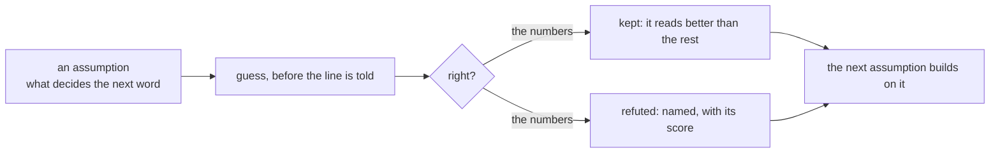

# 204 · Trial and error — assumptions tested on one book, the refuted ones named

The ruling: if it cannot learn, redefine learning as trial and error. Take the book, make many assumptions about what decides the next word, prove them wrong where the numbers say so, and see what builds — up from the words and down from the sentence at once, through the relations and their hierarchy.

So an assumption is a reader. It guesses every next word of the book before the line is told (`phient::study::Arena`, the one honest protocol of docs/176), and it is kept or refuted by its top-1 on the same positions as every other assumption.

## The lab

`phient` example `trial` (`cargo run --release -p phient --example trial -- [book.txt] [--lines N] [--round 3]`). The book is Emma (`data/corpora/austen/emma.txt`), split as the arena example splits it: 4,466 sentences, 7,239 words of vocabulary, 188,004 positions, floor 0.014%. Every reader starts knowing nothing.

## Rounds 1 and 2

| assumption | top-1 | first → last slice | finding |
|---|---|---|---|
| A6 soft trial and error: mixing weights learned from the error | **19.0%** | 16.9% → 20.4% | kept |
| A6b the same, and the scope (the last 3 sentences' words recur) | 19.0% | 16.9% → 20.4% | refuted: the scope adds nothing at top-1 |
| A1 two words before, backing off | 17.7% | 15.9% → 19.1% | the best hard context |
| A5 trial and error, experts lose weight when wrong | 17.7% | 15.9% → 19.1% | refuted: collapses onto one expert |
| A5b the same, weights per situation | 17.7% | 15.9% → 19.1% | refuted as a gain; its weights are a finding (below) |
| A2 bottom-up: a rare word read by its ending | 17.6% | 15.6% → 19.1% | refuted: no gain |
| A1b three words before | 17.3% | 15.7% → 18.5% | refuted: one book is too sparse for it |
| A0 the word before (backing off to the commonest) | 17.2% | 16.0% → 18.1% | the baseline |
| A4b two words, then the open operator | 17.1% | 15.0% → 18.7% | refuted |
| A4 BCPL: the open operator and its operand | 17.1% | 15.0% → 18.5% | refuted as a replacement for the word before |
| A3 top-down: the place in the sentence | 17.0% | 15.7% → 18.0% | refuted |
| phient counts (the word before, no back-off) | 16.8% | 15.0% → 17.9% | the contrast line |

What survives: learning is not the counts, it is learning **how far to trust each context**, from the error. A6 keeps one table per context (two words, the word before, nothing) and a weight per context bucket (how often the two words were seen: never, once, 2–4, 5–19, 20+); after each word the weights move toward the contexts that gave the true word more probability. It beats the best hard back-off by 1.3 points and counting by 2.2, and its curve is still climbing at the end of the book.

What the hierarchy said, through A5b's weights: after an operator (one of the 50 commonest words) trial and error came to trust the two words before; after a content word, the word before alone. The structure decides how much context to read — the operator opens a phrase, and the phrase needs both words.

The BCPL assumption (A4) read English the way BCPL's expression parser reads code (docs/199): the commonest words as operators, the open operator and its operand as the context. As a replacement for the word before it is refuted (17.1% against 17.2%), and placed after the two words before it costs 0.6 points. It is not refuted as structure: its lift is the largest (+3.5, +3.7), so it learns fastest from what it is told.

## The arena, and the teacher

The arena (docs/176) on the three Austen novels, 1,500 sentences, 750 told first, 34,121 positions: the error-driven learner (docs/203) 16.5%, counts 16.1%, concepts 15.0%, phiecs's World 8.8%, the Joint operator 6.0%, the conjugate mirror 1.9% — every curve saturated, none lifts after the told half.

The teacher (docs/191) on Emma, 4 chunks, 6 constructions asked per chunk: with the reserve as the teacher it was told 1 use in 24 asks, and TAUGHT equals ALONE (7.6%, lift 0.0). With phi4 through ollama it was told 60 uses for the same 24 asks (14 · 14 · and the rest in chunks 3 and 4), and TAUGHT still equals ALONE: 7.6% each, last slice 8.2% against 8.3% — NO EFFECT at this dose, reported straight. The oracle reaches a teacher; 60 sentences against 13,243 streamed are too few to move the phasors. `Spawned::ollama` now runs `ollama run <model> --nowordwrap`: without it, ollama wraps long lines with cursor escapes and writes the wrapped word twice, and the learner would be told the escapes.

## What the data can be

| source | what it gives | measured |
|---|---|---|
| Austen, three novels (`data/corpora/austen`) | 364,522 words of one voice | the curves above |
| Carroll and Chesterton (`data/corpora/contrast`) | 239,543 words of other voices | not yet read |
| Webster's dictionary (`data/websters_dictionary.json`) | definitions: a word's relations stated | not yet read |
| phi4 and phi4-builder through ollama | uses of exactly the constructions the learner is unsure of | ~1 minute per answer on the GTX 1660 Ti (the 9.1 GB model is partly on the CPU) |
| the phi4 trickle (`scripts/gen_prose.py --pace 30 --until 23:59 --threads 4`) | 16 usage sentences per word of Emma's vocabulary, most common first, written steadily into `gemphi/_corpus/prose` at ~30 words a minute, 4 CPU threads, the model kept loaded | started 2026-10-28 11:52; the first word (*the*) took 6 minutes for 210 words; ~20,000 words by midnight. phi4 repeats itself across calls (*The cat curled up on the windowsill* three times in the first 16), and only exact repeats are dropped |
| BCPL's `bcplprogs/words/words` | 45,373 spellings, no sentences | covers 84.1% of Austen's types and 93.2% of its tokens; it lacks *a*, *I*, *Mr*, *Mrs*, contractions and British spellings |
| BCPL itself (`ext/bcpl`, phiclm) | a language whose structure is written down: priorities, the tree, O-code | its parser's priorities are assumption A4 |

## Round 3 — do the phasors carry anything the counts do not?

The phasor learner (docs/203) as one more part of A6's mix, its weight learned from the error like the others. The first 1,500 sentences of Emma, 64,068 positions:

| reader | top-1 | first → last slice | lift |
|---|---|---|---|
| A7 A6 with the phasor learner as a part | 17.2% | 14.6% → 17.7% | +3.1 |
| A6 soft trial and error | 17.1% | 14.6% → 17.6% | +3.0 |
| A1 two words before, backing off | 16.0% | 13.9% → 16.0% | +2.1 |
| phient counts | 15.3% | 12.7% → 15.9% | +3.2 |
| the phasor learner alone | 13.3% | 8.2% → 15.4% | **+7.1** |

The weights the error gave each part, by how often the two words before had been seen:

| two words seen | two words | the word before | the commonest | phasor learner |
|---|---|---|---|---|
| never | 0.00 | 0.36 | 0.55 | **0.09** |
| once | 0.07 | 0.50 | 0.43 | 0.00 |
| 2–4 times | 0.17 | 0.50 | 0.32 | 0.00 |
| 5–19 times | 0.20 | 0.52 | 0.28 | 0.00 |
| 20+ times | 0.37 | 0.42 | 0.21 | 0.00 |

Refuted: "the phasors already know what the counts know, and more" — they add 0.1 point. Kept, narrower: the phasors carry something only where no count has a context (weight 0.09 where the two words were never seen, 0.00 everywhere a count stands). And the learner learns fastest of all (+7.1 against counts' +3.2), still climbing at the end: it is the reader most starved of text. The trust in the two words before grows with their evidence, 0.00 → 0.37, which is the bucket rule A6 was built on, now measured.

## Round 5 — a sentence is a scene (the phiphx island split)

phiphx cuts a mesh into islands (`phikit/crates/phiphx/src/uv/island.rs`): faces joined across the edges they share, cut along the seams, by union-find. Read on a book: a sentence is a face, its words in order the vertices, two adjacent words an edge; two sentences join across a pair they share unless the pair is a seam (held by `seam` sentences or more — *of the*). The islands are the scenes. Reading a line, its scene is the island its edges so far reach (else the last line's), and the scene's part of the mix is what followed the word before in that scene's last 64 lines. A line whose edges reach no island is the unexpected. (`trial --round 5 [--seam N]`, the scene in `examples/trial/scene.rs`.)

Emma, 188,004 positions, seam 8:

| reader | top-1 | first → last slice |
|---|---|---|
| A8 A6 with the scene as a part | 19.0% | 16.9% → 20.4% |
| A6 soft trial and error | 19.0% | 16.9% → 20.4% |
| phient counts | 16.8% | 15.0% → 17.9% |

The error gave the scene 0.00 in every bucket but the last (0.01 where the two words were seen 20+ times). Refuted as built — and the count of the unexpected says why: 123 of 4,466 lines reached no scene. At seam 8 the shared pairs percolate and the book is nearly one island, so "the scene" was only the last 64 lines again, the scope A6b already refuted. The cut has to be tighter for scenes to separate: seam 3 is queued.

Seam 3 (queued, now read): 658 of 4,466 lines reached no scene — the cut separates five times as many — and still the error gave the scene 0.00 in every bucket but the last (0.01), and top-1 stayed 19.0%. Refuted at both cuts: a scene's own word-before counts predict the next word no better than the book's.

## Round 6 — classes from the ground up

A word is read through the frequent word it behaves like: every 500 lines each word joins the anchor (one of the 200 commonest words) whose followers look most like its own, by the cosine of their follower counts; the class part reads what followed the word two back's class and the word before, else the class of the word before (`examples/trial/classes.rs`, `trial --round 6`).

| reader | top-1 | first → last slice |
|---|---|---|
| A6 soft trial and error | 19.0% | 16.9% → 20.4% |
| A9 A6 with classes as a part | 18.9% | 16.9% → 20.3% |

| two words seen | never | once | 2–4 | 5–19 | 20+ |
|---|---|---|---|---|---|
| the weight the error gave the classes | 0.09 | 0.03 | 0.05 | 0.06 | 0.05 |

The first part the error kept everywhere — and top-1 fell 0.1. That is not a contradiction, it is the measure: the weights are learned to raise the probability of the word that came (the error), and top-1 only asks which word ranks first. A part can make what came less unexpected without changing the first guess. So from round 8 every mix also reports its **surprise**: the bits of −log₂ of the probability it gave the true word, before it was told. Learning is the unexpected shrinking.

## Round 8 — the parts measured by the unexpected

The same Emma, the three parts side by side, each mix's surprise reported (`trial --round 8`):

| mix | top-1 | bits per word | the extra part's weight (never · once · 2–4 · 5–19 · 20+) |
|---|---|---|---|
| A6 soft trial and error | 19.0% | 7.595 | — |
| A8 with the scene (seam 3) | 19.0% | 7.594 | 0.00 · 0.00 · 0.00 · 0.00 · 0.01 |
| A9 with classes | 18.9% | **7.588** | 0.09 · 0.03 · 0.05 · 0.06 · 0.05 |
| A10 with the open operator | 19.0% | 7.595 | 0.00 · 0.01 · 0.01 · 0.01 · 0.00 |

The classes are the one part that makes what came less unexpected, by 0.007 bits a word — kept, and small. The scene and the open operator carry nothing the counts do not on one book.

## Round 9 — BCPL's priorities, learned by trial and error

The parser of BCPL's `rexp(n)` on English (`examples/trial/parse.rs`, `trial --parse`): the 30 commonest words are operators; an operator closes every open one of equal or higher priority and waits for its operand; the open one and the word before are the context, mixed 0.5 · 0.35 · 0.15 with the word before and the commonest. Every priority starts at 3 (the flat rule, A4); each of the 30 is tried at the four other levels, twice over, and a change is kept only if the surprise on the learning part (the first four fifths) drops.

| reading | bits per word, the held-out fifth |
|---|---|
| the word before | **7.287** |
| the open operator, every priority equal (A4) | 7.320 |
| the open operator, priorities learned by trial and error | 7.320 |

0 changes kept of 240 tried. Refuted, plainly: on this book no priority order makes the open operator a better context than the word before, and the flat rule is already worse than the word before by 0.03 bits. The parse of English by BCPL's priorities does not predict its next word.

## Round 10 — what transfers

One book told is not the test of structure: on the book itself, the counts have seen nearly every context. Structure should matter where the counts have not been — another author. Round 10 tells all three Austen novels unscored (`Arena::read_split`, 8,151 lines), then scores every mix on Carroll's *Alice*, 32,586 positions never told before they are scored (`trial --round 10`):

| reader | top-1 | first → last slice | bits per word | the extra part's weight (never · once · 2–4 · 5–19 · 20+) |
|---|---|---|---|---|
| A8 with the scene (seam 3) | **19.6%** | 17.9% → 21.1% | **7.631** | 0.02 · 0.08 · 0.10 · 0.07 · 0.09 |
| A10 with the open operator | 18.7% | 17.0% → 20.4% | 7.804 | 0.00 · 0.02 · 0.01 · 0.03 · 0.08 |
| A6 soft trial and error | 18.6% | 16.9% → 20.3% | 7.808 | — |
| A9 with classes | 18.6% | 16.8% → 20.3% | 7.801 | 0.03 · 0.02 · 0.02 · 0.03 · 0.00 |
| phient counts | 15.4% | 14.2% → 17.2% | — | — |

Kept, and the largest gain of any assumption: **in a new story the scene is what learns it** — +1.0 point of top-1 and 0.177 bits less surprise a word, with weight in every bucket. Inside one book the scene added nothing because the book's counts already held what the scene holds; on *Alice* the old counts have never seen *the Queen* or *said Alice*, and the sentences that share those pairs join into scenes as the story is read. The unexpected becomes expected through the edges the sentences share — the phiphx island split, read on a story. The open operator, refuted inside one book, keeps 0.08 of the weight where the two words are common and 0.004 bits; the classes 0.007 bits.

## Round 4 — the phasors given three times the text

Round 3's readers on the whole of Emma, 188,004 positions:

| reader | top-1 | first → last slice | lift |
|---|---|---|---|
| A7 A6 with the phasor learner as a part | **19.1%** | 16.9% → 20.5% | +3.5 |
| A6 soft trial and error | 19.0% | 16.9% → 20.4% | +3.4 |
| A1 two words before, backing off | 17.7% | 15.9% → 19.1% | +3.2 |
| phient counts | 16.8% | 15.0% → 17.9% | +2.9 |
| the phasor learner alone | 16.2% | 12.6% → **18.3%** | +5.8 |

| two words seen | never | once | 2–4 | 5–19 | 20+ |
|---|---|---|---|---|---|
| the weight the error gave the phasors (1,500 lines, round 3) | 0.09 | 0.00 | 0.00 | 0.00 | 0.00 |
| the same, the whole book | **0.31** | **0.13** | **0.11** | 0.01 | 0.00 |

Given three times the text, the phasor learner's last slice (18.3%) passes the counts' (17.9%): its curve crosses. And the error trusts it three times more where the counts are thin, and now also where a context was seen once or a few times. What the phasors lacked was text.

## Round 11 — the scene and the phasors together, on two other authors

The two structures that earned their keep, in one mix: told all three Austen novels unscored, then scored on a book by another hand (`trial --round 11 [--test book.txt]`).

| scored on | reader | top-1 | first → last slice | bits per word |
|---|---|---|---|---|
| Carroll, *Alice* (32,586 positions) | A11 with the scene and the phasors | **20.2%** | 18.1% → 21.8% | **7.572** |
| | A8 with the scene | 19.6% | 17.9% → 21.1% | 7.631 |
| | A6 (round 10) | 18.6% | 16.9% → 20.3% | 7.808 |
| | phient counts | 15.4% | 14.2% → 17.2% | — |
| Chesterton, *The Man Who Was Thursday* (65,849 positions) | A11 with the scene and the phasors | **18.1%** | 16.8% → 20.1% | **8.524** |
| | A8 with the scene | 17.5% | 16.3% → 19.3% | 8.569 |
| | phient counts | 14.3% | 13.5% → 15.4% | — |

| the weight the error gave (never · once · 2–4 · 5–19 · 20+) | the scene | the phasor learner |
|---|---|---|
| *Alice* | 0.01 · 0.05 · 0.06 · 0.06 · 0.08 | 0.21 · 0.22 · 0.17 · 0.16 · 0.05 |
| *Thursday* | 0.00 · 0.02 · 0.06 · 0.02 · 0.04 | 0.25 · 0.12 · 0.08 · 0.10 · 0.03 |

The structures stack, on both authors: 4.8 and 3.8 points over counting, and on *Alice* 0.236 bits a word less surprise than the error-weighted counts alone. On a voice the counts have never read, the error trusts the phasors in every bucket — even where the two words before were seen 5 to 19 times — and the scene alongside them. This is the first round where the system learns, on text it was never told, something counting cannot.

## Round 12 — the phasors alone, on a voice they never read

The phasor learner by itself, no counts: told all three Austen novels, then scored on *Alice* — once learning online only, once also trained 3 epochs on the shelf before the book (`trial --round 12`; the arena's split lane calls a reader's epochs once the told half ends).

| reader | top-1 | first → last slice | lift |
|---|---|---|---|
| the phasor learner alone, and 3 epochs on the shelf | **18.8%** | 15.7% → **21.5%** | +5.8 |
| the phasor learner alone, online only | 18.7% | 15.8% → 20.8% | +5.0 |
| A6 soft trial and error (the best counting reader) | 18.6% | 16.9% → 20.3% | +3.3 |
| phient counts | 15.4% | 14.2% → 17.2% | +3.0 |

Again on Chesterton, *The Man Who Was Thursday* (65,849 positions):

| reader | top-1 | first → last slice | lift |
|---|---|---|---|
| the phasor learner alone, and 3 epochs on the shelf | **18.1%** | 17.1% → 19.6% | +2.5 |
| the phasor learner alone, online only | 17.7% | 16.7% → 19.1% | +2.3 |
| A6 soft trial and error | 17.0% | 15.9% → 18.7% | +2.8 |
| phient counts | 14.3% | 13.5% → 15.4% | +1.9 |

Met, on both authors: **the phasors alone read a new voice better than every counting reader** — on *Alice* 3.4 points over counting the word before and 0.2 over the error-weighted counts (1.2 in the last slice, still climbing); on *Thursday* 3.8 and 1.1. Trained 3 epochs on the shelf, the learner alone equals round 11's whole mix there (18.1%). Inside one book they trail counting (16.2% against 16.8%, round 4); on a voice the counts have never read, they lead. The counts memorise one voice; the phasors, corrected by their error, carry what transfers.

## Round 13 — Webster's definitions told before the shelf

Each word the reader will meet (the shelf's and the new book's vocabulary) told as a line before the shelf: the word, then the first sentence of its definition (`examples/trial/dict.rs`, `trial --round 13`). 2,591 words have an entry (the dictionary holds headwords, so inflected forms miss). The same readers as round 10, scored on *Alice*:

| mix | top-1 (round 10 → with definitions) | bits per word (round 10 → with definitions) |
|---|---|---|
| A6 | 18.6% → 18.4% | 7.808 → 7.800 |
| A8 with the scene | 19.6% → 19.5% | 7.631 → 7.617 |
| A9 with classes | 18.6% → 18.4% | 7.801 → 7.790 |
| phient counts | 15.4% → 15.1% | — |

Refuted as a help to the next word: told as sentences, the definitions pull the counts toward the dictionary's own phrasing and cost 0.1–0.3 points of top-1, though they make what came less unexpected by about 0.01 bits. A definition is a relation, not a sentence; told as one, it is read as one.

## The runs lost once

Round 4 and the teacher with phi4 ended once with exit code 127 before writing their results (neither example exits with 127; the lab had been rebuilt while round 4 ran from the same executable, on an overloaded machine). Both were run again: round 4 is above, and the teacher with phi4 is in the section on the teacher.

## Where it stands

Told one shelf, the system reads a book by another hand better than counting can — 20.2% and 18.1% top-1 against counting's 15.4% and 14.3%, the gain carried by the two structures the error chose to trust, the scene (sentences joined by the pairs they share) and the phasors (corrected by their error). And the phasors alone, with no counts, read both new voices better than every counting reader (*Alice* 18.8% against 18.6% and 15.4%; *Thursday* 18.1% against 17.0% and 14.3%; round 12). Still open: the teacher with phi4 shows no effect at the dose tried (60 uses told, lift 0.0); the dictionary told as sentences costs top-1; the gains are a few points. Kept so far:

- learning as the error-driven trust of each context (A6), the trust measured per context bucket;
- the operator/content split of how much context to read (A5b);
- the phasors where the counts are thin, more so with more text, and everywhere on a new voice (rounds 3, 4, 11);
- the scene, in a story the counts have not read (rounds 10, 11);
- the classes, by a hair (rounds 6, 8, 10).

Refuted: three words of context, the place in the sentence, a rare word's ending, hard winner-take-all, the last sentences' words, the scene inside one book, and BCPL's priorities as the next word's context (rounds 1, 2, 5, 9).

Next: the phi4 trickle's corpus, once grown, told before the shelf; Webster's definitions told as relations (`word is …`) rather than as sentences.
