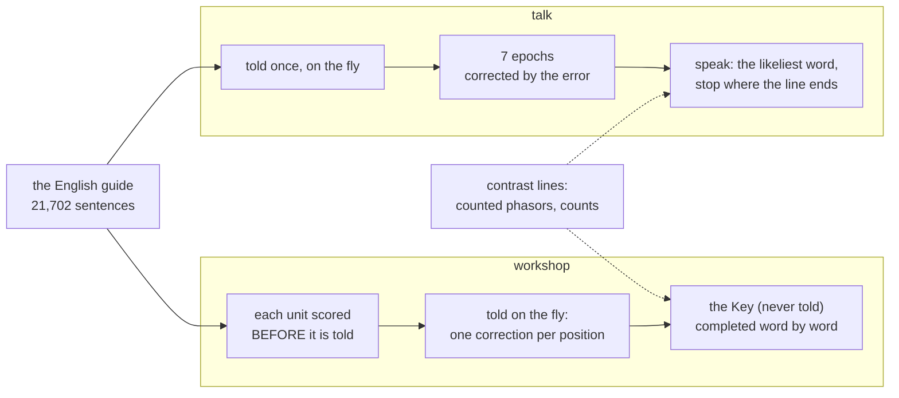

# 205 · The learner speaks — talk and the workshop on the error-driven learner

In Phient's world, a word (w) is a seed: what it relates to, under what conditions (c), grows from it. The Phical paradigm, X ⇒ Y, drives and composes Phient's Phasor Language Models: Phinet, Phiano, PhiTon. Phical stores no point: a word is 32–64 relations, each a complex phasor on a closed circle; meaning is a side effect of pairs of words moving under a condition, and they move by the error of what was expected — toward what came, away from what did not.

The ruling of docs/203 left one thing undone: the parts that GENERATE — `talk` and the workshop — still ran on the counted phasors (each angle moved to the mean of what it was seen with). Now they run on phient's learner (`lineup::Learner`): every reading a prediction, the error moving the angles. The counted phasors stay only as a contrast line (`talk --counted`, the workshop's contrast column).

## talk

`cargo run --release -p phiano --example talk -- crates/phiano/data/person/murphy.txt "…"`: 21,702 sentences told to the learner, then 7 epochs (blocks of 8, silence 0.2, the setting of docs/203's final run), in 192.6 s at idle priority. The same questions as docs/203; the contrast column is the counted phasors told the same sentences in the same run (3.1 s).

| asked | the learner goes on (all of the book, 7 epochs) | docs/203's learner (the training split, early-stopped) | the counted phasors |
|---|---|---|---|
| i have been waiting | for a long time | *(ends the line)* | for the job of the to was your when the were i |
| if i had known | if we had a problem | *(ends the line)* | wait the me was a to of your to the a but |
| when do we use the present perfect | continuous i am doing | continuous i have been doing | continuous past simple i do a say to somebody the and you |
| she has been working | *(ends the line)* | *(ends the line)* | a is of the to was your when the were i the |
| i wish i | knew i would have gone to work | had a lot of money | had to holiday the ten perfect i have to been the for |
| the man who lives next door | to me | to me | to me a the of and street the baker using the verb |
| we are going to | do | the party | the a but the didn't the meaning of not is a to |

Read: the learner speaks short and in grammar; where it stops, the guide's own sentences stop there too. The counted phasors run on through the crowd of docs/200–202 (`the`, `a`, `to`, `of`, `your`) and never stop. Told all of the book, the learner now goes on where docs/203's (told 85% of it) ended the line: `for a long time`. Two answers are grammatical but not what the guide teaches after that prompt (`if we had a problem`, `we are going to do`).

## The workshop

`cargo run --release -p phiano --example workshop -- crates/phiano/data/person/murphy.txt --key crates/phiano/data/person/murphy_key.txt --pages 64`: the learner is the student, corrected on the fly as each sentence is told, with no rehearsal (`--rehearse` not set). The page is [205_workshop.md](205_workshop.md).

| over 129 units, one run | the learner | the counted phasors | the counts |
|---|---|---|---|
| **the Key completed** (never told), word by word | **19.0%** (1865/9805) | 14.2% (1388/9805) | 17.2% (1689/9805) |
| next words brought to each unit before it is told | 12.6% (15036/119561) | — | — |

Read: on the Key, the learner beats both counting lines in the same run, on the fly. In docs/193 the counts led the counted phasors (20.1% against 15.7%). docs/193's totals differ from this run's: 10,544 Key words then, 9,805 now, and 126,259 positions then, 119,561 now. The book is read differently since (the tokenizer moved to `phiton::p64::words`), so only same-run comparisons are made here.

## And the builders' counts, moved

The builders example's counts now live in phient's `relate::Tally`, with the game's own rules kept in the example (`GameCounts`). The full report re-run (seed 7, R = 32, 30 epochs) matches docs/113_rule_game_seed7.md in all 90 table rows; only the run time differs (1,319 s at idle priority on a busy machine, against 79 s).

## Status

2026-10-28. `examples/talk.rs` (the learner; `--counted` is the contrast), `examples/workshop/main.rs` (the learner as the student; the counted phasors and the counts as contrast columns; `--rehearse`). Not run yet: the workshop with `--rehearse`, and `talk` on another person's corpus.
