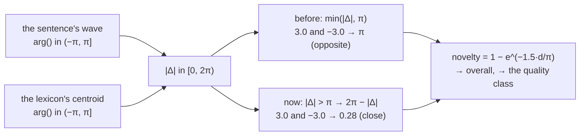

# 206 · Novelty folded — the seam that read as the far side

In Phient's world, a word (w) is a seed: what it relates to, under what conditions (c), grows from it. The Phical paradigm, X ⇒ Y, drives and composes Phient's Phasor Language Models: Phinet, Phiano, PhiTon. Phical stores no point: a word is 32–64 relations, each a complex phasor on a closed circle; meaning is a side effect of pairs of words moving under a condition, and they move by the error of what was expected — toward what came, away from what did not.

The evaluator (`phient::eval`) scores a text by coherence, resonance and **novelty**. Novelty is the angle between the sentence's wave and the lexicon's centroid. Both are directions read by `arg()`, in (−π, π], so their difference can be almost 2π. The code took `|Δ|` and **capped** it at π. Two directions either side of the ±π seam are close, but they read as opposite: maximally novel. The survey of phient's calculations (docs/phient/calculations) found it; the user's ruling was "Yes, fold it". The angle is now **folded** into [0, π] (`phical::circle::distance`).

## What moved

`examples/novelty_fold.rs` reads every sentence both ways, from the same wave and centroid. Lexicon: `data/austen.chroma`; text: the first 2,000 sentences of the English guide (`data/person/murphy.txt`).

| | |
|---|---|
| sentences read | 2,000 |
| with a defined novelty | 1,993 |
| **across the ±π seam** (the only ones the fold changes) | **41 (2.1%)** |
| novelty moved, mean · max | 0.376 · 0.558 |
| overall score moved, mean · max | 0.113 · 0.168 |
| quality class changed | 22 of the 41 |

Every one of the 41 had read exactly 0.777, the most novelty the formula gives (d = π); folded, they spread from 0.23 to 0.73. No other sentence's score moved. Examples:

| sentence | novelty, capped → folded | overall | class |
|---|---|---|---|
| THE WORLD’S BEST-SELLING GRAMMAR BOOK | 0.777 → 0.422 | 0.587 → 0.481 | WeaklyCoherent → WeaklyCoherent |
| ode and instructions inside | 0.777 → 0.346 | 0.858 → 0.729 | CoherentNovel → CoherentFamiliar |
| • Thesaurus boxes help you to expand your vocabulary | 0.777 → 0.285 | 0.643 → 0.495 | WeaklyCoherent → WeaklyCoherent |
| 20 19 18 17 16 15 14 13 12 11 10 9 8 7 6 5 4 3 2 | 0.777 → 0.241 | 0.581 → 0.420 | DissonantNovel → Incoherent |
| 22 will and shall 2 | 0.777 → 0.232 | 0.933 → 0.770 | CoherentNovel → CoherentGrounded |
| 30 may and might 2 | 0.777 → 0.253 | 0.777 → 0.620 | ModerateNovel → CoherentFamiliar |

Read: the cap made about one sentence in fifty look new because of where its direction happened to fall on the circle, not what it said. These sentences were never read as close to the lexicon before; folded, they mostly read as familiar.

## On the guide's own lexicon

The same measurement with the lexicon trained on the guide itself. A Facet is told nine sentences in ten (19,904 of them, `Trainer::train_corpus_with_descent`), and the reading is done on 2,000 sentences of the held-out tenth, which it was never told. `novelty_fold -- data/person/murphy.txt data/person/murphy.txt`; the example now also prints where the centroid points.

| | Austen's lexicon | the guide's own lexicon |
|---|---|---|
| sentences read | the guide's first 2,000 | 2,000 of the guide's held-out tenth |
| the centroid points at | −2.642 rad | −2.029 rad |
| with a defined novelty | 1,993 | 1,973 |
| **across the ±π seam** | **41 (2.1%)** | **932 (47.2%)** |
| novelty moved, mean · max | 0.376 · 0.558 | 0.122 · 0.364 |
| overall moved, mean · max | 0.113 · 0.168 | 0.037 · 0.109 |
| quality class changed | 22 | 165 |

Read: where the centroid sits does not explain the difference. The guide's centroid is farther from the seam than Austen's. The spread of the sentences explains it. Against Austen's lexicon the guide's sentences point near the centroid. Against the guide's own lexicon they point every way, and nearly half are more than π from it the long way round. Under the cap all 932 read 0.777, the most the formula gives: **nearly half the guide read as maximally new against a lexicon learned from the guide.**

Folded, they spread from 0.41 to 0.777. The moves are smaller than with Austen because the guide's centroid is farther from the seam: a sentence across it is at least 1.11 rad away, where with Austen it could be 0.50.

| sentence | novelty, capped → folded | overall | class |
|---|---|---|---|
| 117 like and as | 0.777 → 0.507 | 0.633 → 0.552 | WeaklyCoherent → WeaklyCoherent |
| She is on her way to work | 0.777 → 0.608 | 0.660 → 0.609 | WeaklyCoherent → WeaklyCoherent |
| The book is not intended to be | 0.777 → 0.692 | 0.725 → 0.699 | WeaklyCoherent → WeaklyCoherent |
| 4 I need to eat something soon | 0.777 → 0.731 | 0.914 → 0.900 | CoherentNovel → CoherentNovel |
| 6 Past continuous (I was doing) | 0.777 → 0.751 | 0.590 → 0.582 | DissonantNovel → DissonantNovel |

## Who reads the evaluator

The overall score and the class feed composition (better/worse), persona dialog and impersonation, searle's semantics, the server's eval route, the `chat`, `eval`, `learn` and oscillator commands, and the metrics. Their earlier recorded numbers were made with the cap; a re-run of any of them will differ where its texts fall across the seam.

## Status

2026-10-28. `phient/src/eval/verdict.rs` (the fold), `phiano/examples/novelty_fold.rs` (the measurement). Tests unchanged: phient 163, phiano 24.

2026-10-29. The guide's own lexicon was measured, and the example now trains a `.txt` lexicon on nine sentences in ten and prints the centroid's direction.
