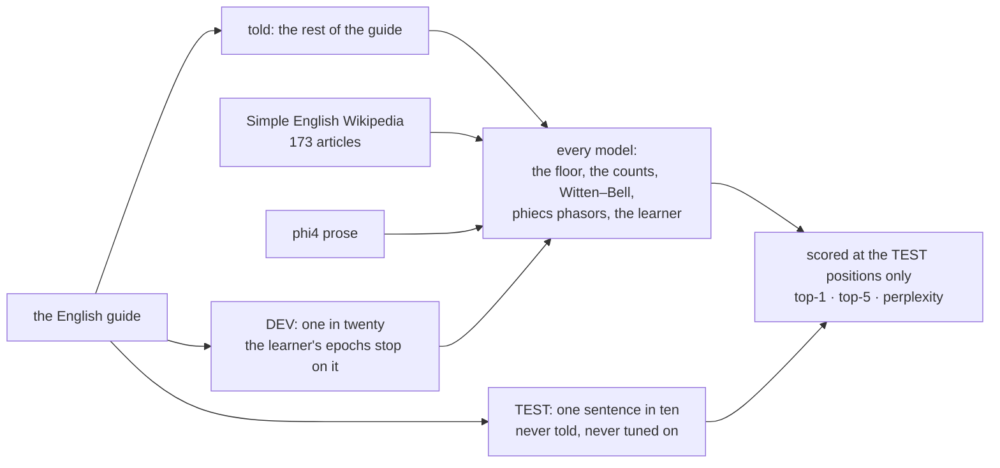

# 207 · More English: the guide plus Simple Wikipedia

In Phient's world, a word (w) is a seed: what it relates to, under what conditions (c), grows from it. The Phical paradigm, X ⇒ Y, drives and composes Phient's Phasor Language Models: Phinet, Phiano, PhiTon. Phical stores no point: a word is 32–64 relations, each a complex phasor on a closed circle; meaning is a side effect of pairs of words moving under a condition, and they move by the error of what was expected — toward what came, away from what did not.

The ruling, in the user's words: "use the engligg languge guide and testing meaning fully here austin is not so usefu here", and "we've an english learning document and ohonline access why are you not trainging". docs/203 ranked the levers it had not pulled, and the first was "more text than one book (every model here is starved)". This round pulls it. The English guide (`data/person/murphy.txt`) stays the only test: its held-out tenth is scored, and nothing else is.

## What was told

| source | what it is |
|---|---|
| the guide's training sentences | the English guide less its test (one in ten) and dev (one in twenty) sentences: 18,446 sentences, 142,281 words |
| Simple English Wikipedia | 173 everyday-topic articles (family, food, the house, school, weather, the body, time, animals, feelings …), plain-text extracts through the site's API, one request at a time |
| phi4 prose | 16 sentences per common word, written by a local phi4 model (`_corpus/prose/prose_0000.txt` as it stood when the run began, the first thirty or so of its 7,076 words) |

The Wikipedia articles and the prose together came to 12,469 sentences and 176,678 words, as the learner counts them.

`examples/learner -- data/person/murphy.txt --block 8 --silence 0.2 --more …/simplewiki/all.txt,…/prose/prose_0000.txt`. The `--more` flag is new this round: the extra text goes to training only, so the dev and test sets stay the guide's own. The learner's config is the same as docs/203's final run.

## What it scored

The same 2,171 test sentences (14,831 positions) in both runs.

| model, on the guide's held-out test | the guide alone: top-1 · top-5 · ppl | plus Wikipedia and prose: top-1 · top-5 · ppl |
|---|---|---|
| the most told word (floor) | 4.5% · 15.1% · — | 4.5% · 12.8% · — |
| phient counts (the word before) | 17.1% · 35.9% · — | 16.0% · 34.0% · — |
| Witten–Bell trigram | 24.8% · 45.9% · 84.7 | 24.0% · 44.8% · 102.2 |
| phiecs phasors (running mean) | 13.6% · 28.6% · — | 12.3% · 25.5% · — |
| **phient learner** | **21.3% · 40.9% · 101.2** | **19.8% · 39.2% · 121.2** |

| | the guide alone | plus Wikipedia and prose |
|---|---|---|
| sentences told | 18,446 | 30,915 |
| vocabulary | 4,705 | 15,609 |
| the learner's best dev epoch · dev perplexity | 7 · 105.7 | 9 · 129.2 |
| time | 5 minutes | 22 minutes |

Read: **more English of another kind made every model worse on the guide.** Top-1 is the clean comparison, because the positions are the same and an untold word is a miss for everyone. On top-1 the counts lost 1.1 points, the trigram 0.8, the phiecs phasors 1.3 and the learner 1.5. The learner gained nothing against the trigram: it was 3.5 points short and is now 4.2 short.

Perplexity is not like for like. It is taken over the test words a model was told, and the extra text taught test words the guide alone never had, rare ones that are hard to predict. Still, both the learner's and the trigram's perplexity rose by about a fifth.

Why: an encyclopedia is not the guide's English. The guide is short, first-person, everyday sentences written to show one structure at a time ("If I'd known = If I had known"). Simple Wikipedia is third-person and descriptive, about things ("A family is a group of people who, in most cases, live together"). The extra text pulled every model's sense of what comes next toward that register. The learner also spread the same 64 channels over three times the vocabulary.

What it says, asked (greedy; it stops where the end of the line is likelier than any word):

| asked | the learner, the guide alone | the learner, plus Wikipedia | the counts, plus Wikipedia |
|---|---|---|---|
| i have been waiting | *(ends the line)* | *(ends the line)* | for the same way to the |
| if i had known | *(ends the line)* | *(ends the line)* | as a lot of the same way to the |
| when do we use the present perfect | continuous i have been doing | continuous | continuous i don't know what time to the same way to |
| she has been working | *(ends the line)* | *(ends the line)* | hard to the same way to |
| i wish i | had a lot of money | had to go out | don't know what time to the same way to |
| the man who lives next door | to me | to me | to the same way to |
| we are going to | the party | the cinema | the same way to |

The learner still speaks short, grammatical English and stops; the counts' refrain changed from the guide's `the sentences using the` to `the same way to`.

## What next

- **English in the guide's register, not more of any English.** Short, everyday, first- and second-person sentences: dialogue, example sentences, learners' readers. Tatoeba's English sentences are the closest open source.
- **Read the guide last.** Tell the wide text first and the guide's own sentences in the final epochs (a curriculum), so the wide text teaches the words and the guide teaches their use.
- **More channels for a larger vocabulary**, at least 128 when the vocabulary triples.
- **A dev set that mixes registers**, to tell a model that learned English from one that learned the guide.

## Status

2026-10-29. `examples/learner/main.rs` (`--more`), `scratchpad/fetch_simplewiki.py` (the fetch, cached in `gemphi/_corpus/simplewiki`). The runs are recorded here; no code in the learner changed, and the golden test in `phient::lineup::learner` (the numbers on the guide) still holds.
