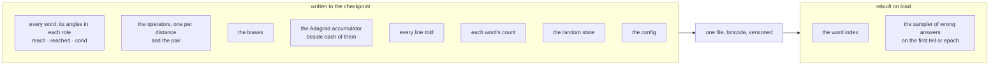
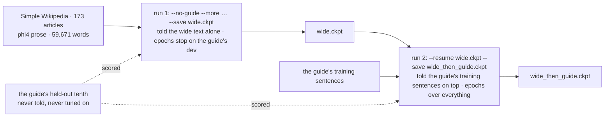

# 208 · Learning that accumulates — the checkpoint, and the curriculum as two runs

In Phient's world, a word (w) is a seed: what it relates to, under what conditions (c), grows from it. The Phical paradigm, X ⇒ Y, drives and composes Phient's Phasor Language Models: Phinet, Phiano, PhiTon. Phical stores no point: a word is 32–64 relations, each a complex phasor on a closed circle; meaning is a side effect of pairs of words moving under a condition, and they move by the error of what was expected — toward what came, away from what did not.

The user's question, 2026-11-07: "why are we not accumulating learning and getting it done?" The answer was in the code, and it was plain. The learner had no way to be saved. Every run since docs/203 — the guide alone, the guide plus Wikipedia (docs/207), every harness walk — began with `Learner::new`, at seed 7, and ended by dropping what it had learned. Nine days of runs carried nothing forward. Nothing accumulated because nothing could.

## What the learner already did online

`Learner::tell` was online from the start (docs/203): told a line, it corrects itself on it at once, one step per position, and interns any word it has not met, born at its seed angles. The sampler of wrong answers rebuilds itself when the vocabulary has grown a twentieth. So a learner can be told new English at any time and takes it. What it could not do was survive the end of the process.

## The checkpoint

`phient::lineup::learner::store` — `Learner::save(path)` and `Learner::load(path)`. Everything learned goes to the file and comes back:

The accumulators and the random state are the part that matters for honesty: with them, a run continued from the file takes the very steps the uninterrupted run would have. The test `a_saved_learner_reads_back_whole_and_goes_on` pins it with the golden test's own fingerprint — a learner told 300 of the guide's sentences and trained one epoch is saved and read back; it gives bit-identical scores on the next 40 sentences' prefixes, its next epoch returns the bit-identical loss, and a line told after the read-back is taken, new words and all. The golden test of docs/203 (`the_numbers_on_the_guide_do_not_move`) still holds: nothing about the learning changed, only that it is kept.

## The curriculum as two runs

docs/207 found that telling the guide and Simple Wikipedia together made every model worse on the guide: an encyclopedia is not the guide's register, and the learner's 64 channels were spread over three times the vocabulary. The lever it named, and the user was asked to choose, was the curriculum: the wide text first, the guide last, so the wide text teaches the words and the guide teaches their use. With a checkpoint that is not a new mode of training. It is two runs.

`examples/learner` gains three flags: `--save` writes the best epoch's learner; `--resume` starts from a checkpoint and tells it only what is new; `--no-guide` tells the extra text alone. The test set and the dev set stay the guide's own in both runs, so run 1's numbers say what the wide text alone is worth on the guide, and run 2's say what the guide adds on top of it.

## What it scored

Both runs at docs/203's final config (`--block 8 --silence 0.2`, 64 channels, 16 epochs at most, stopped on the guide's dev set), at low priority on a loaded machine. The same 2,171 held-out guide sentences (14,831 positions) in every column.

| model, on the guide's held-out test | guide alone (docs/203) | guide + wide, mixed (docs/207) | **wide first, then the guide** |
|---|---|---|---|
| Witten–Bell trigram | 24.8% · 45.9% · 84.7 | 24.0% · 44.8% · 102.2 | 24.8% · 45.9% · 84.7 |
| **phient learner** | **21.3% · 40.9% · 101.2** | 19.8% · 39.2% · 121.2 | **19.9% · 39.3% · 123.4** |

| | run 1: the wide text alone | run 2: the guide on top |
|---|---|---|
| told this run | 16,630 sentences, 230,936 words (0 the guide's) | 18,446 sentences, 142,281 words (all the guide's) |
| lines in the learner after | 16,630 | **35,076** — run 1's carried, run 2's added |
| vocabulary | 15,675 | 16,936 |
| best dev epoch · dev perplexity | 1 · 717.3 | 13 · 131.4 |
| on the guide's test | 9.4% · 20.3% · 648.9 | 19.9% · 39.3% · 123.4 |
| time | 8 min | 40 min |

Read, straight:

- **The checkpoint works.** Run 2 resumed with 16,630 lines told and a 15,675-word vocabulary, took the guide on top, and its epochs passed over all 35,076 lines. The first online pass of the guide alone (no epochs yet) already scored 11.3% on dev at perplexity 256 — against 10.2% at 304 for a fresh learner told the guide once (docs/203). The wide text was still in it.
- **The curriculum did not beat mixing, and neither beat the guide alone.** Wide-then-guide: 19.9%. Mixed: 19.8%. Guide alone: 21.3%. Order was not the problem. The wide text is: whichever way it is told, Simple Wikipedia and phi4 prose cost the learner 1.4 points on the guide and raised its perplexity by a fifth. The trigram, told the guide only in run 2, sits at its docs/203 figure.
- **Run 1 shows the register mismatch plainly.** Trained on the wide text alone and measured on the guide, the learner's dev perplexity *rose* with every epoch after the first (717 → 770 → 863): learning Wikipedia better is learning the guide worse. Its best epoch on the guide's dev was epoch 1, and the counts and trigram told the same text score 9–10% on the guide, a hair above the 4.5% floor. There is almost no guide in an encyclopedia.
- **64 channels over 16,936 words** is the other half, as docs/207 said: run 2's vocabulary is 3.6× docs/203's and the channels did not grow with it.
- What it says, asked, is still short grammatical English and stops: *i wish i* → "would have done"; *she has been working* → "there"; *we are going to* → "the cinema". The counts still fall into the book's refrain.

So the honest result of this round is the mechanism, not the number. The number says: stop telling it encyclopedias. Tell it English in the guide's register, and give it channels when the vocabulary grows.

## How the system learns online, from here

The pieces now exist; this is how they go together.

1. **One learner, one file.** A running learner is a process that holds a `Learner`, is told sentences as they arrive (`tell`: one correction per position, at once), and saves itself on a schedule. The next process loads the file. Nothing is lost between them.
2. **Epochs as rehearsal, not retraining.** `epoch` passes over everything ever told, in a shuffled order. Told new text and then run for an epoch, the learner rehearses the old alongside the new, which is what keeps it from forgetting the guide while it learns Wikipedia. The lines are kept in the checkpoint for exactly this; at 142k words the guide is small, and keeping every line is cheaper than any cleverness about which to keep.
3. **Adagrad is already the right step for online.** Each row's step shrinks with how much that row has been corrected, so an old word moves little and a new word moves fast, which is what a new word needs.
4. **Measure on a fixed set, always the same one.** The guide's held-out tenth is scored after every stage, so the curve across runs is one curve.
5. **Register, not volume.** docs/207's lesson stands: more English of the wrong kind hurts. Text in the guide's own register — short, everyday, first- and second-person — is what to tell it next. Tatoeba's English sentences are the nearest open source.

## Status

2026-11-07. `phient/src/lineup/learner/store.rs` (save, load, lines_told; 1 test), `phiano/examples/learner/main.rs` (`--save`, `--resume`, `--no-guide`). phient's learner tests 8 of 8, the golden test unchanged.
