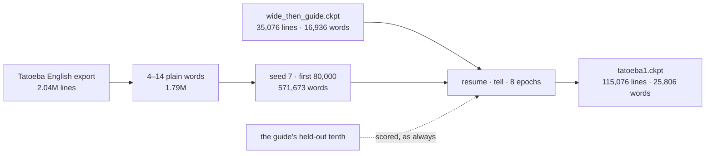

# 209 · English in the guide's register — the first Tatoeba instalment

In Phient's world, a word (w) is a seed: what it relates to, under what conditions (c), grows from it. The Phical paradigm, X ⇒ Y, drives and composes Phient's Phasor Language Models: Phinet, Phiano, PhiTon. Phical stores no point: a word is 32–64 relations, each a complex phasor on a closed circle; meaning is a side effect of pairs of words moving under a condition, and they move by the error of what was expected — toward what came, away from what did not.

docs/207 and docs/208 said the same thing twice: more English of the wrong register makes the learner worse on the guide, whatever the order it is told in. Tatoeba's English sentences are the nearest open source to the guide's register — short, everyday, first- and second-person ("Where is your soul?", "Do you have any idea what Tom and Mary need to do?"). This round tells the learner 80,000 of them, as an instalment on the checkpoint, and reads what moved. The user's choice: "Train on Tatoeba".

## What was told

From Tatoeba's English export (2,040,024 lines), the sentences of 4 to 14 plain words — letters, spaces, a few marks, ending in `.`, `?` or `!` — are 1,785,978. Shuffled with seed 7, the first 80,000 (571,673 words) were told to the learner resumed from `wide_then_guide.ckpt` (docs/208), with `--no-guide` so the guide's sentences were not told twice. Eight epochs, over everything the learner has ever been told: 115,076 lines by the end. 37 minutes at low priority. Saved as `tatoeba1.ckpt` (45 MB).

## What it scored

The learner's own line, checkpoint by checkpoint, on the same 2,171 held-out guide sentences:

| the learner, after | told so far | vocabulary | top-1 | top-5 | perplexity |
|---|---|---|---|---|---|
| the guide alone (docs/203) | 18,446 | 4,705 | **21.3%** | **40.9%** | **101.2** |
| the wide text, then the guide (docs/208) | 35,076 | 16,936 | 19.9% | 39.3% | 123.4 |
| **+ 80,000 Tatoeba sentences** | 115,076 | 25,806 | 19.7% | 39.7% | 119.6 |

Read, straight:

- **Tatoeba helped where Wikipedia hurt.** Perplexity fell 123.4 → 119.6 and top-5 rose 39.3 → 39.7; top-1 did not move. Compare the run-1 of docs/208, where an epoch of Wikipedia made the guide *worse* each time. The register is right.
- **It is still below the guide alone.** 21.3% from 142k words of the guide; 19.7% from 1.3M words with the guide inside them. The same 64 channels now cover 25,806 words, 5.5 times the vocabulary they covered at 21.3%. That is the constraint now, not the text: the learner cannot be widened on resume (its planes are 64 wide), so widening means a fresh learner and losing everything accumulated. `Learner::widen` is the next piece of mechanism (TODO.md).
- **The online pass shows the register plainly.** Told the 80,000 once, before any epoch, the learner stood at 14.4% on the guide's dev set at perplexity 184. Told 16,630 Wikipedia sentences once, it had stood at 7.9% and 820; told the guide once, fresh, at 10.2% and 304. Tatoeba's sentences disturbed what the learner knew of the guide least, because they are the same kind of sentence.
- **The epochs were still improving when the instalment ended** (dev perplexity 133.0 → 127.2 over eight, no early stop). The next instalment picks up from `tatoeba1.ckpt`; that is the point of docs/208.

What it says, asked (greedy; it stops where the end of the line is likelier than any word):

| asked | after the guide alone | after Wikipedia, then the guide | **after Tatoeba** |
|---|---|---|---|
| i have been waiting | *(ends)* | for the job | for you |
| she has been working | *(ends)* | there | for years |
| i wish i | had a lot of money | would have done | had to do that |
| we are going to | the party | the cinema | be |
| when do we use the present perfect | continuous i have been doing | continuous | continuous and present continuous |

"For you", "for years", "had to do that": the Tatoeba register is audible. (The counts' refrain, told Tatoeba only this run, is now "tom and mary said that".)

**A caution on this run's baseline rows.** The floor, counts and trigram in the run's own table were told only the 80,000 Tatoeba sentences, since the guide was not re-told; their 14.1% / 271.7 is "Tatoeba alone, scored on the guide", not the docs/203 trigram (24.8% / 84.7), which was told the guide. The learner's row is the accumulated model. They are not the same comparison, and the table above compares the learner with itself for that reason.

## Status

2026-11-07. `examples/learner`: `--epochs` now applies on `--resume` (the learner's shape is the checkpoint's; how long an instalment trains is the run's). Checkpoints in `gemphi/_corpus/checkpoints/`; the sample in `gemphi/_corpus/tatoeba/sample80k.txt`, with the export beside it.
