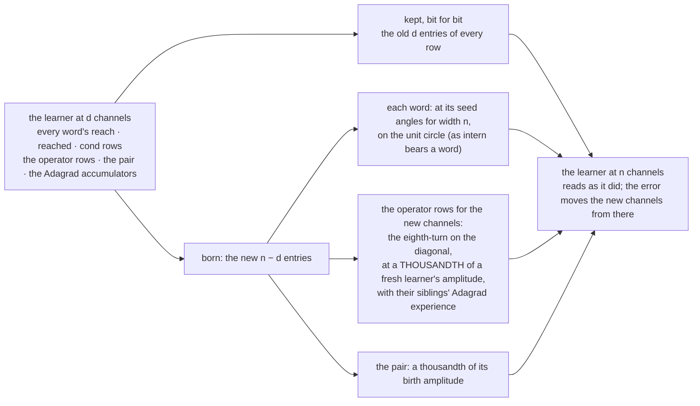

# 210 · Widening — more channels for a learner that has already learned

In Phient's world, a word (w) is a seed: what it relates to, under what conditions (c), grows from it. The Phical paradigm, X ⇒ Y, drives and composes Phient's Phasor Language Models: Phinet, Phiano, PhiTon. Phical stores no point: a word is 32–64 relations, each a complex phasor on a closed circle; meaning is a side effect of pairs of words moving under a condition, and they move by the error of what was expected — toward what came, away from what did not.

docs/209 ended on a hypothesis: 64 channels over 25,806 words is the constraint, not the text. Testing it needed a mechanism, because a checkpoint fixes its width — its planes are that wide — and 128 channels meant a fresh learner and the loss of everything accumulated (docs/208). This round builds `Learner::widen` and runs the test. The user's choice: "Build widen".

## The mechanism

The first attempt bore the new operator rows at a fresh learner's quiet, the amplitude `new` uses so a fresh learner's first readings are unsure. Beside a trained learner's scores that is loud: a read of the guide went from perplexity 197 to 336 before any training. A fresh learner has nothing to disturb; a trained one has everything. So the new channels are born at a thousandth of it, and the new operator rows with the mean accumulator of the old rows at their distance, so their first steps are as small as the trained rows' and not a fresh row's leap. The test pins it: every old channel bit-identical, the new ones on the circle, the read within 5% before training (it was within rounding), the error falling on, and a widened learner round-tripping through a checkpoint.

## What it scored

`tatoeba1.ckpt` (docs/209: 115,076 lines, 25,806 words, 64 channels) widened to 128 and trained on everything it had already been told — no new text, so that capacity alone is what changes. `--widen 128 --epochs 8`, stopped on the guide's dev set as always.

| | dev top-1 | dev perplexity | seconds |
|---|---|---|---|
| resumed and widened, before any training | 18.7% | 127.2 | — |
| epoch 1 | 18.6% | 128.6 | 965 |
| epoch 2 | 18.7% | 127.6 | 390 |

Two epochs without improvement is the stop, so it stopped; the best epoch was the untrained one, and the saved `widened128.ckpt` is the widened checkpoint with nothing learned into its new channels. On the guide's held-out test: 19.7% · 39.6% · 119.6, the same as docs/209.

Read, straight:

- **The mechanism does what it says.** Widened, the learner read 18.7% at 127.2 — docs/209's last epoch to the digit. Nothing learned was lost, nothing a read can see was added.
- **Capacity alone did nothing in two epochs.** The training error fell lower than at 64 channels (2.525 against 2.532), so the wider learner fits what it was told better, and the guide's dev set did not move. The hypothesis docs/209 ended on is not confirmed by this run.
- **Two epochs may be too few for channels born this quiet.** Born at a thousandth and stepping with their siblings' experience, the new channels move slowly by design — and the stop's patience of two epochs ended the run before they had moved anywhere. The run that would settle it gives the new channels more epochs, or bears them with less experience, and watches whether dev perplexity turns. Each epoch at 128 channels cost 6 to 16 minutes on a loaded machine.
- **The other explanation stands untested:** the guide is 18,446 of the 115,076 lines the epochs rehearse, a sixth. Every instalment of other English dilutes it further. The cheap test is to tell the guide again on top of a checkpoint, so it weighs double in the rehearsal, and see whether top-1 climbs back toward the 21.3% of the guide alone.

(The run's baseline rows read 0%: with `--no-guide` and no `--more`, the counters were told nothing. The learner's row is the accumulated model.)

## Status

2026-11-07. `phient/src/lineup/learner/widen.rs` (1 test; the learner's tests 9 of 9, the golden test unchanged), `phiano/examples/learner` (`--widen`, and the floor no longer panics when told nothing). Checkpoints: `tatoeba1.ckpt` (64), `widened128.ckpt` (128, untrained in its new channels).
