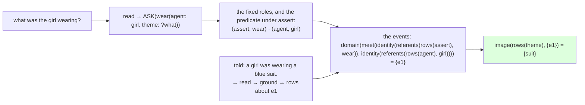

# 211 · Tell it English, ask it English — the loop closed

In Phient's world, a word (w) is a seed: what it relates to, under what conditions (c), grows from it. The Phical paradigm, X ⇒ Y, drives and composes Phient's Phasor Language Models: Phinet, Phiano, PhiTon. Phical stores no point: a word is 32–64 relations, each a complex phasor on a closed circle; meaning is a side effect of pairs of words moving under a condition, and they move by the error of what was expected — toward what came, away from what did not.

The user, 2026-11-07: "we need to finish this system, it's been ages." Finished, for a system that reads English, means one path: told sentences in English, it answers questions in English about what it was told. Every door on that path existed in phisor — the reader (`ladder::act::read`, English → an act), `ground` (an act → rows about an event), `machine::ask::answer` (an act with a hole + rows → the class that fills it, in phiclm's Lisp) — and nothing joined them. This round joins them.

## The gap, exactly

`ask` answers a question about a *thing*: "who was the first king of France?" describes its answer — `king{order: first, of: France}` — and the answer is the referents those descriptors meet on. A told sentence is not rows about a thing. `ground` makes it rows about an *event*:

```text
e1  assert  wear      "a girl was wearing a blue suit"
e1  agent   girl
e1  theme   suit
e1  tense   past
e1  aspect  progressive
```

Asked "what was the girl wearing?" — `ASK(wear(agent: girl, theme: ?what), past)` — `ask` would look for a referent with `agent: girl` and find **the event**, not the suit. The two halves used two shapes of row and did not know it.

## `machine::told` — the question over events



The fixed roles name the events, exactly as a thing's descriptors name its referents in `ask`; then the hole's role is read off those events with `image`. One lambda in phiclm's Lisp, the same four named set operations as `ask` plus `image` and `union`. A `where` is read off every preposition role the events carry, not only the one the reader guessed — "sarah is driving to work" put her place under `to`, and "where is sarah driving?" puts its hole under `in` — and a preposition role is told structurally (a kind that is not a named role, a feature or a force), never from a list of words.

## What it does

`examples/converse`, told and asked, the reader unprimed:

```text
told  sarah is driving to work.      → 4 rows about e1
told  tom was reading a book.        → 5 rows about e2
told  sarah lives in london.         → 3 rows about e3
asked where is sarah driving?        → work
asked what was tom reading?          → book
asked where does sarah live?         → london
  ?   who was reading a book?        (the reader cannot read this)
  ?   who lives in london?           (the reader cannot read this)
told  a girl was wearing a blue suit. → 5 rows about e4
asked what was the girl wearing?     → suit
  ?   a boy was wearing a white cap.  (the reader cannot read this)

4 told (17 rows) · 4 asked · 3 not read
```

Four told, four answered, three not read. The three are the reader's, and are stated, not hidden: a subject question ("who was reading…", "who lives…") is not yet read; "boy" is outside the unprimed reader's words; and primed with the mined lexicon the reader refuses "wearing" in a statement as noun-and-verb, though it still reads the question. The test `told_english_it_answers_english_about_what_it_was_told` pins the three that answer; a second test pins the algebra apart from the reader, the user's girl-and-boy rows by hand.

## What "finished" is, and is not

This is the loop: English in, rows kept, English answered — the system does what it was for, on the sentences its reader covers. What it is not: coverage. The reader reads about a third of the guide's sentences soundly (the harness, docs 234), and the questions it reads are object questions. Each further sentence shape is the reader's work, and by the ruling of the same day every word it needs lives in a file, not in its code.

## Status

2026-11-07. `phisor/src/machine/told.rs` (+ `told/tests.rs`, 2 tests), `ground::FEATURES`, `examples/converse.rs`. phisor 266 tests. The rest of phisor's reader unchanged; its hand lists are the next move under the no-data-in-code ruling.
