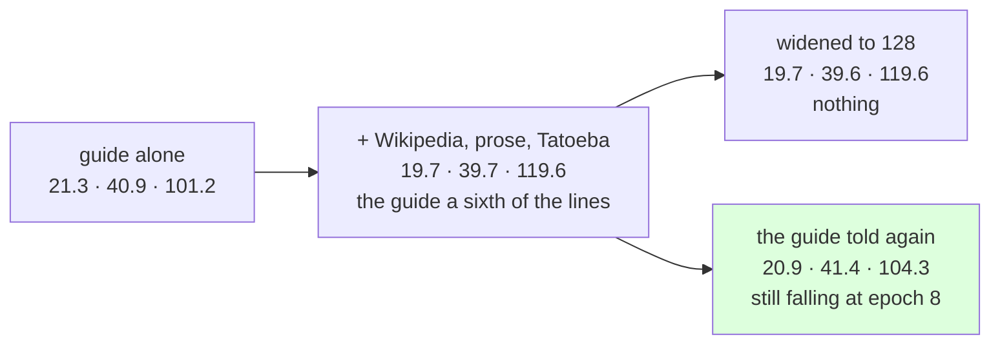

# 212 · The guide told twice — dilution, not capacity

In Phient's world, a word (w) is a seed: what it relates to, under what conditions (c), grows from it. The Phical paradigm, X ⇒ Y, drives and composes Phient's Phasor Language Models: Phinet, Phiano, PhiTon. Phical stores no point: a word is 32–64 relations, each a complex phasor on a closed circle; meaning is a side effect of pairs of words moving under a condition, and they move by the error of what was expected — toward what came, away from what did not.

docs/210 left two explanations for why 1.3 million words had not caught up with 142 thousand on the guide's own test, each one run away. Widening had been tried and bought nothing. This is the other: the guide was 18,446 of the 115,076 lines the epochs rehearsed, a sixth, and every instalment of other English diluted it further. The test is the cheapest there is with a checkpoint — resume, and tell the guide's training sentences again, so they weigh double. The user's choice: "Re-tell the guide".

## What it scored

`tatoeba1.ckpt` resumed (64 channels, 115,076 lines), the guide's 18,446 training sentences told a second time, eight epochs over all 133,522 lines. 40 minutes at low priority. The baselines were told the guide, so their rows are docs/203's.

| model, on the guide's held-out test | top-1 | top-5 | perplexity |
|---|---|---|---|
| Witten–Bell trigram (the guide) | 24.8% | 45.9% | 84.7 |
| the learner, the guide alone (docs/203) | 21.3% | 40.9% | 101.2 |
| the learner, + wide text + Tatoeba (docs/209) | 19.7% | 39.7% | 119.6 |
| the learner, widened to 128, same text (docs/210) | 19.7% | 39.6% | 119.6 |
| **the learner, + the guide again** | **20.9%** | **41.4%** | **104.3** |

| epoch | dev top-1 | dev perplexity |
|---|---|---|
| told once (online) | 18.8% | 114.7 |
| 1 | 19.7% | 113.5 |
| 4 | 19.5% | 112.2 |
| 8 | 20.4% | 109.2 |

Read, straight:

- **Dilution was the constraint, not capacity.** The same 64 channels, the same vocabulary of 25,806, and the guide's share of the rehearsal doubled: 1.2 points of top-1 back, 1.7 of top-5, perplexity down a seventh. Widening the same learner had moved nothing.
- **The accumulated model is level with the guide alone, and above it on top-5** — 41.4% against 40.9%. The online pass of the re-told guide alone, before any epoch, read 18.8% at 114.7: better than any epoch of docs/209, because the lines it rehearsed were the test's own register.
- **It was still improving at epoch 8** — dev perplexity fell every epoch but one, 114.7 → 109.2, dev top-1 20.4% at the end — so `guide_twice.ckpt` is not the end of this instalment, only where its eight epochs ran out. The next run resumes it.
- **What it says** has the guide's voice back: *she has been working* → "for a long time"; *i wish i* → "had a lot of money" (docs/203's own answer); *i have been waiting* → "for you" from Tatoeba is kept.

So the order of the day's lessons: the register of the text decides whether it helps (docs/207, 209); its share of the rehearsal decides how much (here); and capacity was not what was short (docs/210). Each was one run, because the checkpoint made each one cheap.

## Status

2026-11-07. No code changed. `guide_twice.ckpt` (133,522 lines, 25,806 words, 64 channels) is the newest checkpoint; the next run resumes it with more epochs.
