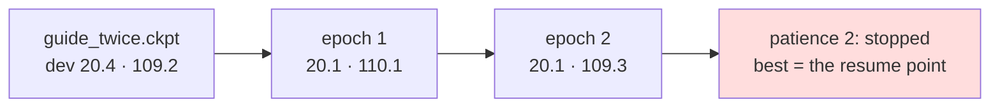

# 213 · Eight more epochs — the curve had flattened

In Phient's world, a word (w) is a seed: what it relates to, under what conditions (c), grows from it. The Phical paradigm, X ⇒ Y, drives and composes Phient's Phasor Language Models: Phinet, Phiano, PhiTon. Phical stores no point: a word is 32–64 relations, each a complex phasor on a closed circle; meaning is a side effect of pairs of words moving under a condition, and they move by the error of what was expected — toward what came, away from what did not.

docs/212 ended "still improving at epoch 8" — dev perplexity 114.7 → 109.2, falling every epoch but one — and named the next run: resume `guide_twice.ckpt`, same text, more epochs. The user's word: "8 more epochs". This records what that bought, which is nothing, and says so.

## What it scored

`guide_twice.ckpt` resumed (64 channels, 133,522 lines, 25,806 words), nothing new told, up to eight epochs over the same lines, the example's patience of two epochs without a better dev perplexity.

| epoch | error (train) | dev top-1 | dev perplexity | seconds |
|---|---|---|---|---|
| resumed (212's epoch 8) | — | 20.4% | 109.2 | 6 |
| 1 | 2.455 | 20.1% | 110.1 | 387 |
| 2 | 2.446 | 20.1% | 109.3 | 226 |

Two epochs, neither under 109.2, and the run stopped itself. The best epoch is the resume point, so `guide_twice_2.ckpt` is `guide_twice.ckpt` to the byte (46,196,303 bytes, the same test row: **20.9% / 41.4% / 104.3**), and what it says is unchanged — *she has been working* → "for a long time", *i wish i* → "had a lot of money".

Read, straight:

- **212's "still improving" was a line drawn through the last two points, not a trend.** The curve had flattened at 109.2: the training error still eases (2.455 → 2.446) and dev does not follow, which is the shape of a learner that has taken from these lines what it can at this width and this rate.
- **A run that buys nothing costs a checkpoint of nothing.** The example saves the best epoch, and the best epoch was epoch 0 — so nothing learned was lost, and the next instalment resumes either file.
- **What is left is not more epochs of the same text.** Two levers remain untried in this register: the second Tatoeba 80k with the guide told again beside it (more text, the share held — docs/209 and 212 both say text of the right register helps while the share holds), and the learning rate, which no run has moved off 0.5 (an Adagrad step whose per-row sums have grown over 133 thousand lines takes very small steps now; a resumed run may want either a reset of the accumulators or a larger rate).

## Status

2026-11-07, 17:15. No code changed. `guide_twice_2.ckpt` is a copy of `guide_twice.ckpt`; either is the newest learner. Next run: Tatoeba's second 80k with the guide re-told beside it.
