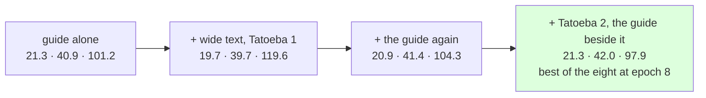

# 214 · Tatoeba's second 80k, the guide told beside it — past the guide alone

In Phient's world, a word (w) is a seed: what it relates to, under what conditions (c), grows from it. The Phical paradigm, X ⇒ Y, drives and composes Phient's Phasor Language Models: Phinet, Phiano, PhiTon. Phical stores no point: a word is 32–64 relations, each a complex phasor on a closed circle; meaning is a side effect of pairs of words moving under a condition, and they move by the error of what was expected — toward what came, away from what did not.

docs/209 said text of the guide's register helps; docs/212 said the guide's share of the rehearsal decides how much; docs/213 said more epochs of the same text buy nothing. The run those three name: more Tatoeba, and the guide told again beside it so its share holds. This is that run, and it is the first accumulated learner to beat the one trained on the guide alone on every number.

## The text

A second 80,000 Tatoeba sentences (`_corpus/tatoeba/sample80k_2.txt`, 612,173 words), drawn with seed 2 from the 1.95 million ASCII English sentences not in the first sample — disjoint from it by construction. Told on top of `guide_twice.ckpt` with the guide's 18,446 training sentences a third time: 96,112 new lines, 229,634 in all, vocabulary 25,806 → 33,034.

## What it scored

| epoch | error (train) | dev top-1 | dev perplexity | seconds |
|---|---|---|---|---|
| told once (online) | — | 17.8% | 130.9 | 391 |
| 1 | 2.661 | 19.9% | 105.9 | 677 |
| 2 | 2.618 | 19.9% | 105.3 | 577 |
| 4 | 2.569 | 20.4% | 104.1 | 533 |
| 6 | 2.537 | 20.5% | 103.7 | 421 |
| 8 | 2.515 | 20.6% | 102.6 | 489 |

Every epoch's dev perplexity is under the previous best of any run (109.2), and the eighth is the best of the eight. 78 minutes at low priority.

| model, on the guide's held-out test | top-1 | top-5 | perplexity |
|---|---|---|---|
| Witten–Bell trigram, the guide alone (docs/203) | 24.8% | 45.9% | 84.7 |
| Witten–Bell trigram, this run's text (guide + Tatoeba 2) | 23.2% | 44.7% | 101.8 |
| the learner, the guide alone (docs/203) | 21.3% | 40.9% | 101.2 |
| the learner, + the guide again (docs/212) | 20.9% | 41.4% | 104.3 |
| **the learner, + Tatoeba 2, the guide beside it** | **21.3%** | **42.0%** | **97.9** |

Read, straight:

- **The accumulated learner is past the guide-alone learner on every number**: top-1 level (21.3%), top-5 up 1.1, perplexity down from 101.2 to 97.9. Nine instalments of text, every one resumed from the last, and the sum is now worth more than the guide by itself — which no run before today could say.
- **The trigram's own numbers show why.** Counted on this run's text, the trigram reads 101.8 — *worse* than counted on the guide alone (84.7), because 612 thousand words of Tatoeba flatten its guide counts. The learner, told the same text, reads 97.9: better than the trigram over the same words. It is not yet better than the trigram over the guide's words only (24.8% / 84.7), which stays the bar.
- **Register and share, together.** Tatoeba 1 alone (docs/209) left top-1 at 19.7%; the guide re-told alone (docs/212) brought it to 20.9%; Tatoeba 2 with the guide re-told beside it, 21.3% and the lowest perplexity. More of the right register helps when the guide's share is held, and only then.
- **Still falling at epoch 8** — but docs/213 said that of 212's curve too, and eight more epochs bought nothing. The difference this time is the text: 96 thousand lines the learner had seen eight times, not sixteen. The next run is not more epochs; it is the stride (`forget`, docs/215), and after it the third slice.
- **What it says**: *i wish i* → "could do that"; *the man who lives next door* → "to me"; *we are going to* → "the party"; *when do we use the present perfect* → "continuous and past simple" — the guide's own answer, longer than any run before gave it.

## Status

2026-11-07, 21:05. No code changed for this run (`--forget` and `--rate` on resume landed beside it, for docs/215). `tatoeba2_guide.ckpt` (229,634 lines, 33,034 words, 64 channels, 61 MB) is the newest checkpoint and the best learner so far.
