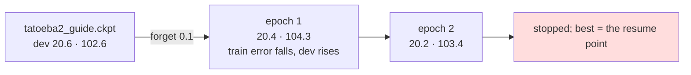

# 215 · The stride back — forgetting the accumulators bought nothing

In Phient's world, a word (w) is a seed: what it relates to, under what conditions (c), grows from it. The Phical paradigm, X ⇒ Y, drives and composes Phient's Phasor Language Models: Phinet, Phiano, PhiTon. Phical stores no point: a word is 32–64 relations, each a complex phasor on a closed circle; meaning is a side effect of pairs of words moving under a condition, and they move by the error of what was expected — toward what came, away from what did not.

docs/213 named a second explanation for why more epochs of the same text buy nothing: Adagrad divides every step by the root of the squared gradients a row has seen, so a learner resumed after two hundred thousand lines is sure, and steps very little. `Learner::forget(share)` scales every accumulator and keeps every phasor; `--forget 0.1` on resume gives the learner the stride of one that had seen a tenth of its history. This is the one run that tests it.

## What it scored

`tatoeba2_guide.ckpt` resumed (229,634 lines, 33,034 words), accumulators scaled by 0.1, nothing new told, up to eight epochs on the same lines, patience two.

| epoch | error (train) | dev top-1 | dev perplexity |
|---|---|---|---|
| resumed (214's epoch 8) | — | 20.6% | 102.6 |
| 1, stride back | 2.559 | 20.4% | 104.3 |
| 2 | 2.534 | 20.2% | 103.4 |

Stopped by patience. The best epoch is the resume point, so `forget01.ckpt` is `tatoeba2_guide.ckpt` with its accumulators scaled and its phasors untouched: the same test row, **21.3% / 42.0% / 97.9**, the same answers.

Read, straight:

- **The stride was not the constraint.** With a tenth of its experience the learner's training error falls faster than before (2.515 → 2.559 → 2.534 on a rehearsal that had been easing by 0.01 an epoch) and dev gets worse, not better. Larger steps on the same text learn the text, not English: this is docs/213's plateau again, reached quicker.
- **Three ways of pushing on the same lines have now bought nothing**: more epochs (213), more channels (210), a longer stride (here). One way has bought something every time it was tried: more lines of the right register with the guide's share held (209, 212, 214). The learner is text-bound, not optimiser-bound, at 64 channels over 33 thousand words.
- **`forget` stays**, because its other use was not tested here: told something *new*, a learner whose accumulators were scaled meets it with a real step. The next run that tells new text can take `--forget` beside it; this one did not, so that the stride was the only thing that moved.

## Status

2026-11-07, 21:25. `forget01.ckpt` is not the newest learner — `tatoeba2_guide.ckpt` is, with its stride intact. Next run: Tatoeba's third 80k with the guide told beside it, the lever that has worked three times.
