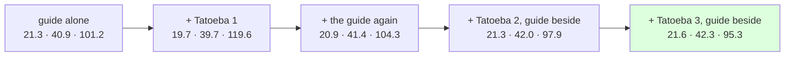

# 216 · Tatoeba's third 80k — still paying, less

In Phient's world, a word (w) is a seed: what it relates to, under what conditions (c), grows from it. The Phical paradigm, X ⇒ Y, drives and composes Phient's Phasor Language Models: Phinet, Phiano, PhiTon. Phical stores no point: a word is 32–64 relations, each a complex phasor on a closed circle; meaning is a side effect of pairs of words moving under a condition, and they move by the error of what was expected — toward what came, away from what did not.

docs/214's lever, once more: a third disjoint 80,000 Tatoeba sentences (`sample80k_3.txt`, 614,808 words, seed 3 from the sentences not in the first two samples) on top of `tatoeba2_guide.ckpt`, the guide's 18,446 training sentences told a fourth time beside them. 96,117 new lines, 325,751 in all, vocabulary 33,034 → 38,303.

## What it scored

| epoch | error (train) | dev top-1 | dev perplexity |
|---|---|---|---|
| told once (online) | — | 18.8% | 119.2 |
| 1 | 2.620 | 20.3% | 101.2 |
| 3 | 2.572 | 20.6% | 100.5 |
| 5 | 2.546 | 20.5% | 99.9 |
| 7 | 2.524 | 20.8% | **99.7** |
| 8 | 2.517 | 20.6% | 99.9 |

The best epoch is the seventh; the first dev perplexity under 100. 110 minutes at low priority, the machine shared.

| model, on the guide's held-out test | top-1 | top-5 | perplexity |
|---|---|---|---|
| Witten–Bell trigram, the guide alone (docs/203) | 24.8% | 45.9% | 84.7 |
| Witten–Bell trigram, this run's text | 23.0% | 44.5% | 101.7 |
| the learner, the guide alone (docs/203) | 21.3% | 40.9% | 101.2 |
| the learner, + Tatoeba 2, the guide beside it (docs/214) | 21.3% | 42.0% | 97.9 |
| **the learner, + Tatoeba 3, the guide beside it** | **21.6%** | **42.3%** | **95.3** |

Read, straight:

- **The lever paid a fourth time**, and the accumulated learner is now ahead of the guide-alone learner by 0.3 top-1, 1.4 top-5 and six points of perplexity. It has never been better.
- **It paid less.** Tatoeba 2 took perplexity down 6.4 (104.3 → 97.9); Tatoeba 3 took it down 2.6 (97.9 → 95.3). Top-1 moved 0.0 then 0.3. The second slice bought more than the third because the first-told register was still rare in the rehearsal; by the third, Tatoeba is 73% of the lines, and more of it moves the learner less. The guide is a sixth of the lines again (4 × 18,446 of 325,751), which is where docs/212 found dilution.
- **The vocabulary grows faster than the channels**: 38,303 words over 64 channels. docs/210's widening bought nothing at 25,806; whether that stays true at 38 thousand is a cheap run, and the one to try before a fifth slice.
- **What it says** keeps the guide's voice — *i wish i* → "had a lot of time"; *we are going to* → "the party" — and drops one: *the man who lives next door* → nothing, where 214 said "to me". A prefix that answered once and not now is the one to watch across runs.

## Status

2026-11-07, 23:20. No code changed. `tatoeba3_guide.ckpt` (325,751 lines, 38,303 words, 64 channels, 73 MB) is the newest and best learner. Next: a fourth slice with the guide told again beside it, and the guide told twice more so its share climbs back; then widen at this vocabulary.
