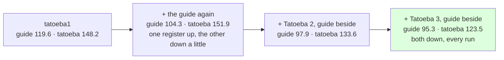

# 217 · Two registers — did it learn English, or the guide?

In Phient's world, a word (w) is a seed: what it relates to, under what conditions (c), grows from it. The Phical paradigm, X ⇒ Y, drives and composes Phient's Phasor Language Models: Phinet, Phiano, PhiTon. Phical stores no point: a word is 32–64 relations, each a complex phasor on a closed circle; meaning is a side effect of pairs of words moving under a condition, and they move by the error of what was expected — toward what came, away from what did not.

Every number from docs/203 to 216 is on one held-out set: a tenth of the guide's sentences. A learner told four times as much Tatoeba as guide could be climbing that test by learning the guide better, or by learning English. The root TODO had asked for "a dev set that mixes registers, to tell a model that learned English from one that learned the guide." This is it, as a second held-out set rather than a mixed one, so each register is read on its own.

## The set, and the flag

`_corpus/tatoeba/heldout2k.txt`: 2,000 Tatoeba sentences (15,066 words) drawn with seed 99 from the 1.7 million not in any of the four 80k samples — never told to any checkpoint. `examples/learner --test-more held.txt` scores the best epoch on each extra file beside the guide's test row; with `--epochs 0 --no-guide --resume ckpt` the example is a scorer, loading a checkpoint and measuring it in under a minute.

## What the checkpoints read

| checkpoint | the guide's test top-1 · top-5 · ppl | never-told Tatoeba top-1 · top-5 · ppl |
|---|---|---|
| `tatoeba1` (docs/209) | 19.7 · 39.7 · 119.6 | 20.3 · 39.0 · 148.2 |
| `guide_twice` (docs/212) | 20.9 · 41.4 · 104.3 | 20.0 · 39.1 · 151.9 |
| `tatoeba2_guide` (docs/214) | 21.3 · 42.0 · 97.9 | 20.9 · 40.7 · 133.6 |
| `tatoeba3_guide` (docs/216) | 21.6 · 42.3 · 95.3 | 21.3 · 41.7 · 123.5 |

Read, straight:

- **It is learning English.** From `tatoeba1` to `tatoeba3_guide` the never-told Tatoeba perplexity fell 148.2 → 123.5 and its top-1 rose 20.3% → 21.3%, while the guide's fell 119.6 → 95.3. Both registers improved on every run that told new Tatoeba with the guide beside it.
- **Re-telling the guide alone (docs/212) traded registers**: the guide 119.6 → 104.3, Tatoeba 148.2 → 151.9. Share bought the guide's test a little at Tatoeba's expense — the one run where the two moved apart. The next two runs, text and share together, moved them together.
- **The learner reads unseen Tatoeba about as well as it reads the guide, by top-1** (21.3% against 21.6%) — the guide's sentences are a register it has seen 142k words of, Tatoeba's a register it has seen 1.8 million words of and these 15 thousand never. The perplexities differ (95.3 against 123.5) because Tatoeba's vocabulary is wider: more of its held-out words are rare or unseen.
- **The guide's test stays the bar** for the trigram comparison (docs/203's 24.8% / 84.7); this set is beside it, so a run that climbs one by sacrificing the other is seen.

## Status

2026-11-08, 00:10. `--test-more` in `examples/learner`; the set is on disk under `_corpus`, not in a repository, as the samples are. Every run from here reports both rows.
