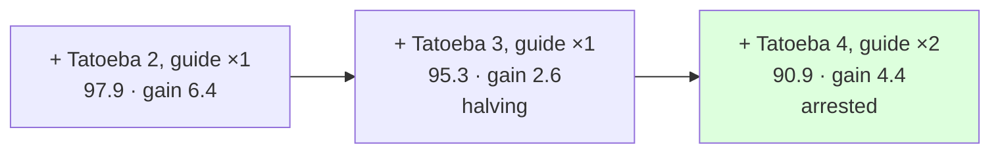

# 218 · Tatoeba's fourth 80k, the guide told twice beside it — the halving arrested

In Phient's world, a word (w) is a seed: what it relates to, under what conditions (c), grows from it. The Phical paradigm, X ⇒ Y, drives and composes Phient's Phasor Language Models: Phinet, Phiano, PhiTon. Phical stores no point: a word is 32–64 relations, each a complex phasor on a closed circle; meaning is a side effect of pairs of words moving under a condition, and they move by the error of what was expected — toward what came, away from what did not.

docs/216 found the text lever paying less each time (perplexity down 6.4, then 2.6) and the guide back to a sixth of the rehearsal. The run: a fourth disjoint 80,000 Tatoeba sentences (`sample80k_4.txt`, 612,328 words), and the guide's 18,446 training sentences told **twice** beside them (`--guide-times 2`, new for this run), on top of `tatoeba3_guide.ckpt`. 114,466 new lines, 440,217 in all, vocabulary 38,303 → 42,672.

## What it scored

| epoch | error (train) | dev top-1 | dev perplexity |
|---|---|---|---|
| told once (online) | — | 19.5% | 109.9 |
| 1 | 2.591 | 20.7% | 96.2 |
| 4 | 2.545 | 21.2% | 95.0 |
| 6 | 2.528 | 21.4% | 94.5 |
| 8 | 2.514 | 21.3% | **94.1** |

Every epoch under the previous best (99.7); the eighth the best of the eight. Three hours at low priority with the machine shared with builds and tests, and one restart of the session that the process outlived.

| model, on the guide's held-out test | top-1 | top-5 | perplexity |
|---|---|---|---|
| Witten–Bell trigram, the guide alone (docs/203) | 24.8% | 45.9% | 84.7 |
| Witten–Bell trigram, this run's text | 24.0% | 45.6% | 100.3 |
| the learner, the guide alone (docs/203) | 21.3% | 40.9% | 101.2 |
| the learner, + Tatoeba 3, the guide beside it (docs/216) | 21.6% | 42.3% | 95.3 |
| **the learner, + Tatoeba 4, the guide twice beside it** | **22.1%** | **43.3%** | **90.9** |

| checkpoint | never-told Tatoeba (docs/217) |
|---|---|
| tatoeba3_guide | 21.3% · 41.7% · 123.5 |
| **tatoeba4_guide2** | **21.7% · 41.9% · 119.5** |

Read, straight:

- **Doubling the guide's share arrested the halving.** The text lever's gains were 6.4, 2.6 — and now 4.4, with the guide at a fifth of the lines instead of a sixth. Share and text together, again, and the share set higher.
- **Best on every number, both registers.** 22.1% / 43.3% / 90.9 on the guide, +0.5 / +1.0 / −4.4 over docs/216; on never-told Tatoeba 119.5, −4.0. It is learning English and the guide at once.
- **The trigram over the same text is now 9.4 points of perplexity behind** (100.3 against 90.9) and 1.9 points of top-1 ahead (24.0% against 22.1%). The guide-only trigram (24.8% / 84.7) stays the bar: 2.7 points of top-1 and 6.2 of perplexity away, from 3.5 and 16.5 at the start of 2026-11-07.
- **Still falling at epoch 8** — and docs/213 says what that is worth on the same text. The record (docs/220) now carries this instalment and proposes the next.
- **What it says**: *i have been waiting* → "for the bus"; *she has been working* → "hard"; *when do we use the present perfect* → "continuous and present simple" — the guide's own answer; and *if i had known* → nothing, where every earlier run said "you". A prefix that answered and now does not is the one to watch.

## Status

2026-11-08, 02:35. `tatoeba4_guide2.ckpt` (440,217 lines, 42,672 words, 64 channels, 85 MB) is the newest and best learner; recorded in `data/curriculum/instalments.tsv`. The record's proposal, `guide` (its last gain the largest), is running as `guide_thrice`.
