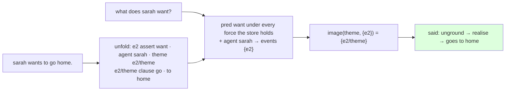

# 219 · A clause unfolded, a predicate under any force — two gaps of `told` closed

In Phient's world, a word (w) is a seed: what it relates to, under what conditions (c), grows from it. The Phical paradigm, X ⇒ Y, drives and composes Phient's Phasor Language Models: Phinet, Phiano, PhiTon. Phical stores no point: a word is 32–64 relations, each a complex phasor on a closed circle; meaning is a side effect of pairs of words moving under a condition, and they move by the error of what was expected — toward what came, away from what did not.

docs/211 closed the loop — told English, asked English, answered — and named two things `told` did not do: a clause filling a role was passed over, and the told force was taken to be `assert`. Both are the store's shape, not the reader's, so both are mine to close, and they are closed here (2026-11-08).

## A clause unfolded

`ground` names a clause and stops — "sarah wants to go home" grounds as `(e2, theme, e2/theme)` and nothing about the going — by design: one call, one frame, so the row count holds (R5.12). A told sentence needs the clause's rows as well, or "what does sarah want?" can answer only with the sub-event's name. `ground::unfold` grounds the act and then every clause under the name `nested` gave it, to any depth, with a new kind for the clause's predicate row: `clause`. A clause is not asserted by the speaker — *sarah wants to go home* asserts the wanting, not the going — so it takes no force; `clause` says what it is.

```text
e2        assert  want        the sentence's own force
e2        agent   sarah
e2        theme   e2/theme    the clause, named
e2/theme  clause  go          its rows, under its name
e2/theme  to      home
```

And the way back: `ground::unground(event, rows)` reads the rows about an event as an act again — a row's kind is a force, a feature, `clause`, or else a role; a role's filler that is itself an event the rows describe is a clause — so a sub-event the machine answers with can be said in English. `told::said` realises it and drops the statement's full stop: asked *what does sarah want?*, the answer is **goes to home**, not `e2/theme`. The realiser says a statement; the complement form — *to go home* — is the realiser's `say_theme`, which is the reader's side and not public yet. Recorded, not hidden.

## A predicate under any force

`told` filtered events by `(assert, pred)`. Told "i wish i had a lot of money" — `WISH(have(agent: i, theme: money), past)` — the row is `(e1, wish, have)`, and *what did i have?* found nothing. Now the predicate's relation is the **union over every force kind the store holds**, and over `clause`: `(union-all (list (identity (referents (phisor-rows "wish") have)) (identity (referents (phisor-rows "assert") have)) …))`. The store names the forces; nothing lists them in the code. A store holding no force kind is given `assert` empty, so the question has an empty class, not an error. `clause` is excluded from the preposition roles a `where` reads over, structurally, beside the four named roles, the five features and the seven forces.

The test `any_force_and_a_clause_said_in_english` pins both: the wish's `have` answers *what did i have?* with **money**, and the want's clause answers *what does sarah want?* in English. `examples/converse` tells through `unfold` now.



## Status

2026-11-08, 01:25. `ground/unfold.rs` (`unfold`, `unground`, `is_event`, `CLAUSE`), `told` (any force, `said`), `KindRows::all`. phisor 45 machine, ground and lovelace tests green. Left: the complement form of a clause answer (the realiser's), and a question whose hole is inside a clause.
