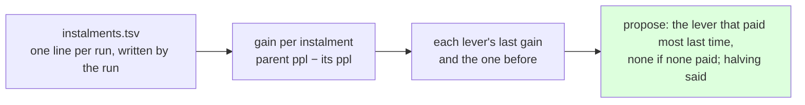

# 220 · The curriculum as a record — the next instalment proposed from it

In Phient's world, a word (w) is a seed: what it relates to, under what conditions (c), grows from it. The Phical paradigm, X ⇒ Y, drives and composes Phient's Phasor Language Models: Phinet, Phiano, PhiTon. Phical stores no point: a word is 32–64 relations, each a complex phasor on a closed circle; meaning is a side effect of pairs of words moving under a condition, and they move by the error of what was expected — toward what came, away from what did not.

Paper 28 named the learner's curriculum as the next scale for Note D's arrangement: each instalment a card, its measured gain the cost, the next proposed from the record rather than from the writer. docs 208–217 were that record, kept by hand in prose. Now the run keeps it.

## The record

`crates/phiano/data/curriculum/instalments.tsv`, one line per instalment: what it resumed from, which lever it pulled, what text, the guide's share, the epochs, and what it scored on the guide's held-out test. `examples/learner --record name,lever,doc` appends the line after a run, with the numbers the run measured — so the record is the run's, not the writer's — and `--propose` reads it back and names the next lever.

The levers, as the record names them: `guide` (the guide told again), `text` (other text, the guide not), `text+guide` (other text with the guide beside it), `epochs`, `widen`, `forget`. A lever's gain is the perplexity its instalment took off the one it resumed from.

## What the record says, read back on 2026-11-08

| instalment | from | lever | text | guide × | top-1 | top-5 | ppl | gain | doc |
|---|---|---|---|---|---|---|---|---|---|
| guide_alone | - | guide | - | 1 | 21.3% | 40.9% | 101.2 | — | 203 |
| wide_then_guide | wide | guide | - | 1 | 19.9% | 39.3% | 123.4 | — | 208 |
| tatoeba1 | wide_then_guide | text | sample80k | 0 | 19.7% | 39.7% | 119.6 | +3.8 | 209 |
| widened128 | tatoeba1 | widen | - | 0 | 19.7% | 39.6% | 119.6 | +0.0 | 210 |
| guide_twice | tatoeba1 | guide | - | 1 | 20.9% | 41.4% | 104.3 | +15.3 | 212 |
| guide_twice_2 | guide_twice | epochs | - | 0 | 20.9% | 41.4% | 104.3 | +0.0 | 213 |
| tatoeba2_guide | guide_twice | text+guide | sample80k_2 | 1 | 21.3% | 42.0% | 97.9 | +6.4 | 214 |
| forget01 | tatoeba2_guide | forget | - | 0 | 21.3% | 42.0% | 97.9 | +0.0 | 215 |
| tatoeba3_guide | tatoeba2_guide | text+guide | sample80k_3 | 1 | 21.6% | 42.3% | 95.3 | +2.6 | 216 |

| lever | last gain | the one before |
|---|---|---|
| guide | +15.3 | — |
| text | +3.8 | — |
| text+guide | +2.6 | +6.4 |
| epochs | +0.0 | — |
| forget | +0.0 | — |
| widen | +0.0 | — |

> proposal: pull `guide` again, resuming `tatoeba3_guide` — its last application took 15.3 off the perplexity.

Read, straight:

- **The record proposes what the writer chose.** The run that was already going when the record was read — Tatoeba 4 with the guide told *twice* beside it (`--guide-times 2`) — is the `guide` lever pulled inside `text+guide`: the proposal and the choice agree, which is the first thing to ask of a proposer.
- **It says what three days of docs said in two tables**: the share lever paid most (+15.3), text in the right register pays and pays less each time (+6.4 then +2.6 — the halving the proposer watches for), and the three levers that pushed on the same lines paid nothing (epochs, forget, widen).
- **It is a reading, not a prediction.** The proposer ranks last gains; it does not model them. That is her limit kept on purpose: the engine follows the analysis it is given. When Tatoeba 4 records itself, the `text+guide` row will say whether doubling the share arrested the halving, and the next proposal will come from that line, not from this doc.

## Status

2026-11-08, 01:45. `examples/learner/curriculum.rs` (`read`, `record`, `gain`, `propose`), `data/curriculum/instalments.tsv` (ten instalments from docs 203–216). Every run from here is recorded by `--record`. Next: Tatoeba 4 records itself (docs/218); then the proposal is followed.
