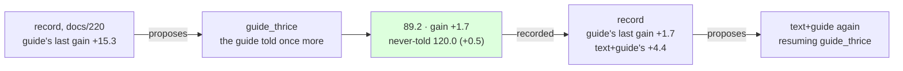

# 221 · The guide told a third time — the record's first proposal, followed

In Phient's world, a word (w) is a seed: what it relates to, under what conditions (c), grows from it. The Phical paradigm, X ⇒ Y, drives and composes Phient's Phasor Language Models: Phinet, Phiano, PhiTon. Phical stores no point: a word is 32–64 relations, each a complex phasor on a closed circle; meaning is a side effect of pairs of words moving under a condition, and they move by the error of what was expected — toward what came, away from what did not.

docs/220 made the curriculum a record and the record proposed `guide` — the lever whose last application had paid most (+15.3, docs/212). This is that proposal followed, the first instalment the writer did not choose: the guide's 18,446 training sentences told once more on top of `tatoeba4_guide2.ckpt` (docs/218), no other text, eight epochs. 18,446 new lines, 458,663 in all; the vocabulary unchanged at 42,672, since the guide had nothing new to name. The run recorded itself (`--record guide_thrice,guide,221`) and scored the never-told set (`--test-more heldout2k.txt`).

## What it scored

| epoch | error (train) | dev top-1 | dev perplexity |
|---|---|---|---|
| told once (online) | — | 21.4% | 93.0 |
| 1 | 2.506 | 21.6% | 92.5 |
| 2 | 2.501 | 21.6% | 92.5 |
| 4 | 2.492 | 21.6% | 92.2 |
| 6 | 2.483 | 21.8% | 91.6 |
| 8 | 2.475 | 21.8% | 91.4 |

Best epoch the last, still falling by a tenth a time. About 15 minutes an epoch at low priority over the 458,663 lines.

| on the guide's held-out test | top-1 | top-5 | perplexity |
|---|---|---|---|
| Witten–Bell trigram, the guide alone (docs/203) — the bar | 24.8% | 45.9% | 84.7 |
| the learner, the guide alone (docs/203) | 21.3% | 40.9% | 101.2 |
| the learner, + Tatoeba 4, the guide twice beside it (docs/218) | 22.1% | 43.3% | 90.9 |
| **the learner, the guide a third time on top** | **22.3%** | **43.7%** | **89.2** |

| checkpoint | never-told Tatoeba (docs/217) |
|---|---|
| tatoeba4_guide2 | 21.7% · 41.9% · 119.5 |
| guide_thrice | 21.6% · 42.2% · 120.0 |

Read, straight:

- **The share lever paid, and paid a ninth of what it paid before.** +1.7 of perplexity, against +15.3 in docs/212. Then the guide was a sixth of the lines and starved; now it was already a fifth, told twice beside Tatoeba 4, and a third telling finds little left to rebalance. The lever is the right one when the guide is diluted and a small one when it is not — which is what the record's "the one before" column is there to show.
- **Best on the guide, by the smallest step yet.** 22.3% / 43.7% / 89.2: +0.2 / +0.4 / −1.7 over docs/218. The gap to the bar is 2.5 points of top-1 and 4.5 of perplexity, from 3.5 and 16.5 when 2026-11-07 began.
- **The other register paid for it, a little.** Never-told Tatoeba 119.5 → 120.0. The guide's register and Tatoeba's pull against each other once the share is high enough; docs/217's two-register test is what shows it, and this is the first run where the registers moved apart. Half a point is small, and the text lever has moved both registers together every time.
- **The record's second proposal is `text+guide`** (+4.4 last, over +2.6 before — the arrested halving of docs/218), resuming `guide_thrice`. The writer agrees: more lines of the right register with the guide's share held at two is the lever that has moved both registers.
- **What it says**: *i have been waiting* → "for you"; *she has been working* → "hard"; *when do we use the present perfect* → "continuous i have done"; *the man who lives next door* → "to me"; *if i had known* → nothing, as in docs/218.

## Status

2026-11-08, 05:10. `guide_thrice.ckpt` (458,663 lines, 42,672 words, 64 channels) is the newest and best learner on the guide; recorded in `data/curriculum/instalments.tsv` by the run. The record's proposal, `text+guide` on `guide_thrice`, is running as `tatoeba5_guide2`: a fifth disjoint 80,000 Tatoeba sentences (`sample80k_5.txt`, 572,569 words, seed 5 from the sentences in no earlier sample nor the held-out set), the guide twice beside them (docs/222, records itself).
