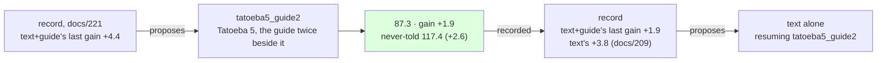

# 222 · Tatoeba five, the guide twice beside it — the record's second proposal, followed

In Phient's world, a word (w) is a seed: what it relates to, under what conditions (c), grows from it. The Phical paradigm, X ⇒ Y, drives and composes Phient's Phasor Language Models: Phinet, Phiano, PhiTon. Phical stores no point: a word is 32–64 relations, each a complex phasor on a closed circle; meaning is a side effect of pairs of words moving under a condition, and they move by the error of what was expected — toward what came, away from what did not.

docs/221 followed the record's first proposal and the record then proposed `text+guide` (+4.4 last, docs/218), resuming `guide_thrice`. This is that proposal followed: a fifth disjoint 80,000 Tatoeba sentences (`sample80k_5.txt`, 572,569 words, seed 5 from the sentences in no earlier sample nor the held-out set), the guide's 18,446 training sentences told twice beside them, eight epochs on top of `guide_thrice.ckpt`. 116,892 new lines, 575,555 in all; the vocabulary 42,672 → 44,991, since Tatoeba 5 named 2,319 words nothing before it had. The run recorded itself (`--record tatoeba5_guide2,text+guide,222`) and scored the never-told set (`--test-more heldout2k.txt`); the never-told perplexity went into the record's `held` column by hand, since the column was added while this run was already in flight.

## What it scored

| epoch | error (train) | dev top-1 | dev perplexity |
|---|---|---|---|
| told once (online) | — | 20.4% | 98.9 |
| 1 | 2.511 | 21.4% | 90.4 |
| 2 | 2.502 | 21.7% | 90.1 |
| 4 | 2.490 | 21.9% | 89.6 |
| 6 | 2.480 | 22.3% | 89.5 |
| 7 | 2.478 | 22.3% | 89.4 |
| 8 | 2.474 | 22.2% | 89.8 |

Best epoch the seventh, the eighth a half-tenth worse - the first run where the last epoch was not the best. Between 20 and 46 minutes an epoch at low priority over the 575,555 lines; the spread is the machine's, which was building phisor beside it for most of the morning.

| on the guide's held-out test | top-1 | top-5 | perplexity |
|---|---|---|---|
| Witten–Bell trigram, the guide alone (docs/203) — the bar | 24.8% | 45.9% | 84.7 |
| the learner, the guide alone (docs/203) | 21.3% | 40.9% | 101.2 |
| the learner, + Tatoeba 4, the guide twice beside it (docs/218) | 22.1% | 43.3% | 90.9 |
| the learner, the guide a third time on top (docs/221) | 22.3% | 43.7% | 89.2 |
| **the learner, + Tatoeba 5, the guide twice beside it** | **22.6%** | **44.0%** | **87.3** |

| checkpoint | never-told Tatoeba (docs/217) |
|---|---|
| tatoeba4_guide2 | 21.7% · 41.9% · 119.5 |
| guide_thrice | 21.6% · 42.2% · 120.0 |
| tatoeba5_guide2 | 22.0% · 42.5% · 117.4 |

Read, straight:

- **Best on both registers.** 22.6% / 44.0% / 87.3 on the guide, +0.3 / +0.3 / −1.9 over docs/221; 117.4 never told, −2.6 over docs/221 and −2.1 over the best before it. The gap to the bar is 2.2 points of top-1 and 2.6 of perplexity, from 3.5 and 16.5 when 2026-11-07 began.
- **The registers moved together again.** docs/221's `guide` lever moved them apart (−0.5 beside +1.7); this lever has moved them together every time it was pulled, and the record's last line now says so: "`tatoeba5_guide2` moved the never-told register with the guide's (+2.6 beside +1.9)". Lines of the right register with the guide's share held are the lever that pays on both sides.
- **The halving is back.** The text+guide lever's gains run 6.4, 2.6, 4.4, 1.9. docs/218 arrested the halving once by doubling the guide's share; the next doubling of lines did not arrest it again. Each 80,000 sentences buys about half what the last did on the guide's register, while the never-told register's gains (4.0, −0.5, 2.6) do not yet show the same curve.
- **The record's third proposal is `text` alone**, resuming `tatoeba5_guide2`: by its rule, the lever whose last application paid most, and `text` alone last paid +3.8 (docs/209, on `wide_then_guide`, from 123.4). That gain is old and from a poor base, and the writer would not have chosen it - but it is the one measurement the two registers were built for and have not yet had: new text with no guide beside it, on a checkpoint where the guide's share is high. If the guide's register rises while the never-told falls, that is docs/212's dilution measured cleanly; if both fall, the guide's share was never the point. Either way the record learns what `text` alone is worth from a good base, and its next proposal is made on that.
- **What it says**: *i have been waiting* → "for you"; *she has been working* → "hard"; *when do we use the present perfect* → "continuous"; *the man who lives next door* → "to me"; *i wish i* → "could do that"; *we are going to* → "the party"; *if i had known* → nothing, as in docs/218 and 221.

## Status

2026-11-08, 09:10. `tatoeba5_guide2.ckpt` (575,555 lines, 44,991 words, 64 channels) is the newest and best learner on both registers; recorded in `data/curriculum/instalments.tsv` by the run, with `held` filled in by hand. The record's proposal, `text` alone on `tatoeba5_guide2`, is running as `tatoeba6`: a sixth disjoint 80,000 Tatoeba sentences (`sample80k_6.txt`, seed 6), `--no-guide`, eight epochs (docs/223, records itself). Left after that: widen at 45 thousand words; `--forget` beside new text.
