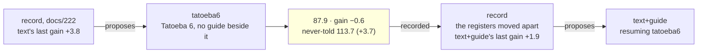

# 223 · Tatoeba six, alone — the dilution measured

In Phient's world, a word (w) is a seed: what it relates to, under what conditions (c), grows from it. The Phical paradigm, X ⇒ Y, drives and composes Phient's Phasor Language Models: Phinet, Phiano, PhiTon. Phical stores no point: a word is 32–64 relations, each a complex phasor on a closed circle; meaning is a side effect of pairs of words moving under a condition, and they move by the error of what was expected — toward what came, away from what did not.

docs/222 followed the record's second proposal and the record then proposed `text` alone (+3.8 last, docs/209), resuming `tatoeba5_guide2`. This is that proposal followed: a sixth disjoint 80,000 Tatoeba sentences (`sample80k_6.txt`, 571,473 words, seed 6 from the sentences in no earlier sample nor the held-out set), `--no-guide`, eight epochs asked for on top of `tatoeba5_guide2.ckpt`. 80,000 new lines and none of them the guide's, 655,555 in all; the vocabulary 44,991 → 47,083, since Tatoeba 6 named 2,092 words nothing before it had. The run recorded itself (`--record tatoeba6,text,223`) and scored the never-told set (`--test-more heldout2k.txt`); this is the first instalment whose `held` column the run wrote.

It is the measurement docs/212 asked for and docs/217 built the second register to make: new text with no guide beside it, from a base where the guide's share is high. If the guide's register rises while the never-told register falls, the guide's lines beside the text were doing something; if both fall, they were not.

## What it scored

| epoch | error (train) | dev top-1 | dev perplexity | minutes |
|---|---|---|---|---|
| told once (online) | — | 20.9% | 99.5 | 6 |
| 1 | 2.511 | 21.9% | 90.8 | 63 |
| 2 | 2.502 | 21.9% | 90.9 | 50 |
| 3 | 2.498 | 22.0% | 90.6 | 74 |
| 4 | 2.492 | 21.9% | 90.8 | 25 |
| 5 | 2.488 | 22.0% | 91.0 | 25 |

The learner stopped itself after the fifth epoch: its rule is two epochs without a gain on the dev register, and the third was the best. The first run to stop before the epochs asked for; docs/222's best was the seventh of eight. The first three epochs ran beside phisor's builds and tests; the last two had the machine, at 25 minutes an epoch over 655,555 lines.

| on the guide's held-out test | top-1 | top-5 | perplexity |
|---|---|---|---|
| Witten–Bell trigram, the guide alone (docs/203) — the bar | 24.8% | 45.9% | 84.7 |
| the learner, the guide alone (docs/203) | 21.3% | 40.9% | 101.2 |
| the learner, the guide a third time on top (docs/221) | 22.3% | 43.7% | 89.2 |
| the learner, + Tatoeba 5, the guide twice beside it (docs/222) | 22.6% | 44.0% | 87.3 |
| **the learner, + Tatoeba 6, alone** | **22.6%** | **44.2%** | 87.9 |

| checkpoint | never-told Tatoeba (docs/217) |
|---|---|
| tatoeba4_guide2 | 21.7% · 41.9% · 119.5 |
| guide_thrice | 21.6% · 42.2% · 120.0 |
| tatoeba5_guide2 | 22.0% · 42.5% · 117.4 |
| **tatoeba6** | **22.0% · 42.8% · 113.7** |

Read, straight:

- **The dilution, measured cleanly.** The guide's register rose 0.6 (87.3 → 87.9) while the never-told register fell 3.7 (117.4 → 113.7). The record's last line says it: "`tatoeba6` moved the never-told register against the guide's (+3.7 beside −0.6)". docs/212 inferred the dilution from one register; this is the first run that shows it on two, with nothing else changed - the same base, the same kind of text, only the guide's lines left out.
- **The text pays on the never-told register either way.** That register's gains run 4.0, −0.5, 2.6, 3.7: the biggest two are the two runs with the most new text in them, and `text` alone paid the most of all. What the guide's lines beside the text buy is the guide's register, not the other: `text+guide` last moved it −1.9, `text` alone +0.6.
- **Top-1 and top-5 did not fall.** 22.6% / 44.2% against 22.6% / 44.0%: the perplexity rose because the learner is less sure of the guide's words, not because it chooses them less often. The dev register says the same - 90.6 at its best against 89.4 in docs/222, and 99.5 on the online pass against 98.9.
- **The stop rule did its work.** Five epochs instead of eight, and the dev register was flat from the first: 90.8, 90.9, 90.6, 90.8, 91.0. New text without the guide gives the guide's dev set nothing to improve on after the first epoch, so the learner stopped. Epochs are measured by the dev register, and that register is the guide's; the never-told register is scored only at the end. A run of `text` alone would be better stopped by the register it is moving.
- **The record's fourth proposal is `text+guide` again**, resuming `tatoeba6`: its last gain +1.9, the largest any lever has to show on the guide's register, with the record's own caveat that it is less than half of the 4.4 before it. That is the right call from this base: the guide's share of the lines just fell, and the lever that raises it beside new text is the one that moved both registers together every time.
- **What it says**: *i have been waiting* → "for you"; *she has been working* → "hard"; *when do we use the present perfect* → "continuous"; *the man who lives next door* → "to me"; *i wish i* → "could have done that"; *we are going to* → "be"; and *if i had known* → "tom had to do that" - the first checkpoint to go on from that one at all, with Tatoeba's own protagonist.

## Status

2026-11-08, 12:30. `tatoeba6.ckpt` (655,555 lines, 47,083 words, 64 channels) is the newest learner and the best on the never-told register; `tatoeba5_guide2.ckpt` stays the best on the guide's. Recorded in `data/curriculum/instalments.tsv` by the run, `held` included. The record's proposal, `text+guide` on `tatoeba6`, is running as `tatoeba7_guide2`: a seventh disjoint 80,000 Tatoeba sentences (`sample80k_7.txt`, seed 7), the guide twice beside them, eight epochs (docs/224, records itself). Left after that: widen at 47 thousand words; `--forget` beside new text; a stop rule for a `text` run that reads the register it moves.
