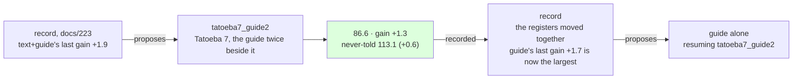

# 224 · Tatoeba seven, the guide twice beside it — the registers together again

In Phient's world, a word (w) is a seed: what it relates to, under what conditions (c), grows from it. The Phical paradigm, X ⇒ Y, drives and composes Phient's Phasor Language Models: Phinet, Phiano, PhiTon. Phical stores no point: a word is 32–64 relations, each a complex phasor on a closed circle; meaning is a side effect of pairs of words moving under a condition, and they move by the error of what was expected — toward what came, away from what did not.

docs/223 followed the record's third proposal, `text` alone, and the record then proposed `text+guide` (+1.9 last, docs/222), resuming `tatoeba6`. This is that proposal followed: a seventh disjoint 80,000 Tatoeba sentences (`sample80k_7.txt`, 571,867 words, seed 7 from the sentences in no earlier sample nor the held-out set), the guide's 18,446 training sentences told twice beside them, eight epochs asked for on top of `tatoeba6.ckpt`. 116,892 new lines, 772,447 in all; the vocabulary 47,083 → 48,947, since Tatoeba 7 named 1,864 words nothing before it had. The run recorded itself (`--record tatoeba7_guide2,text+guide,224`) and scored the never-told set.

With docs/223 this makes a pair: the same amount of new text, from adjacent bases, once without the guide beside it and once with it twice. The two runs are the lever's two sides.

## What it scored

| epoch | error (train) | dev top-1 | dev perplexity | minutes |
|---|---|---|---|---|
| told once (online) | — | 20.9% | 96.6 | 4 |
| 1 | 2.515 | 21.9% | 89.7 | 27 |
| 2 | 2.506 | 21.9% | 90.0 | 26 |
| 3 | 2.501 | 22.0% | 89.5 | 27 |
| 4 | 2.496 | 22.1% | 89.7 | 26 |
| 5 | 2.492 | 22.0% | 89.7 | 24 |

Stopped by its own rule after the fifth epoch, the third the best, as in docs/223. The machine was quiet for all of it: 24 to 27 minutes an epoch over 772,447 lines, two hours and a half in all.

| on the guide's held-out test | top-1 | top-5 | perplexity |
|---|---|---|---|
| Witten–Bell trigram, the guide alone (docs/203) — the bar | 24.8% | 45.9% | 84.7 |
| the learner, the guide alone (docs/203) | 21.3% | 40.9% | 101.2 |
| the learner, + Tatoeba 5, the guide twice beside it (docs/222) | 22.6% | 44.0% | 87.3 |
| the learner, + Tatoeba 6, alone (docs/223) | 22.6% | 44.2% | 87.9 |
| **the learner, + Tatoeba 7, the guide twice beside it** | **22.6%** | 44.1% | **86.6** |

| checkpoint | never-told Tatoeba (docs/217) |
|---|---|
| tatoeba5_guide2 | 22.0% · 42.5% · 117.4 |
| tatoeba6 | 22.0% · 42.8% · 113.7 |
| **tatoeba7_guide2** | **22.0% · 42.8% · 113.1** |

Read, straight:

- **Best on both registers.** 86.6 on the guide, −0.7 under docs/222's 87.3 and −1.3 under the base it resumed; 113.1 never told, −0.6 under docs/223's 113.7. The gap to the bar is 2.2 points of top-1 and 1.9 of perplexity, from 3.5 and 16.5 when 2026-11-07 began.
- **The lever's two sides, on the same text.** Without the guide beside 80,000 new sentences (docs/223) the guide's register moved +0.6 and the never-told −3.7; with the guide twice beside the next 80,000, +1.3 the other way on the guide's and −0.6 on the never-told. The guide's lines buy the guide's register and spend most of the never-told gain the text alone would have made. Neither half is free; the record now has both measured from good bases, which it did not have this morning.
- **Together again, the fourth time of four.** `text+guide` has never moved the registers apart; the record's line says "(+0.6 beside +1.3)". `guide` alone (docs/221) and `text` alone (docs/223) each moved them apart, in opposite directions. The lever that holds the guide's share while adding lines is the one that pays on both sides, as docs/222 read it.
- **The halving goes on.** `text+guide`'s gains run 6.4, 2.6, 4.4, 1.9, 1.3. Each 80,000 sentences with the guide beside them buys about two thirds of what the last did now, and the never-told side's gain fell from 2.6 to 0.6 because docs/223 had just taken 3.7 of it.
- **Five of eight again.** The online pass does most of the work (96.6 → 89.7 after one epoch) and the dev register is then flat within half a point. Two runs in a row have stopped at the fifth epoch; the stop rule reads the guide's dev set, and that set has little left to give an instalment of this size. The item in phiano's TODO stands: the dev register should follow the lever.
- **The record's fifth proposal is `guide` alone**, resuming `tatoeba7_guide2`: its last gain, +1.7 in docs/221, is now the largest any lever has to show, since `text+guide`'s fell to 1.3. docs/221 pulled it and the registers moved apart (−0.5 beside +1.7); from this base the same is likely, the guide's register down and the never-told up a little. The record's rule is followed; what it learns is whether the guide alone still pays from a base twice the size of docs/221's.
- **What it says**: *i have been waiting* → "for the bus", new; *she has been working* → "hard"; *when do we use the present perfect* → "continuous"; *the man who lives next door* → "to me"; *i wish i* → "could have done that"; *we are going to* → "be"; *if i had known* → nothing again, the guide's lines having taken back what docs/223's Tatoeba gave it.

## Status

2026-11-08, 15:40. `tatoeba7_guide2.ckpt` (772,447 lines, 48,947 words, 64 channels) is the newest learner and the best on both registers; recorded in `data/curriculum/instalments.tsv` by the run, `held` included. The record's proposal, `guide` alone on `tatoeba7_guide2`, is running as `guide_four`: the guide's training sentences once more, eight epochs asked for (docs/225, records itself). Left after that: widen at 49 thousand words, which is due; `--forget` beside new text; a stop rule that reads the register the lever moves.
