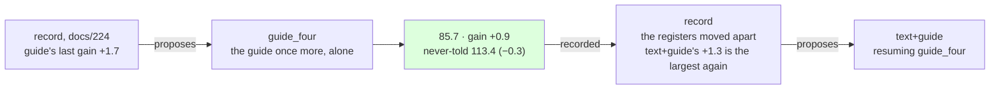

# 225 · The guide told a fourth time — the record's fifth proposal, followed

In Phient's world, a word (w) is a seed: what it relates to, under what conditions (c), grows from it. The Phical paradigm, X ⇒ Y, drives and composes Phient's Phasor Language Models: Phinet, Phiano, PhiTon. Phical stores no point: a word is 32–64 relations, each a complex phasor on a closed circle; meaning is a side effect of pairs of words moving under a condition, and they move by the error of what was expected — toward what came, away from what did not.

docs/224 followed the record's fourth proposal and the record then proposed `guide` alone (+1.7 last, docs/221), resuming `tatoeba7_guide2`. This is that proposal followed: the guide's 18,446 training sentences once more, no new text, eight epochs asked for on top of `tatoeba7_guide2.ckpt`. 790,893 lines in all; the vocabulary unchanged at 48,947, since the guide names nothing the learner has not heard. The run recorded itself (`--record guide_four,guide,225`) and scored the never-told set.

## What it scored

| epoch | error (train) | dev top-1 | dev perplexity | minutes |
|---|---|---|---|---|
| told once (online) | — | 22.1% | 89.6 | 1 |
| 1 | 2.493 | 22.1% | 88.5 | 25 |
| 2 | 2.488 | 22.2% | 88.6 | 25 |
| 3 | 2.485 | 22.2% | 88.4 | 26 |
| 4 | 2.482 | 22.2% | 88.6 | 24 |
| 5 | 2.478 | 22.1% | 88.8 | 24 |

Stopped by its own rule after the fifth epoch, the third the best - the third run in a row to do so. Two hours over 790,893 lines on a quiet machine.

| on the guide's held-out test | top-1 | top-5 | perplexity |
|---|---|---|---|
| Witten–Bell trigram, the guide alone (docs/203) — the bar | 24.8% | 45.9% | 84.7 |
| the learner, the guide alone (docs/203) | 21.3% | 40.9% | 101.2 |
| the learner, the guide a third time (docs/221) | 22.3% | 43.7% | 89.2 |
| the learner, + Tatoeba 7, the guide twice beside it (docs/224) | 22.6% | 44.1% | 86.6 |
| **the learner, the guide a fourth time** | 22.6% | **44.3%** | **85.7** |

| checkpoint | never-told Tatoeba (docs/217) |
|---|---|
| tatoeba6 | 22.0% · 42.8% · 113.7 |
| tatoeba7_guide2 | 22.0% · 42.8% · 113.1 |
| guide_four | 22.1% · 42.9% · 113.4 |

Read, straight:

- **One point from the bar.** 85.7 against the trigram's 84.7, from 16.5 points when 2026-11-07 began; top-5 44.3 against 45.9. Top-1 is still 2.2 points under it, and has not moved: 22.6% in docs/222, 223, 224 and here, through 300,000 lines of three levers. Perplexity and top-5 move, so the learner is surer of the words it already ranks first and ranks more right words in its five; the first choice does not change.
- **Apart, as docs/224 said it would be.** −0.3 on the never-told beside +0.9 on the guide's: the guide alone pays the guide's register and costs the other a little, as docs/221 did (−0.5 beside +1.7). The three levers now have three signatures over two registers each: `text` alone moves them apart one way (docs/223), `guide` alone the other (docs/221, here), `text+guide` together every time (docs/222, 224). The record's line names each.
- **The guide lever halves too.** Its gains run 15.3, 1.7, 0.9 - each telling of the guide buys half what the last did, as each 80,000 sentences beside it does (6.4, 2.6, 4.4, 1.9, 1.3). Every lever the record has is paying less each pull, and the flat top-1 says why: at 64 channels over 49 thousand words, more lines of either register sharpen the ranking the learner has and do not change it. docs/209's hypothesis again, two instalments past where docs/210 placed the widening.
- **The record cannot propose widen.** Its rule names the lever whose last application paid most; a lever it has never recorded shows +0.0 and never wins. docs/210 widened `tatoeba1` before the record existed, and that run stopped before its new channels had moved - born at a thousandth of a fresh learner's quiet, they had not turned the dev register in two epochs - so the widening has never been measured at all, and `widen` has no instalment; nor do `forget` and `epochs`. The record's sixth proposal is `text+guide` again, resuming `guide_four` (+1.3 last), and it is followed - but the rule has a hole: the untried are never tried. Either each lever is pulled once before the rule is trusted, or the writer supplies the first instalment of each by hand. Widen at 49 thousand words is the first of those, and it comes after this run.
- **Three runs at five of eight.** The online pass and the first epoch do the work, the guide's dev set is then flat within half a point, and the rule stops. For a `guide` run the dev register is the right one and the rule is sound; it is the `text` runs it misjudges (docs/223).
- **What it says**: *i have been waiting* → "for the last time i saw tom", Tatoeba's protagonist in the guide's clause; *she has been working* → nothing, where docs/222 to 224 said "hard"; *when do we use the present perfect* → "continuous"; *the man who lives next door* → "to me"; *i wish i* → "could have done that"; *we are going to* → "be"; *if i had known* → nothing.

## Status

2026-11-08, 17:50. `guide_four.ckpt` (790,893 lines, 48,947 words, 64 channels) is the newest learner and the best on the guide's register; `tatoeba7_guide2.ckpt` stays the best on the never-told (113.1 against 113.4). Recorded in `data/curriculum/instalments.tsv` by the run. The record's proposal, `text+guide` on `guide_four`, is running as `tatoeba8_guide2`: an eighth disjoint 80,000 Tatoeba sentences (`sample80k_8.txt`, seed 8), the guide twice beside them, eight epochs asked for (docs/226, records itself). Then widen to 128 channels, by hand, as the record's first `widen` instalment; `--forget` beside new text; a stop rule that reads the register the lever moves.
