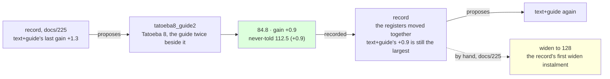

# 226 · Tatoeba eight, the guide twice beside it — a tenth from the bar

In Phient's world, a word (w) is a seed: what it relates to, under what conditions (c), grows from it. The Phical paradigm, X ⇒ Y, drives and composes Phient's Phasor Language Models: Phinet, Phiano, PhiTon. Phical stores no point: a word is 32–64 relations, each a complex phasor on a closed circle; meaning is a side effect of pairs of words moving under a condition, and they move by the error of what was expected — toward what came, away from what did not.

docs/225 followed the record's fifth proposal and the record then proposed `text+guide` again (+1.3 last, docs/224), resuming `guide_four`. This is that proposal followed: an eighth disjoint 80,000 Tatoeba sentences (`sample80k_8.txt`, 571,927 words, seed 8 from the sentences in no earlier sample nor the held-out set), the guide's 18,446 training sentences told twice beside them, eight epochs asked for on top of `guide_four.ckpt`. 116,892 new lines, 907,785 in all; the vocabulary 48,947 → 50,619, since Tatoeba 8 named 1,672 words nothing before it had. The run recorded itself (`--record tatoeba8_guide2,text+guide,226`) and scored the never-told set.

## What it scored

| epoch | error (train) | dev top-1 | dev perplexity | minutes |
|---|---|---|---|---|
| told once (online) | — | 21.1% | 94.6 | 4 |
| 1 | 2.500 | 22.2% | 87.9 | 42 |
| 2 | 2.493 | 22.3% | 87.7 | 104 |
| 3 | 2.489 | 22.4% | 87.7 | 28 |
| 4 | 2.485 | 22.3% | 87.6 | 24 |
| 5 | 2.481 | 22.4% | 87.7 | 28 |
| 6 | 2.478 | 22.3% | 87.7 | 48 |

Stopped by its own rule after the sixth epoch, the fourth the best - one more than the three runs before it. Four hours and a half in all over 907,785 lines; the second and sixth epochs ran beside other sessions' builds, the quiet ones took 24 to 28 minutes.

| on the guide's held-out test | top-1 | top-5 | perplexity |
|---|---|---|---|
| Witten–Bell trigram, the guide alone (docs/203) — the bar | 24.8% | 45.9% | 84.7 |
| the learner, the guide alone (docs/203) | 21.3% | 40.9% | 101.2 |
| the learner, + Tatoeba 7, the guide twice beside it (docs/224) | 22.6% | 44.1% | 86.6 |
| the learner, the guide a fourth time (docs/225) | 22.6% | 44.3% | 85.7 |
| **the learner, + Tatoeba 8, the guide twice beside it** | **22.9%** | **44.5%** | **84.8** |

| checkpoint | never-told Tatoeba (docs/217) |
|---|---|
| tatoeba7_guide2 | 22.0% · 42.8% · 113.1 |
| guide_four | 22.1% · 42.9% · 113.4 |
| **tatoeba8_guide2** | **22.0% · 42.8% · 112.5** |

Read, straight:

- **A tenth from the bar.** 84.8 against the trigram's 84.7, from 16.5 points under it when 2026-11-07 began and 101.2 at docs/203. The bar is the best of counting on the guide alone; the learner has reached it on perplexity by being told the guide beside 640,000 sentences of another register, and is still 1.9 points under it on top-1 and 1.4 on top-5.
- **Top-1 moved.** 22.9% after four instalments at 22.6% (docs/222 to 225): the first choice changed for the first time since the morning, and top-5 with it. docs/225 read the flat top-1 as 64 channels having nothing more to give; this run says the lever still moves it, by three tenths. The question is open, not answered, and widen is the run that answers it.
- **Together, the fifth time of five.** The record's line: "`tatoeba8_guide2` moved the never-told register with the guide's (+0.9 beside +0.9)". `text+guide` has never moved them apart; its gains run 6.4, 2.6, 4.4, 1.9, 1.3, 0.9 on the guide's register, each pull about two thirds of the last now, and the never-told register has fallen on every pull but one.
- **Six of eight.** The best epoch was the fourth and the dev register sat within three tenths from the first epoch on; the rule stopped it two later. The same pattern as the three runs before: the online pass and the first epoch do the work.
- **The record proposes `text+guide` again**, +0.9 being still the largest last gain it has. It is not followed first. docs/225 found the hole in the rule - a lever the record has never measured shows +0.0 and is never proposed - and said widen would come after this run by hand, as the record's first `widen` instalment. That is next: `tatoeba8_guide2` widened to 128 channels, the guide told once at the new width, and the stop rule given the patience docs/210 said channels born quiet need. Then the record has a `widen` row, and its rule can weigh it.
- **What it says**: *i have been waiting* → "for the bus"; *she has been working* → "hard", back from docs/225's silence; *i wish i* → "could do that"; *when do we use the present perfect* → "continuous"; *the man who lives next door* → "to me"; *we are going to* → "be"; *if i had known* → nothing.

## Status

2026-11-08, 22:35. `tatoeba8_guide2.ckpt` (907,785 lines, 50,619 words, 64 channels) is the newest learner and the best on both registers; recorded in `data/curriculum/instalments.tsv` by the run. Next, by hand: `--widen 128` on it with `--patience 4`, the guide once, eight epochs, recorded as `widen128,widen,227`. Then the record's proposal; `--forget` beside new text; a stop rule that reads the register the lever moves.
