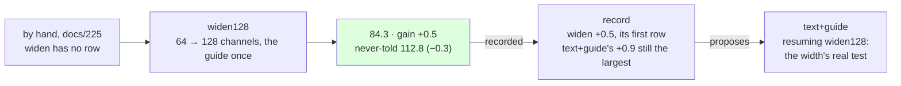

# 227 · Widened to 128 — the record's first widen instalment, by hand

In Phient's world, a word (w) is a seed: what it relates to, under what conditions (c), grows from it. The Phical paradigm, X ⇒ Y, drives and composes Phient's Phasor Language Models: Phinet, Phiano, PhiTon. Phical stores no point: a word is 32–64 relations, each a complex phasor on a closed circle; meaning is a side effect of pairs of words moving under a condition, and they move by the error of what was expected — toward what came, away from what did not.

docs/225 found the hole in the record's rule: a lever it has never measured shows +0.0 and is never proposed, and `widen` was one - docs/210's widening stopped before its new channels had moved. docs/226 said the writer would supply the first instalment by hand after `tatoeba8_guide2`, and this is it: `tatoeba8_guide2.ckpt` (907,785 lines, 50,619 words, 64 channels) widened to 128 by `Learner::widen` - the old channels kept bit for bit, the new born at a thousandth of a fresh learner's quiet (docs/210) - then the guide's 18,446 training sentences told once at the new width, eight epochs asked for, with the stop given a patience of four instead of two (`--patience`, new this run, the default unchanged). 926,231 lines in all. The run recorded itself (`--record widen128,widen,227`) and scored the never-told set.

## What it scored

| epoch | error (train) | dev top-1 | dev perplexity | minutes |
|---|---|---|---|---|
| told once (online) | — | 22.0% | 89.2 | 2 |
| 1 | 2.481 | 22.5% | 87.1 | 22 |
| 2 | 2.477 | 22.2% | 87.2 | 28 |
| 3 | 2.474 | 22.4% | 87.3 | 24 |
| 4 | 2.471 | 22.4% | 87.0 | 25 |
| 5 | 2.468 | 22.5% | 87.2 | 30 |
| 6 | 2.465 | 22.3% | 87.1 | 44 |
| 7 | 2.462 | 22.4% | 87.3 | 42 |
| 8 | 2.460 | 22.4% | 87.1 | 51 |

All eight epochs, the fourth the best; four and a half hours, the last three epochs beside other sessions' builds. Under the old patience of two it would have stopped after the third with the first epoch's 87.1; the patience of four found 87.0, a tenth.

| on the guide's held-out test | top-1 | top-5 | perplexity |
|---|---|---|---|
| Witten–Bell trigram, the guide alone (docs/203) — the bar | 24.8% | 45.9% | 84.7 |
| the learner, the guide alone (docs/203) | 21.3% | 40.9% | 101.2 |
| the learner, the guide a fourth time (docs/225) | 22.6% | 44.3% | 85.7 |
| the learner, + Tatoeba 8, the guide twice beside it (docs/226) | 22.9% | 44.5% | 84.8 |
| **the learner, widened to 128, the guide once** | 22.9% | 44.5% | **84.3** |

| checkpoint | never-told Tatoeba (docs/217) |
|---|---|
| guide_four | 22.1% · 42.9% · 113.4 |
| tatoeba8_guide2 | 22.0% · 42.8% · 112.5 |
| widen128 | 22.1% · 43.0% · 112.8 |

Read, straight:

- **Under the bar.** 84.3 against the trigram's 84.7: the first learner under the best of counting on the guide's own test, from 101.2 at docs/203 and 16.5 points over the bar when 2026-11-07 began. On perplexity only - top-1 and top-5 did not move from docs/226's 22.9% and 44.5%.
- **What the width bought, so far, a guide pass would have.** `guide` alone at 64 channels paid 0.9 on its last pull (docs/225) and the lever halves, so about half that was due from the next; the widening with a guide pass paid 0.5. The record's new `widen` row cannot yet be told from a `guide` row. The new channels were born quiet by design, and the dev register was flat from the first epoch (87.1, 87.2, 87.3, 87.0, 87.2, 87.1, 87.3, 87.1) while the train error fell through all eight, 2.481 → 2.460, under any 64-channel run's (2.478 at docs/226): the width fits the guide's lines better without predicting the guide's test better. More capacity over the same text is fit, not foresight.
- **Apart, as every guide-alone pull.** −0.3 on the never-told beside +0.5 on the guide's, the signature of docs/221 and docs/225: that is the guide's lines, not the width. The width's own signature is not visible yet.
- **The test of the width is new text at 128.** docs/209's hypothesis was that 64 channels over the vocabulary is the constraint, not the text; this run neither confirms nor refutes it, since it added no text. The record proposes `text+guide` again, resuming `widen128` (+0.9 last, at 64 channels), and that is the measurement: if the ninth 80,000 sentences with the guide beside them pay more at 128 than the 0.9 they paid at 64 - or more than the 0.6 the halving predicts - the width was the constraint; if about 0.6, it was not, and the lines are. Followed, with the default patience of two so the pull is comparable with the lever's six before it.
- **The cost.** The checkpoint went from 115 to 193 MB. The quiet epochs took 22 to 30 minutes over 926,231 lines against 24 to 28 at 64 channels over 907,785: the epoch's time hardly moved with the channels doubled, so the lines, not the width, are the cost of a run.
- **What it says**: *i have been waiting* → "for you", as in docs/222 and 223; *she has been working* → "hard"; *i wish i* → "could have done that"; *when do we use the present perfect* → "continuous"; *the man who lives next door* → "to me"; *we are going to* → "be"; *if i had known* → nothing.

## Status

2026-11-09, 03:15. `widen128.ckpt` (926,231 lines, 50,619 words, 128 channels) is the newest learner and the best on the guide's register, under the bar; `tatoeba8_guide2.ckpt` stays the best on the never-told (112.5 against 112.8). Recorded in `data/curriculum/instalments.tsv` by the run: the `widen` lever has a row, `forget` and `epochs` still have none. The record's proposal, `text+guide` on `widen128`, is running as `tatoeba9_guide2`: a ninth disjoint 80,000 Tatoeba sentences (`sample80k_9.txt`, seed 9), the guide twice beside them, eight epochs, patience two (docs/228, records itself). Left: `--forget` beside new text, the record's other untried lever; a stop rule that reads the register the lever moves.
