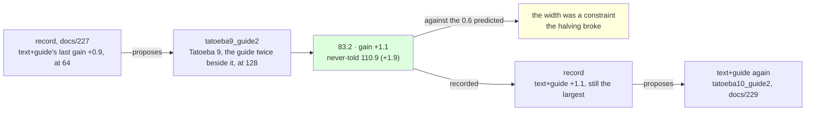

# 228 · Tatoeba nine at 128 — the width's test

In Phient's world, a word (w) is a seed: what it relates to, under what conditions (c), grows from it. The Phical paradigm, X ⇒ Y, drives and composes Phient's Phasor Language Models: Phinet, Phiano, PhiTon. Phical stores no point: a word is 32–64 relations, each a complex phasor on a closed circle; meaning is a side effect of pairs of words moving under a condition, and they move by the error of what was expected — toward what came, away from what did not.

docs/227 widened the learner to 128 channels and found that the widening alone paid what a guide pass would have: the test of the width was new text at the new width. The record proposed exactly that, `text+guide` resuming `widen128`, and this is that proposal followed: a ninth disjoint 80,000 Tatoeba sentences (`sample80k_9.txt`, 571,249 words, seed 9 from the sentences in no earlier sample nor the held-out set), the guide's 18,446 training sentences told twice beside them, eight epochs asked for on top of `widen128.ckpt`, patience two so the pull compares with the lever's six before it. 116,891 new lines, 1,043,122 in all; the vocabulary 50,619 → 52,084, since Tatoeba 9 named 1,465 words nothing before it had. The run recorded itself (`--record tatoeba9_guide2,text+guide,228`) and scored the never-told set.

The prediction, from docs/227: the same lever paid 0.9 at 64 channels (docs/226) and every lever has halved per pull, so about 0.6 was due; more than that and the width was the constraint, about that and the lines are.

## What it scored

| epoch | error (train) | dev top-1 | dev perplexity | minutes |
|---|---|---|---|---|
| told once (online) | — | 21.0% | 93.4 | 7 |
| 1 | 2.484 | 22.5% | 86.6 | 51 |
| 2 | 2.479 | 22.7% | 86.5 | 51 |
| 3 | 2.474 | 22.3% | 86.6 | 51 |
| 4 | 2.470 | 22.4% | 86.4 | 51 |
| 5 | 2.467 | 22.5% | 86.3 | 51 |
| 6 | 2.464 | 22.6% | 86.0 | 53 |
| 7 | 2.461 | 22.4% | 86.4 | 50 |
| 8 | 2.458 | 22.8% | 86.0 | 52 |

All eight epochs, the sixth and the eighth the best - the first run since docs/222 that the stop rule did not end early (docs/223 to 226 stopped at five or six of eight). Seven hours in all, no other session building: every epoch took 50 to 53 minutes over 1,043,122 lines, against 24 to 28 at 64 channels over 907,785 (docs/226).

| on the guide's held-out test | top-1 | top-5 | perplexity |
|---|---|---|---|
| Witten–Bell trigram, the guide alone (docs/203) — the bar | 24.8% | 45.9% | 84.7 |
| the learner, the guide alone (docs/203) | 21.3% | 40.9% | 101.2 |
| the learner, + Tatoeba 8, the guide twice beside it, 64 channels (docs/226) | 22.9% | 44.5% | 84.8 |
| the learner, widened to 128, the guide once (docs/227) | 22.9% | 44.5% | 84.3 |
| **the learner, + Tatoeba 9, the guide twice beside it, 128 channels** | **23.2%** | **44.8%** | **83.2** |

| checkpoint | never-told Tatoeba (docs/217) |
|---|---|
| tatoeba8_guide2 | 22.0% · 42.8% · 112.5 |
| widen128 | 22.1% · 43.0% · 112.8 |
| **tatoeba9_guide2** | **22.2% · 43.2% · 110.9** |

Read, straight:

- **The width was a constraint.** The lever paid 1.1 where it had paid 0.9 at 64 channels and the halving predicted 0.6: the first pull in four to pay more than the one before it (6.4, 2.6, 4.4, 1.9, 1.3, 0.9, 1.1). The widening itself (docs/227) could not be told from a guide pass; the width's signature is here, in what new text does at it. Whether 128 is now the constraint, or the lines are, is the next pull's to say: if it halves from 1.1, about 0.7 is due.
- **Together, the sixth time of six, and the largest never-told gain since docs/222.** +1.9 on the never-told beside +1.1 on the guide's; the never-told register had moved by tenths for five instalments (+0.6, −0.3, +0.9, −0.3) and here by nearly two points. The width bought more on the register it was not told than on the one it was: 64 channels over 50 thousand words were holding back the general register most.
- **1.5 under the bar.** 83.2 against the trigram's 84.7 on perplexity; still 1.6 under it on top-1 (23.2% against 24.8%) and 1.1 on top-5 (44.8% against 45.9%). Top-1 moved by three tenths for the second instalment running.
- **Eight of eight, and still moving.** The dev register fell 86.6 → 86.0 across the epochs, 0.6 of the run's gain, where the 64-channel runs of docs/223 to 226 had it flat within three tenths from the first epoch and were stopped at five or six. The train error fell 2.484 → 2.458. At 64 channels the online pass and the first epoch did the work; at 128 the epochs still do some.
- **The cost doubled with the channels, over new text.** 50 to 53 minutes an epoch against 24 to 28 at 64, with no other session on the machine, and the checkpoint 193 → 202 MB. docs/227's epochs at 128 took 22 to 30 minutes over the guide's lines alone, so it is the new text's words at 128 that cost: a `text+guide` instalment at this width is seven hours, not four and a half.
- **A correction to docs/225–227.** They said `forget` and `epochs` have no row in the record. They have one each, at +0.0: eight more epochs over the same lines (docs/213, `guide_twice_2`) and the stride scaled over the same lines (docs/215, `forget01`), as docs/220's table showed. The hole in the record's rule stands in a truer form: a lever whose one pull paid nothing is never proposed again, however the circumstances change - and `forget` was pulled where nothing new was told. `--forget` beside new text is still the untried use of it.
- **The record proposes `text+guide` again**, +1.1 being the largest last gain it has, resuming `tatoeba9_guide2`. Followed.
- **What it says**: *i have been waiting* → "for you", as since docs/222; *she has been working* → "hard"; *i wish i* → "could"; *when do we use the present perfect* → "continuous"; *the man who lives next door* → "to me"; *we are going to* → "be here"; *if i had known* → nothing.

## Status

2026-11-09, 10:30. `tatoeba9_guide2.ckpt` (1,043,122 lines, 52,084 words, 128 channels) is the newest learner and the best on both registers, 1.5 under the bar on the guide's; recorded in `data/curriculum/instalments.tsv` by the run, `held` included. The record's proposal, `text+guide` on `tatoeba9_guide2`, is running as `tatoeba10_guide2`: a tenth disjoint 80,000 Tatoeba sentences (`sample80k_10.txt`, seed 10), the guide twice beside them, eight epochs, patience two (docs/229, records itself) - whether the halving resumes from 1.1 at the new width. Left: `--forget` beside new text, by hand; a stop rule that reads the register the lever moves.
