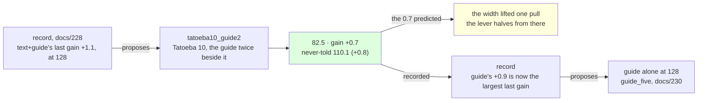

# 229 · Tatoeba ten at 128 — the halving resumes

In Phient's world, a word (w) is a seed: what it relates to, under what conditions (c), grows from it. The Phical paradigm, X ⇒ Y, drives and composes Phient's Phasor Language Models: Phinet, Phiano, PhiTon. Phical stores no point: a word is 32–64 relations, each a complex phasor on a closed circle; meaning is a side effect of pairs of words moving under a condition, and they move by the error of what was expected — toward what came, away from what did not.

docs/228 found the width was a constraint: new text at 128 channels paid 1.1 where it had paid 0.9 at 64 and the halving predicted 0.6. The record proposed `text+guide` again, resuming `tatoeba9_guide2`, and docs/228 said about 0.7 was due if the lever halves from 1.1 at the new width. This is that proposal followed: a tenth disjoint 80,000 Tatoeba sentences (`sample80k_10.txt`, 571,196 words, seed 10 from the sentences in no earlier sample nor the held-out set), the guide's 18,446 training sentences told twice beside them, eight epochs asked for, patience two. 116,892 new lines, 1,160,014 in all; the vocabulary 52,084 → 53,518, since Tatoeba 10 named 1,434 words nothing before it had. The run recorded itself (`--record tatoeba10_guide2,text+guide,229`) and scored the never-told set.

## What it scored

| epoch | error (train) | dev top-1 | dev perplexity | minutes |
|---|---|---|---|---|
| told once (online) | — | 21.5% | 91.3 | 6 |
| 1 | 2.468 | 22.6% | 85.6 | 59 |
| 2 | 2.463 | 22.6% | 85.8 | 59 |
| 3 | 2.459 | 22.6% | 85.4 | 57 |
| 4 | 2.455 | 22.3% | 85.6 | 57 |
| 5 | 2.451 | 22.6% | 85.1 | 58 |
| 6 | 2.449 | 22.7% | 85.4 | 58 |
| 7 | 2.445 | 22.5% | 85.3 | 59 |

Stopped by its own rule after the seventh epoch, the fifth the best. Seven hours on a quiet machine: 57 to 59 minutes an epoch over 1,160,014 lines, against 50 to 53 over 1,043,122 in docs/228.

| on the guide's held-out test | top-1 | top-5 | perplexity |
|---|---|---|---|
| Witten–Bell trigram, the guide alone (docs/203) — the bar | 24.8% | 45.9% | 84.7 |
| the learner, the guide alone (docs/203) | 21.3% | 40.9% | 101.2 |
| the learner, + Tatoeba 8, the guide twice beside it, 64 channels (docs/226) | 22.9% | 44.5% | 84.8 |
| the learner, + Tatoeba 9, the guide twice beside it, 128 channels (docs/228) | 23.2% | 44.8% | 83.2 |
| **the learner, + Tatoeba 10, the guide twice beside it, 128 channels** | 23.2% | **45.1%** | **82.5** |

| checkpoint | never-told Tatoeba (docs/217) |
|---|---|
| widen128 | 22.1% · 43.0% · 112.8 |
| tatoeba9_guide2 | 22.2% · 43.2% · 110.9 |
| **tatoeba10_guide2** | **22.4%** · 43.1% · **110.1** |

Read, straight:

- **The halving resumed, at the predicted 0.7.** The lever's gains on the guide's register: 6.4, 2.6, 4.4, 1.9, 1.3, 0.9, 1.1, 0.7. The widening lifted one pull by a fifth over the pull before it and the lever then halves from the lifted value: a wider learner is the same curve with one more pull in it, not a different curve. At 128, the lines are the constraint again - the next 80,000 are due about 0.4 - until another widening, which the record can now weigh, since `widen` has a measured row.
- **Together, the seventh time of seven.** +0.8 on the never-told beside +0.7 on the guide's. `text+guide` has never moved the registers apart; after docs/228's +1.9 the never-told register is back to moving by under a point, as the guide's does.
- **2.2 under the bar, and top-5 within a point.** 82.5 against the trigram's 84.7 on perplexity; top-5 45.1% against 45.9%, the closest yet, 0.8 under; top-1 stayed at 23.2%, 1.6 under. Top-1 has moved three tenths twice in six instalments and not otherwise.
- **Seven of eight.** The online pass and the first epoch did most of it, 91.3 → 85.6, and the dev register then moved half a point in seven epochs, as docs/228's did in eight; the stop rule ended it one epoch short where docs/228's ran all eight. At 128 channels the epochs do some work; at 64 they did almost none.
- **The cost climbs with the lines.** 57 to 59 minutes an epoch against 50 to 53 in docs/228 and 24 to 28 at 64 channels: every `text+guide` instalment is longer than the last, since an epoch is a pass over everything told, and at 128 channels each line costs about twice. The checkpoint 202 → 211 MB. Seven hours a run, for 0.7.
- **The record proposes `guide` alone**, resuming `tatoeba10_guide2`: `text+guide`'s 0.7 fell under `guide`'s last 0.9 (docs/225, at 64 channels), the first time since docs/224 that the proposal changed lever on its own. It is the guide lever's width test, as docs/228 was `text+guide`'s: the guide's series at 64 ran 15.3, 1.7, 0.9, so about 0.5 is due if it halves, and more if 128 lifts it as it lifted `text+guide`. Followed as `guide_five` (docs/230).
- **What it says**: *i wish i* → "could have done that", back from docs/228's bare "could"; *i have been waiting* → "for you"; *she has been working* → "hard"; *when do we use the present perfect* → "continuous"; *the man who lives next door* → "to me"; *we are going to* → "be here"; *if i had known* → nothing.

## Status

2026-11-09, 17:30. `tatoeba10_guide2.ckpt` (1,160,014 lines, 53,518 words, 128 channels) is the newest learner and the best on both registers, 2.2 under the bar on the guide's; recorded in `data/curriculum/instalments.tsv` by the run, `held` included. The record's proposal, `guide` alone on `tatoeba10_guide2`, is running as `guide_five`: the guide's training sentences once more at 128 channels, eight epochs asked for, patience two (docs/230, records itself) - the guide lever's width test. Left: `--forget` beside new text, by hand; a stop rule that reads the register the lever moves.
