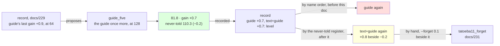

# 230 · The guide a fifth time, at 128 — and a tie broken by name

In Phient's world, a word (w) is a seed: what it relates to, under what conditions (c), grows from it. The Phical paradigm, X ⇒ Y, drives and composes Phient's Phasor Language Models: Phinet, Phiano, PhiTon. Phical stores no point: a word is 32–64 relations, each a complex phasor on a closed circle; meaning is a side effect of pairs of words moving under a condition, and they move by the error of what was expected — toward what came, away from what did not.

docs/229's record proposed `guide` alone, since `text+guide`'s 0.7 had fallen under the guide lever's last 0.9 (docs/225, at 64 channels). This is that proposal followed, and the guide lever's width test: `tatoeba10_guide2.ckpt` (1,160,014 lines, 53,518 words, 128 channels) told the guide's 18,446 training sentences once more, eight epochs asked for, patience two. 1,178,460 lines in all. The run recorded itself (`--record guide_five,guide,230`) and scored the never-told set. The prediction: the guide's series at 64 ran 15.3, 1.7, 0.9, so about 0.5 was due if it halves, more if 128 lifts it as it lifted `text+guide` (0.9 → 1.1, docs/228).

## What it scored

| epoch | error (train) | dev top-1 | dev perplexity | minutes |
|---|---|---|---|---|
| told once (online) | — | 22.7% | 87.1 | 1 |
| 1 | 2.446 | 22.6% | 84.9 | 59 |
| 2 | 2.442 | 22.8% | 85.0 | 59 |
| 3 | 2.439 | 22.6% | 84.6 | 58 |
| 4 | 2.436 | 22.6% | 84.5 | 50 |
| 5 | 2.432 | 22.7% | 84.5 | 51 |
| 6 | 2.430 | 22.8% | 84.5 | 50 |

Stopped by its own rule after the sixth epoch, the fourth the best, the fifth and sixth level with it: the rule counts a level epoch as no gain. Five and a half hours.

| on the guide's held-out test | top-1 | top-5 | perplexity |
|---|---|---|---|
| Witten–Bell trigram, the guide alone (docs/203) — the bar | 24.8% | 45.9% | 84.7 |
| the learner, the guide alone (docs/203) | 21.3% | 40.9% | 101.2 |
| the learner, the guide a fourth time, 64 channels (docs/225) | 22.6% | 44.3% | 85.7 |
| the learner, + Tatoeba 10, the guide twice beside it, 128 channels (docs/229) | 23.2% | 45.1% | 82.5 |
| **the learner, the guide a fifth time, 128 channels** | **23.5%** | 45.1% | **81.8** |

| checkpoint | never-told Tatoeba (docs/217) |
|---|---|
| tatoeba9_guide2 | 22.2% · 43.2% · 110.9 |
| tatoeba10_guide2 | 22.4% · 43.1% · 110.1 |
| guide_five | 22.4% · 43.4% · 110.3 |

Read, straight:

- **The width lifted the guide lever too.** 0.7 where 0.5 was due and 0.9 was the last pull at 64: the series 15.3, 1.7, 0.9, 0.7 - more than half the last, less than the last. For `text+guide` the lift was over the last pull itself (0.9 → 1.1, docs/228); for `guide` it is over the halving only. The two levers now stand level at 0.7 at 128 channels.
- **Top-1 moved, for the third time by three tenths.** 23.5%, 1.3 under the bar's 24.8%, from 22.6% at docs/225. Top-5 did not move from 45.1%. Perplexity 81.8, 2.9 under the bar.
- **Apart, the fifth time of five for the guide alone.** −0.2 on the never-told beside +0.7 on the guide's: the guide's lines pay on the guide's register and cost the other, at 128 as at 64 (docs/221, 225, 227). `tatoeba10_guide2` stays the best on the never-told.
- **A tie broken by name.** With both levers at +0.7, the record proposed `guide` again. The proposer sorted the levers by their last gain and the levers were listed by name, `guide` before `text+guide`, so a level pair was ordered by the alphabet - a rule nobody wrote and the record never said. Fixed in `curriculum.rs`: gains are compared at a tenth, the record's resolution and what the table shows, and a level pair is ordered by the never-told register, the lever whose last pull moved both registers first; the proposal says when it did that. Read again, the record proposes `text+guide`, "level with `guide` there and ahead of it on the never-told register (+0.8 beside −0.2)". A 24-second rebuild.
- **docs/228's reading of the cost is withdrawn.** It said the new text's words at 128 were what cost, since docs/227's epochs over the guide's lines alone took 22 to 30 minutes. This run's epochs over the guide's lines alone took 50 to 59 - the same as docs/229's over new text - with 1,178,460 lines told against docs/227's 926,231, which does not account for a doubling. An epoch at 128 channels costs about an hour whatever the lever; docs/227's were the odd ones, and why the log cannot tell. The step from 59 to 50 minutes at the fourth epoch reads like another session's load ending.
- **The proposal is followed with the untried lever beside it.** `text+guide` on `guide_five` is due about 0.4 if it halves from 0.7. The writer pulls it with `--forget 0.1` beside the new text - the stride scaled back so a sure learner takes real steps on new lines (docs/215), where `forget`'s one row was over the same lines and paid nothing - and records it as the `forget` lever's second row: `tatoeba11_forget` (docs/231). What it pays over 0.4 is forget's; a first reading, since a single run cannot be told from the lever's own variation.
- **What it says**: *if i had known* → "i wish i could have done that", the first time that prompt has gone on at all in this series; *i wish i* → "could have done that"; *we are going to* → "do that", from "be here"; *i have been waiting* → "for you"; *she has been working* → "hard"; *when do we use the present perfect* → "continuous"; *the man who lives next door* → "to me".

## Status

2026-11-09, 23:20. `guide_five.ckpt` (1,178,460 lines, 53,518 words, 128 channels) is the newest learner and the best on the guide's register, 2.9 under the bar; `tatoeba10_guide2.ckpt` stays the best on the never-told (110.1 against 110.3). Recorded in `data/curriculum/instalments.tsv` by the run, `held` included. The proposer's tie-break is fixed (this doc). Running: `tatoeba11_forget` - an eleventh disjoint 80,000 Tatoeba sentences (`sample80k_11.txt`, 571,827 words, seed 11), the guide twice beside them, `--forget 0.1`, eight epochs, patience two, recorded as `forget` (docs/231). Left: a stop rule that reads the register the lever moves.
