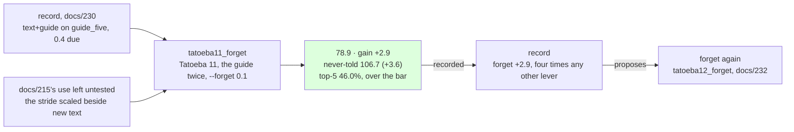

# 231 · Forget beside new text — the stride was the constraint

In Phient's world, a word (w) is a seed: what it relates to, under what conditions (c), grows from it. The Phical paradigm, X ⇒ Y, drives and composes Phient's Phasor Language Models: Phinet, Phiano, PhiTon. Phical stores no point: a word is 32–64 relations, each a complex phasor on a closed circle; meaning is a side effect of pairs of words moving under a condition, and they move by the error of what was expected — toward what came, away from what did not.

docs/215 scaled the Adagrad accumulators by a tenth over lines already told and found nothing: "the stride was not the constraint", and the learner "text-bound, not optimiser-bound". It left one use untested - "told something new, a learner whose accumulators were scaled meets it with a real step" - and every doc since docs/222 has carried it as the item left. This is that run. docs/230's record proposed `text+guide` on `guide_five` (1,178,460 lines, 53,518 words, 128 channels), due about 0.4 if the lever halves from 0.7; the writer pulled it with `--forget 0.1` beside the new text: an eleventh disjoint 80,000 Tatoeba sentences (`sample80k_11.txt`, 571,827 words, seed 11), the guide's 18,446 training sentences told twice beside them, the accumulators scaled by a tenth on resume, eight epochs asked for, patience two. 116,892 new lines, 1,295,352 in all; the vocabulary 53,518 → 54,872. Recorded as the `forget` lever's second row (`--record tatoeba11_forget,forget,231`), the never-told set scored.

## What it scored

| epoch | error (train) | dev top-1 | dev perplexity | minutes |
|---|---|---|---|---|
| told once (online) | — | 20.7% | 95.1 | 5 |
| 1 | 2.470 | 22.6% | 84.9 | 56 |
| 2 | 2.453 | 22.6% | 83.4 | 55 |
| 3 | 2.439 | 22.9% | 83.0 | 55 |
| 4 | 2.428 | 23.2% | 82.5 | 57 |
| 5 | 2.417 | 23.2% | 82.0 | 56 |
| 6 | 2.408 | 23.5% | 82.2 | 56 |
| 7 | 2.399 | 23.5% | 81.9 | 63 |
| 8 | 2.391 | 23.4% | 81.5 | 71 |

All eight epochs, the eighth the best, the stop rule never near. Seven hours and a half.

| on the guide's held-out test | top-1 | top-5 | perplexity |
|---|---|---|---|
| Witten–Bell trigram, the guide alone (docs/203) — the bar | 24.8% | 45.9% | 84.7 |
| the learner, the guide alone (docs/203) | 21.3% | 40.9% | 101.2 |
| the learner, the stride scaled over the same lines (docs/215) | 21.3% | 42.0% | 97.9 |
| the learner, the guide a fifth time, 128 channels (docs/230) | 23.5% | 45.1% | 81.8 |
| **the learner, + Tatoeba 11, the guide twice beside it, the stride scaled** | **24.2%** | **46.0%** | **78.9** |

| checkpoint | never-told Tatoeba (docs/217) |
|---|---|
| tatoeba10_guide2 | 22.4% · 43.1% · 110.1 |
| guide_five | 22.4% · 43.4% · 110.3 |
| **tatoeba11_forget** | **22.8% · 43.9% · 106.7** |

Read, straight:

- **2.9 where 0.4 was due.** The `forget` lever's two rows: +0.0 over the same lines (docs/215), +2.9 beside new ones. `text+guide` alone at 128 had paid 1.1 then 0.7 and was due about 0.4; with the stride scaled it paid seven times that, the largest gain of any instalment since docs/222's 4.4. docs/215's open use is answered: told something new, the learner with its accumulators scaled meets it with a real step, and the step is worth more than the lines.
- **Much of the halving was the stride.** Adagrad divides every step by the root of the squared gradients a row has seen; after 1.2 million lines that root is large and every step small, and scaling the sum by a tenth makes the steps about three times longer. `text+guide`'s gains ran 6.4, 2.6, 4.4, 1.9, 1.3, 0.9, 1.1, 0.7 - read since docs/222 as the lines paying less each time - and one scaling of the stride put the next at 2.9. docs/215's "text-bound, not optimiser-bound" held at 64 channels over 33 thousand words and lines already told; at 128 channels over 1.2 million lines and new ones, the learner was optimiser-bound.
- **Over the bar on top-5.** 46.0% against the trigram's 45.9%, the first of the three heads to pass the best of counting on the guide's own test; top-1 24.2% is 0.6 under the bar's 24.8%, from 1.3 under at docs/230; perplexity 78.9, 5.8 under. Top-1 moved seven tenths in one instalment, having moved three tenths at a time before.
- **Together, by the most since docs/222.** +3.6 on the never-told beside +2.9 on the guide's; 106.7, from 110.3. The stride was holding back both registers alike.
- **The epochs worked.** 84.9 → 81.5 across the eight, 3.4 within the epochs, where every run since docs/223 moved under a point there and was stopped at five to seven; the train error fell 2.470 → 2.391, eight hundredths in a run that used to fall two. The eighth epoch was the best, so the run was ended by its count, not its rule: `epochs` on this checkpoint might pay, where its one row (docs/213) paid nothing.
- **The record proposes `forget` again**, resuming `tatoeba11_forget`, +2.9 being four times any other lever's last gain. Followed as `tatoeba12_forget`: a twelfth disjoint sample, the guide twice, `--forget 0.1` again (docs/232). The question it asks is whether the lever halves too - 2.9 then about 1.5 - or whether a stride scaled at every instalment holds its gain. If it holds, the lever belongs inside the learner: an accumulator that forgets a little with every line, so no one has to say `--forget` by hand; that is phical's, and the learner's TODO carries it.
- **The cost.** 55 to 57 minutes an epoch for six, 63 and 71 for the last two (another session's load, probably; the log cannot tell); the checkpoint 212 → 220 MB.
- **What it says**, and now says more: *i wish i* → "had a lot of money", a new and apt continuation; *if i had known* → "i wish i could have been a long time"; *we are going to* → "be able to do that"; *when do we use the present perfect* → "continuous i have done"; *i have been waiting* → "for me", where it had said "for you" since docs/222; *she has been working* → "hard"; *the man who lives next door* → "to me". The learner goes further before it stops, and not always better.

## Status

2026-11-10, 07:15. `tatoeba11_forget.ckpt` (1,295,352 lines, 54,872 words, 128 channels) is the newest learner and the best on both registers by the widest margin since docs/222, over the bar on top-5; recorded in `data/curriculum/instalments.tsv` by the run, `held` included. The record's proposal, `forget` on `tatoeba11_forget`, is running as `tatoeba12_forget`: Tatoeba 12 (`sample80k_12.txt`, seed 12), the guide twice beside it, `--forget 0.1`, eight epochs, patience two (docs/232, records itself). Left: a stride that forgets by itself (phical); `epochs` on a scaled stride; a stop rule that reads the register the lever moves.
