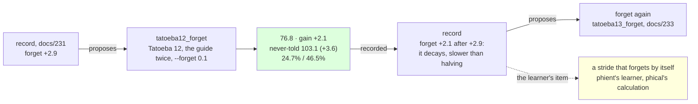

# 232 · Forget again — the lever decays, slower than halving

In Phient's world, a word (w) is a seed: what it relates to, under what conditions (c), grows from it. The Phical paradigm, X ⇒ Y, drives and composes Phient's Phasor Language Models: Phinet, Phiano, PhiTon. Phical stores no point: a word is 32–64 relations, each a complex phasor on a closed circle; meaning is a side effect of pairs of words moving under a condition, and they move by the error of what was expected — toward what came, away from what did not.

docs/231 found the stride was the constraint: the Adagrad accumulators scaled by a tenth beside new text paid 2.9 where the text alone was due 0.4. The record proposed `forget` again, and docs/231 asked whether the lever halves (2.9 then about 1.5) or a stride scaled at every instalment holds its gain. This is that proposal followed: `tatoeba11_forget.ckpt` (1,295,352 lines, 54,872 words, 128 channels) resumed with its accumulators scaled by a tenth again, a twelfth disjoint 80,000 Tatoeba sentences (`sample80k_12.txt`, 572,776 words, seed 12), the guide's 18,446 training sentences told twice beside them, eight epochs asked for, patience two. 116,892 new lines, 1,412,244 in all; the vocabulary 54,872 → 56,129. Recorded as the `forget` lever's third row (`--record tatoeba12_forget,forget,232`), the never-told set scored.

## What it scored

| epoch | error (train) | dev top-1 | dev perplexity | minutes |
|---|---|---|---|---|
| told once (online) | — | 20.7% | 97.4 | 6 |
| 1 | 2.429 | 23.5% | 82.1 | 75 |
| 2 | 2.398 | 23.4% | 81.1 | 77 |
| 3 | 2.375 | 23.9% | 80.8 | 108 |
| 4 | 2.358 | 23.8% | 80.8 | 73 |
| 5 | 2.345 | 24.0% | 80.1 | 150 |
| 6 | 2.333 | 23.9% | 80.2 | 246 |
| 7 | 2.324 | 23.9% | 80.8 | 184 |

Stopped by its own rule after the seventh epoch, the fifth the best. Fifteen hours: 73 to 77 minutes an epoch when the machine was quiet, 108 to 246 beside other sessions' builds, which the learner yields to at low priority.

| on the guide's held-out test | top-1 | top-5 | perplexity |
|---|---|---|---|
| Witten–Bell trigram, the guide alone (docs/203) — the bar | 24.8% | 45.9% | 84.7 |
| the learner, the guide alone (docs/203) | 21.3% | 40.9% | 101.2 |
| the learner, the guide a fifth time, 128 channels (docs/230) | 23.5% | 45.1% | 81.8 |
| the learner, + Tatoeba 11, the guide twice, the stride scaled (docs/231) | 24.2% | 46.0% | 78.9 |
| **the learner, + Tatoeba 12, the guide twice, the stride scaled again** | **24.7%** | **46.5%** | **76.8** |

| checkpoint | never-told Tatoeba (docs/217) |
|---|---|
| guide_five | 22.4% · 43.4% · 110.3 |
| tatoeba11_forget | 22.8% · 43.9% · 106.7 |
| **tatoeba12_forget** | **23.1% · 44.3% · 103.1** |

Read, straight:

- **It decays, slower than halving.** 2.1 after 2.9: seven tenths of the last, where every other lever has paid about half of its last and halving would have said 1.5. The `forget` series is 0.0 (over the same lines, docs/215), 2.9, 2.1. A stride scaled at every instalment does not hold its gain, but it loses it slower than the lines alone did, and it is still three times what any other lever last paid.
- **Both registers by 3.6, again.** The never-told register fell 106.7 → 103.1, the same 3.6 as docs/231, while the guide's gain fell from 2.9 to 2.1: the guide's register is the nearer to its floor. 103.1 is twenty points under the 123.5 the never-told register first read at docs/217, in nine instalments.
- **At the bar on top-1, over it on top-5.** 24.7% against the trigram's 24.8%; 46.5% against 45.9%; perplexity 76.8, 7.9 under the bar's 84.7. The bar is the best of counting on the guide alone: the learner is over it on two heads and a tenth under on the third, told the guide beside 960,000 sentences of another register.
- **Seven of eight, the epochs still working.** 82.1 → 80.1 within the epochs, 2.0 of the run's gain, against 3.4 in docs/231 and under a point in every run before it; the train error 2.429 → 2.324, a tenth in one run where runs before docs/231 fell two or three hundredths. The rule stopped it at seven, two after the fifth's 80.1.
- **The record proposes `forget` again**, +2.1 being three times any other lever's last gain. Followed as `tatoeba13_forget`: a thirteenth sample, the guide twice, `--forget 0.1` (docs/233). If it decays by seven tenths again, about 1.5 is due.
- **The learner's item is now concrete.** `forget` is a flag said by hand once per instalment (`phient/src/lineup/learner/forget.rs` scales every accumulator on resume). Two pulls say the stride should be kept short by the learner itself - an accumulator that forgets a little with every line told, so a tenth of it is left after about an instalment's worth - and then no run needs the flag and the sawtooth of a reset per instalment becomes a steady stride. That is the next change to the learner, in phient's learner with phical's calculation, tested by a run with no flag against this series.
- **What it says, less than docs/231.** *i have been waiting* → "for you", back; *we are going to* → "be a teacher", new; *when do we use the present perfect* → "continuous"; *the man who lives next door* → "to me"; *i wish i* → "could", from "had a lot of money"; *she has been working* → nothing, where it had said "hard" since docs/222; *if i had known* → nothing. The scores rose and the sayings shortened: the two measure different things, and the sayings are seven prompts.

## Status

2026-11-10, 22:40. `tatoeba12_forget.ckpt` (1,412,244 lines, 56,129 words, 128 channels) is the newest learner and the best on both registers, over the bar on top-5 and a tenth under it on top-1; recorded in `data/curriculum/instalments.tsv` by the run, `held` included. The record's proposal, `forget` on `tatoeba12_forget`, is running as `tatoeba13_forget`: Tatoeba 13 (`sample80k_13.txt`, seed 13), the guide twice beside it, `--forget 0.1`, eight epochs, patience two (docs/233, records itself), on a machine shared with other sessions' builds. Left: a stride that forgets by itself (phient's learner); `epochs` on a scaled stride; a stop rule that reads the register the lever moves.
