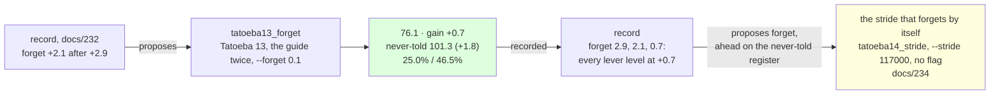

# 233 · Forget a third time — the lever falls to a third

In Phient's world, a word (w) is a seed: what it relates to, under what conditions (c), grows from it. The Phical paradigm, X ⇒ Y, drives and composes Phient's Phasor Language Models: Phinet, Phiano, PhiTon. Phical stores no point: a word is 32–64 relations, each a complex phasor on a closed circle; meaning is a side effect of pairs of words moving under a condition, and they move by the error of what was expected — toward what came, away from what did not.

docs/232 found `forget` paid 2.1 after 2.9, seven tenths of its last pull, and asked for a third. This is the record's proposal followed: `tatoeba12_forget.ckpt` (1,412,244 lines, 56,129 words, 128 channels) resumed with its accumulators scaled by a tenth a third time, a thirteenth disjoint 80,000 Tatoeba sentences (`sample80k_13.txt`, seed 13), the guide's 18,446 training sentences told twice beside them, eight epochs asked for, patience two. 116,892 new lines, 1,529,136 in all; the vocabulary 56,129 → 57,324. Recorded as the `forget` lever's fourth row (`--record tatoeba13_forget,forget,233`), the never-told set scored.

## What it scored

| epoch | error (train) | dev top-1 | dev perplexity | minutes |
|---|---|---|---|---|
| told once (online) | — | 20.8% | 97.9 | 17 |
| 1 | 2.385 | 24.2% | 80.3 | 98 |
| 2 | 2.346 | 24.2% | 79.8 | 84 |
| 3 | 2.323 | 24.3% | 79.5 | 83 |
| 4 | 2.308 | 24.6% | 79.6 | 84 |
| 5 | 2.296 | 23.9% | 80.3 | 366 |

Stopped by its own rule after the fifth epoch, the third the best. Twelve hours: 83 to 98 minutes an epoch when the machine was quiet, six hours for the fifth beside another session's build, which the learner yields to at low priority.

| on the guide's held-out test | top-1 | top-5 | perplexity |
|---|---|---|---|
| Witten–Bell trigram, the guide alone (docs/203) — the bar | 24.8% | 45.9% | 84.7 |
| the learner, the guide alone (docs/203) | 21.3% | 40.9% | 101.2 |
| the learner, + Tatoeba 11, the guide twice, the stride scaled (docs/231) | 24.2% | 46.0% | 78.9 |
| the learner, + Tatoeba 12, the stride scaled again (docs/232) | 24.7% | 46.5% | 76.8 |
| **the learner, + Tatoeba 13, the guide twice, the stride scaled a third time** | **25.0%** | **46.5%** | **76.1** |

| checkpoint | never-told Tatoeba (docs/217) |
|---|---|
| tatoeba11_forget | 22.8% · 43.9% · 106.7 |
| tatoeba12_forget | 23.1% · 44.3% · 103.1 |
| **tatoeba13_forget** | **23.1% · 44.4% · 101.3** |

Read, straight:

- **A third, not seven tenths.** 0.7 after 2.1 after 2.9: the lever fell by a third of its last where it had fallen by seven tenths. The `forget` series is 0.0 (over the same lines, docs/215), 2.9, 2.1, 0.7. The accumulators were the constraint for two instalments; scaled a third time beside the same amount of new text they pay what any other lever pays.
- **Every lever is level at 0.7.** `forget`, `text+guide` and `guide` each last paid 0.7 at a tenth; the record puts `forget` first by the never-told register (+1.8 beside `text+guide`'s +0.8) and says so, the tie-break of docs/230 doing its work. `widen` is at 0.5, `epochs` at 0.0, `text` alone at −0.6.
- **The never-told register halved.** 103.1 → 101.3, 1.8 after 3.6 and 3.6, where the guide's gain fell to a third: the register nearer its floor fell further, the other way round from docs/232. 101.3 is twenty-two points under the 123.5 the never-told register first read at docs/217, in ten instalments.
- **Over the bar on top-1 now.** 25.0% against the trigram's 24.8%; 46.5% against 45.9%; perplexity 76.1, 8.6 under the bar's 84.7. The learner is over the best of counting on the guide alone on all three heads, told the guide beside 1,040,000 sentences of another register.
- **Five of eight, the epochs working less.** 80.3 → 79.5 within the epochs, 0.8 of the run's gain, after 2.0 (docs/232) and 3.4 (docs/231); the train error 2.385 → 2.296, nine hundredths. The rule stopped it at five, two after the third's 79.5; the fourth had the best top-1, 24.6%, at a worse perplexity.
- **The record proposes `forget` again. Followed as the stride that forgets by itself.** The flag scales every accumulator once per instalment; the learner now does it by itself (`Config::stride`, phient `ac9dc4f`, docs/232's item): an accumulator falls to a tenth over `stride` lines told, decayed at the touch. Tatoeba 14 runs with `--stride 117000`, one instalment's lines, and no `--forget`, recorded as `stride` (docs/234): the same amount of forgetting, spread over the lines instead of taken at the start. Against this series it says whether the spread stride pays the 0.7 the reset did, more, or less.
- **What it says, more than docs/232.** *she has been working* → "hard", back; *if i had known* → nothing, still; *i have been waiting* → "for me"; *when do we use the present perfect* → "continuous i have done"; *i wish i* → "could have been doing"; *the man who lives next door* → "to me"; *we are going to* → "the party", from "be a teacher".

## Status

2026-11-11. `tatoeba13_forget.ckpt` (1,529,136 lines, 57,324 words, 128 channels) is the newest learner and the best on both registers, over the bar on all three heads; recorded in `data/curriculum/instalments.tsv` by the run, `held` included. Next, in place of the record's `forget`: the self-forgetting stride's measuring run, `tatoeba14_stride` - Tatoeba 14 (`sample80k_14.txt`, seed 14), the guide twice beside it, `--stride 117000`, no `--forget`, eight epochs, patience two (docs/234, records itself as `stride`). Left: `epochs` on a kept stride; a stop rule that reads the register the lever moves.
