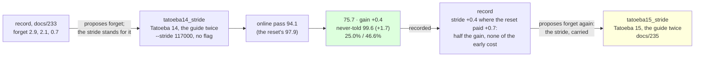

# 234 · The stride that forgets by itself — half the reset's gain, none of its cost

In Phient's world, a word (w) is a seed: what it relates to, under what conditions (c), grows from it. The Phical paradigm, X ⇒ Y, drives and composes Phient's Phasor Language Models: Phinet, Phiano, PhiTon. Phical stores no point: a word is 32–64 relations, each a complex phasor on a closed circle; meaning is a side effect of pairs of words moving under a condition, and they move by the error of what was expected — toward what came, away from what did not.

docs/231–233 pulled `forget` three times: the Adagrad accumulators scaled by a tenth on resume, by a flag, beside each new instalment, paying 2.9, 2.1, 0.7. docs/232 coded the stride into the learner (phient `ac9dc4f`): `Config::stride`, the lines told over which an accumulator falls to a tenth, decayed lazily at the touch by the lines told since. This is its measuring run, in place of the record's `forget` again: `tatoeba13_forget.ckpt` (1,529,136 lines, 57,324 words, 128 channels) resumed with `--stride 117000`, one instalment's lines, and no `--forget`; a fourteenth disjoint 80,000 Tatoeba sentences (`sample80k_14.txt`, seed 14), the guide's 18,446 training sentences told twice beside them, eight epochs asked for, patience two. 116,892 new lines, 1,646,028 in all; the vocabulary 57,324 → 58,458. Recorded as the lever `stride`'s first row (`--record tatoeba14_stride,stride,234`), the never-told set scored. The same forgetting as the flag, spread over the instalment's lines instead of taken at its start. The first launch (2026-11-11) died with the machine's reboot the next day after reading the same online pass; relaunched 2026-11-21 from `phi-old/_corpus`, where the corpus now lives.

## What it scored

| epoch | error (train) | dev top-1 | dev perplexity | minutes |
|---|---|---|---|---|
| told once (online) | — | 21.2% | 94.1 | 4 |
| 1 | 2.362 | 24.5% | 79.9 | 52 |
| 2 | 2.317 | 24.2% | 79.6 | 43 |
| 3 | 2.295 | 24.1% | 79.8 | 40 |
| 4 | 2.281 | 24.7% | 80.3 | 40 |

Stopped by its own rule after the fourth epoch, the second the best. Three hours on a quiet machine, 40 to 52 minutes an epoch.

| on the guide's held-out test | top-1 | top-5 | perplexity |
|---|---|---|---|
| Witten–Bell trigram, the guide alone (docs/203) — the bar | 24.8% | 45.9% | 84.7 |
| the learner, the guide alone (docs/203) | 21.3% | 40.9% | 101.2 |
| the learner, + Tatoeba 11, the guide twice, the stride scaled (docs/231) | 24.2% | 46.0% | 78.9 |
| the learner, + Tatoeba 12, the stride scaled again (docs/232) | 24.7% | 46.5% | 76.8 |
| the learner, + Tatoeba 13, the stride scaled a third time (docs/233) | 25.0% | 46.5% | 76.1 |
| **the learner, + Tatoeba 14, the guide twice, the stride forgetting by itself** | **25.0%** | **46.6%** | **75.7** |

| checkpoint | never-told Tatoeba (docs/217) |
|---|---|
| tatoeba11_forget | 22.8% · 43.9% · 106.7 |
| tatoeba12_forget | 23.1% · 44.3% · 103.1 |
| tatoeba13_forget | 23.1% · 44.4% · 101.3 |
| **tatoeba14_stride** | **23.3% · 44.9% · 99.6** |

Read, straight:

- **Half the reset's gain on the guide's register, the same on the never-told.** 0.4 where the third reset paid 0.7; never-told 101.3 → 99.6, 1.7 where the reset's was 1.8. The spread stride and the reset forget the same tenth over an instalment, and they pay within a few tenths of each other; both are now a lever paying under a point, level with every other.
- **None of the reset's early cost.** The online pass read 94.1 against the reset's 97.9: the flag empties the accumulators at the start and the first lines land with the largest steps; the stride lets them fall as the lines come, so the instalment lands softly. The epochs then had less to recover - 79.9 → 79.6, 0.3 within them, against 0.8 (docs/233), 2.0 (docs/232) and 3.4 (docs/231) - and the second was the best, where the reset's runs peaked at the third, fifth and eighth. The gain moved from the epochs to the online pass; the sum came out a little smaller.
- **The stride is on from here.** `tatoeba14_stride.ckpt` carries `stride: 117000` (checkpoint version 2), so every resume keeps it without a flag, and `--forget` goes beside no run again: the sawtooth of a reset per instalment is a steady stride. The lever `forget` in the record is this lever's history; its rows and `stride`'s read as one series: 2.9, 2.1, 0.7, 0.4.
- **Over the bar on all three heads, a little further.** 25.0% against the trigram's 24.8%; 46.6% against 45.9%; perplexity 75.7, 9.0 under the bar's 84.7. The never-told register has fallen 23.9 points from its first reading of 123.5 (docs/217) in eleven instalments, and still falls by over a point an instalment where the guide's register moves by tenths.
- **Three hours, not twelve.** 40 to 52 minutes an epoch on a quiet machine, under the hour docs/230 measured, and no other session's build beside it.
- **The record proposes `forget` again** - 0.7 level with `text+guide` and `guide` at a tenth, ahead by the never-told tie-break - and `forget` is now the stride, carried. Followed as `tatoeba15_stride`: Tatoeba 15, the guide twice, the stride as the checkpoint keeps it, recorded as `stride` (docs/235): the lever's second row says how the steady stride decays where the reset went 2.9, 2.1, 0.7. The record should learn that `forget` and `stride` are one lever (a lever alias in the curriculum record) rather than proposing a flag the checkpoint has made redundant.
- **What it says, less again.** *when do we use the present perfect* → "continuous"; *the man who lives next door* → "to me"; *we are going to* → "be able to do that"; *i wish i* → "could 41c enough 103", two Tatoeba tokens that are not words, the first time the sayings have shown the samples' noise; *i have been waiting*, *if i had known*, *she has been working* → nothing. The scores rose and the sayings shortened again, as docs/232 noted: the sayings are seven prompts.

## Status

2026-11-23. `tatoeba14_stride.ckpt` (1,646,028 lines, 58,458 words, 128 channels, stride 117,000) is the newest learner and the best on both registers, over the bar on all three heads; recorded in `data/curriculum/instalments.tsv` by the run, `held` included. Next: `tatoeba15_stride` - Tatoeba 15 (`sample80k_15.txt`, seed 15), the guide twice beside it, the stride carried, eight epochs, patience two (docs/235, records itself as `stride`). Left: the record's levers `forget` and `stride` read as one; `epochs` on a kept stride (the second epoch was the best here, so not first); a stop rule that reads the register the lever moves; the samples' non-word tokens.
