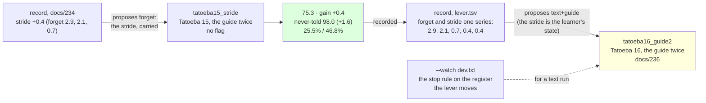

# 235 · The stride holds — 0.4 again, where the reset fell

In Phient's world, a word (w) is a seed: what it relates to, under what conditions (c), grows from it. The Phical paradigm, X ⇒ Y, drives and composes Phient's Phasor Language Models: Phinet, Phiano, PhiTon. Phical stores no point: a word is 32–64 relations, each a complex phasor on a closed circle; meaning is a side effect of pairs of words moving under a condition, and they move by the error of what was expected — toward what came, away from what did not.

docs/234 measured the self-forgetting stride once: 0.4 where the third reset by flag paid 0.7. This is its second row, the record's proposal (`forget` again, which the checkpoint has made the stride): `tatoeba14_stride.ckpt` (1,646,028 lines, 58,458 words, 128 channels, stride 117,000) resumed as it is, a fifteenth disjoint 80,000 Tatoeba sentences (`sample80k_15.txt`, seed 15), the guide's 18,446 training sentences told twice beside them, eight epochs asked for, patience two. 116,892 new lines, 1,762,920 in all; the vocabulary 58,458 → 59,568. Recorded as the lever `stride`'s second row (`--record tatoeba15_stride,stride,235`), the never-told set scored. Beside it, two changes to the learner's example (phiano `a7fcc4b`): the record reads `forget` and `stride` as one lever, named in `data/curriculum/lever.tsv`, and `--watch dev.txt` stops the epochs on the register the lever moves.

## What it scored

| epoch | error (train) | dev top-1 | dev perplexity | minutes |
|---|---|---|---|---|
| told once (online) | — | 21.4% | 95.3 | 7 |
| 1 | 2.350 | 24.2% | 79.9 | 79 |
| 2 | 2.300 | 24.7% | 79.2 | 74 |
| 3 | 2.279 | 24.8% | 79.6 | 48 |
| 4 | 2.265 | 24.7% | 79.9 | 47 |

Stopped by its own rule after the fourth epoch, the second the best. Four and a quarter hours, 47 to 79 minutes an epoch beside other sessions' work.

| on the guide's held-out test | top-1 | top-5 | perplexity |
|---|---|---|---|
| Witten–Bell trigram, the guide alone (docs/203) — the bar | 24.8% | 45.9% | 84.7 |
| the learner, the guide alone (docs/203) | 21.3% | 40.9% | 101.2 |
| the learner, + Tatoeba 12, the stride scaled again (docs/232) | 24.7% | 46.5% | 76.8 |
| the learner, + Tatoeba 13, the stride scaled a third time (docs/233) | 25.0% | 46.5% | 76.1 |
| the learner, + Tatoeba 14, the stride forgetting by itself (docs/234) | 25.0% | 46.6% | 75.7 |
| **the learner, + Tatoeba 15, the guide twice, the stride carried** | **25.5%** | **46.8%** | **75.3** |

| checkpoint | never-told Tatoeba (docs/217) |
|---|---|
| tatoeba13_forget | 23.1% · 44.4% · 101.3 |
| tatoeba14_stride | 23.3% · 44.9% · 99.6 |
| **tatoeba15_stride** | **23.3% · 44.8% · 98.0** |

Read, straight:

- **The stride holds.** 0.4 after 0.4, where the reset went 2.9, 2.1, 0.7. The reset paid for the accumulators it emptied, and less each time as there was less to empty; the steady stride has nothing to empty and pays the instalment's own worth, the 0.4 docs/231 said new text alone was due. Under a point an instalment is what the guide's register has left at this size: the stride did not lift the ceiling, it took the sawtooth out from under it.
- **The never-told register, 1.6 after 1.7.** 99.6 → 98.0; 25.5 points under its first reading of 123.5 (docs/217) in twelve instalments, and still over a point an instalment. Both registers together again (+1.6 beside +0.4).
- **Over the bar on all three heads, and further on top-1.** 25.5% against the trigram's 24.8%, the first half-point over; 46.8% against 45.9%; perplexity 75.3, 9.4 under the bar's 84.7.
- **The epochs as docs/234: the second the best.** 79.9 → 79.2 within them, 0.7, and the train error 2.350 → 2.265. With the stride on, the online pass does the instalment's work and the epochs settle it; `epochs` on a kept stride is not the next lever.
- **One lever, read as one.** The record proposed `forget` by flag after the checkpoint had made it the stride, so the levers are now data (`data/curriculum/lever.tsv`: the lever, the lever it is read as, what the run did), `forget`'s rows read as `stride`'s history, and the proposer sees one series. The stride is the learner's state from here, not a lever: the record names a run by what it does besides, so the next is `text+guide`, which the record proposes (+0.7, level with `guide` at a tenth and ahead of it on the never-told register).
- **The stop rule can read the register the lever moves.** `--watch dev.txt` stops the epochs on those sentences in the guide's dev set's place (docs/223 asked for it: a `text` run stopped by the guide's register going flat); a file also named by `--test-more` is refused, since a stop rule that reads the test picks the epoch that fits it. `heldout_dev1k.txt`, 1,000 never-told sentences disjoint from every sample and from `heldout2k.txt`, is the never-told register's dev set; untried in a run yet.
- **The non-word tokens are the guide's.** *i wish i* → "could 41c enough 103", as docs/234; *if i had known* → "i wish i could 41c enough 103". "41c" is in the guide (an exercise's number, `person/murphy.txt`), not in any Tatoeba sample, whose draw admits letters only. The filter belongs at the guide's reader, not the samples'.
- **What it says, more than docs/234.** *i have been waiting* → "for you", back; *she has been working* → "here"; *when do we use the present perfect* → "continuous i have been doing"; *the man who lives next door* → "to me"; *we are going to* → "the party".

## Status

2026-11-23. `tatoeba15_stride.ckpt` (1,762,920 lines, 59,568 words, 128 channels, stride 117,000) is the newest learner and the best on both registers; recorded in `data/curriculum/instalments.tsv` by the run, `held` included. Next, the record's proposal: `tatoeba16_guide2` - Tatoeba 16 (`sample80k_16.txt`, seed 16), the guide twice beside it, the stride carried, eight epochs, patience two, recorded as `text+guide` (docs/236). Left: the guide's exercise numbers at its reader; a `text` run stopped on `heldout_dev1k.txt`; `widen` to 192 or 256 when the levers stay under a point.
