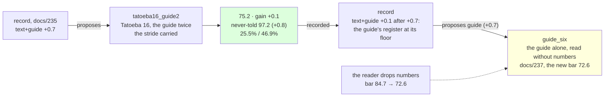

# 236 · Tatoeba 16, the guide twice — the guide's register at its floor

In Phient's world, a word (w) is a seed: what it relates to, under what conditions (c), grows from it. The Phical paradigm, X ⇒ Y, drives and composes Phient's Phasor Language Models: Phinet, Phiano, PhiTon. Phical stores no point: a word is 32–64 relations, each a complex phasor on a closed circle; meaning is a side effect of pairs of words moving under a condition, and they move by the error of what was expected — toward what came, away from what did not.

docs/235 found the stride holds at 0.4 an instalment and made it the learner's state, so the record names a run by what it does besides; it proposed `text+guide` (+0.7, level with `guide` and ahead on the never-told register). This is that proposal followed: `tatoeba15_stride.ckpt` (1,762,920 lines, 59,568 words, 128 channels, stride 117,000) resumed as it is, a sixteenth disjoint 80,000 Tatoeba sentences (`sample80k_16.txt`, seed 16, drawn apart from every text file in the folder, the never-told dev set now among them), the guide's 18,446 training sentences told twice beside them, eight epochs asked for, patience two. 116,892 new lines, 1,879,812 in all; the vocabulary 59,568 → 60,575. Recorded as `text+guide`'s fourth row at 128 (`--record tatoeba16_guide2,text+guide,236`), the never-told set scored. The last run on the guide read with its numbers: the reader drops them since phiano `f9ecd57`, and the bar moves (below).

## What it scored

| epoch | error (train) | dev top-1 | dev perplexity | minutes |
|---|---|---|---|---|
| told once (online) | — | 21.3% | 92.9 | 4 |
| 1 | 2.332 | 24.6% | 79.8 | 49 |
| 2 | 2.285 | 24.5% | 79.3 | 47 |
| 3 | 2.265 | 24.8% | 79.3 | 52 |
| 4 | 2.253 | 24.5% | 80.3 | 57 |
| 5 | 2.245 | 24.5% | 80.0 | 54 |

Stopped by its own rule after the fifth epoch, the third the best by a hair under the second. Four and a third hours beside other sessions' work.

| on the guide's held-out test, read with its numbers | top-1 | top-5 | perplexity |
|---|---|---|---|
| Witten–Bell trigram, the guide alone (docs/203) — the bar | 24.8% | 45.9% | 84.7 |
| the learner, the guide alone (docs/203) | 21.3% | 40.9% | 101.2 |
| the learner, + Tatoeba 14, the stride forgetting by itself (docs/234) | 25.0% | 46.6% | 75.7 |
| the learner, + Tatoeba 15, the stride carried (docs/235) | 25.5% | 46.8% | 75.3 |
| **the learner, + Tatoeba 16, the guide twice** | **25.5%** | **46.9%** | **75.2** |

| checkpoint | never-told Tatoeba (docs/217) |
|---|---|
| tatoeba14_stride | 23.3% · 44.9% · 99.6 |
| tatoeba15_stride | 23.3% · 44.8% · 98.0 |
| **tatoeba16_guide2** | **23.6% · 44.9% · 97.2** |

| the guide read without its numbers (phiano `f9ecd57`) | top-1 | top-5 | perplexity |
|---|---|---|---|
| Witten–Bell trigram, the guide alone — the bar from docs/237 | 26.1% | 47.5% | 72.6 |
| tatoeba15_stride, told nothing | 26.3% | 48.0% | 67.8 |

Read, straight:

- **The guide's register is at its floor for this size.** 0.1 after 0.4, 0.4, 0.7, 1.1 for text beside the guide at 128 channels: the sixteenth instalment of another register paid the guide's test a tenth. The never-told register halved too, 0.8 after 1.6 and 1.7, though it is still the one moving. Both together (+0.8 beside +0.1).
- **The epochs settle, they do not gain.** 79.8 → 79.3 within them, the third the best under the second by less than a tenth, then two worse; the train error 2.332 → 2.245. The online pass did the instalment's work, 92.9 against 95.3 and 94.1 in the stride runs before it.
- **Over the bar on all three heads, where it was.** 25.5% / 46.9% / 75.2 against 24.8% / 45.9% / 84.7; a tenth on top-5, a tenth on perplexity.
- **The record proposes `guide` again, +0.7** (docs/230, the guide a fifth time, at 128): the one lever whose last gain is over half a point. `widen` stands at +0.5 from docs/227 and is the lever to pull when `guide` pays under half a point too, since every lever the record knows is under a point at 128.
- **The bar moves with the reader.** The guide is a grammar book; its unit and exercise numbers were words to the reader, and the learner said them back (*i wish i* → "could 41c enough 103", here again). The reader now drops a token with a digit, the sentence cut unchanged, so the test keeps 13,454 of 14,831 positions and the guide's vocabulary 4,069 of 4,705 words. Read so, the trigram is 26.1% / 47.5% / 72.6, and `tatoeba15_stride` told nothing is 26.3% / 48.0% / 67.8: the number positions were hard for every model. This doc is the last on the old reading; docs/237 on compares to 72.6.
- **A reload reads the never-told set lower than its run did.** `tatoeba15_stride` reloaded and told nothing scored 96.9 on `heldout2k.txt` where its run scored 98.0 and this run's parent row says 98.0. A saved learner should score as the run's best did; the record's `held` column is the run's reading. To find: what the run holds that the file does not (the sampler, the told count), or what `measure` changes.
- **What it says.** *i have been waiting* → "for you"; *she has been working* → "hard"; *when do we use the present perfect* → "continuous and simple", new; *we are going to* → "be able to do that"; *the man who lives next door* → "to me"; *if i had known* → nothing.

## Status

2026-11-23. `tatoeba16_guide2.ckpt` (1,879,812 lines, 60,575 words, 128 channels, stride 117,000) is the newest learner and the best on both registers; recorded in `data/curriculum/instalments.tsv` by the run, `held` included. Next, the record's proposal: `guide_six` - the guide alone, told once more, read without its numbers, on `tatoeba16_guide2`, eight epochs, patience two, recorded as `guide` (docs/237, the first on the new bar). Left: the reload's never-told reading against the run's; `widen` to 192 or 256 when `guide` too pays under half a point; a `text` run stopped on `heldout_dev1k.txt`.
