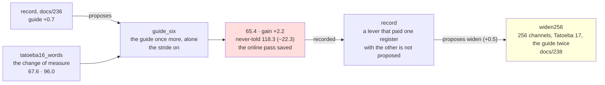

# 237 · The guide alone robs the other register — and the record learns not to propose it

In Phient's world, a word (w) is a seed: what it relates to, under what conditions (c), grows from it. The Phical paradigm, X ⇒ Y, drives and composes Phient's Phasor Language Models: Phinet, Phiano, PhiTon. Phical stores no point: a word is 32–64 relations, each a complex phasor on a closed circle; meaning is a side effect of pairs of words moving under a condition, and they move by the error of what was expected — toward what came, away from what did not.

docs/236 found the guide's register at its floor for 128 channels and the record proposed `guide` (+0.7 at docs/230). This is that proposal followed, the first run on the guide read without its numbers (phiano `f9ecd57`): `tatoeba16_guide2.ckpt` (1,879,812 lines, 60,575 words, 128 channels, stride 117,000) resumed as it is, the guide's 18,446 training sentences told once more, nothing beside them, eight epochs asked for, patience two. 18,446 new lines, 1,898,258 in all; the vocabulary unchanged. Recorded as `guide`'s sixth row (`--record guide_six,guide,237`), the never-told set scored.

## The reading, first

The reader drops a token with a digit, so the guide's test keeps 13,454 of its 14,831 positions, and the never-told set, drawn in docs/217 by a looser rule, loses the tokens of its thirty numbered lines. Every score on either register moves with it, so the record has a row for the change of measure: `tatoeba16_words`, the same learner told nothing, scored anew (lever `reader`, read as `!` in `lever.tsv`: kept so the next gain is against the same reading, never proposed), and `guide_six` resumes from that row.

| the guide read without its numbers | top-1 | top-5 | perplexity | never-told |
|---|---|---|---|---|
| Witten–Bell trigram, the guide alone — the bar | 26.1% | 47.5% | 72.6 | |
| tatoeba15_stride, told nothing | 26.3% | 48.0% | 67.8 | 96.9 |
| tatoeba16_guide2, told nothing (`tatoeba16_words`) | 26.0% | 48.1% | 67.6 | 96.0 |

The reload is faithful: `tatoeba15_stride` reloaded under the old reader scores 75.3 and 98.0, its run's figures to the tenth. docs/236's oddity was the reading, not the file.

## What it scored

| epoch | error (train) | dev top-1 | dev perplexity | minutes |
|---|---|---|---|---|
| told once (online) | — | 24.6% | 72.1 | 1 |
| 1 | 2.259 | 25.6% | 72.6 | 66 |
| 2 | 2.248 | 25.7% | 72.1 | 49 |

Stopped by its own rule after the second epoch: neither epoch beat the online pass, so the learner saved is the online pass, the guide told once more and nothing else.

| on the guide's held-out test, read without its numbers | top-1 | top-5 | perplexity |
|---|---|---|---|
| Witten–Bell trigram, the guide alone — the bar | 26.1% | 47.5% | 72.6 |
| tatoeba16_guide2, told nothing | 26.0% | 48.1% | 67.6 |
| **guide_six: the guide once more, alone** | **26.1%** | **48.2%** | **65.4** |

| checkpoint | never-told Tatoeba (docs/217), read without numbers |
|---|---|
| tatoeba15_stride | 23.4% · 44.9% · 96.9 |
| tatoeba16_guide2 | 23.6% · 45.0% · 96.0 |
| **guide_six** | **21.3% · 42.5% · 118.3** |

Read, straight:

- **The guide alone, with the stride on, robs the other register.** 2.2 off the guide's test and 22.3 put on the never-told set in one pass of 18,446 lines: the never-told register fell back to where it stood at docs/218, fourteen instalments ago. `guide_four` and `guide_five` moved it 0.3 and 0.2 the other way; they ran with the accumulators grown over a million lines, every step small. Now the stride keeps the steps large, and a register told alone pulls the learner to itself. The guide is told beside text from here, never alone.
- **The record proposed it, and now will not.** A lever whose last pull paid one register with the other - the two gains in perplexity points summing under zero - is not proposed, and the proposal says which and by how much (`not proposed: guide paid the guide's register +2.2 with the never-told one (-22.3)`). Two tests. Read so, the record proposes `widen` (+0.5, docs/227), the lever left over half a point: every other is under a point at 128 channels (docs/236).
- **The guide's register under 66 for the first time**, 7.2 under the bar, 26.1% / 48.2% - a tenth under the trigram on top-1, seven tenths over on top-5. At a price the guide's register does not show.
- **The epochs did nothing.** Neither beat the online pass on the dev set; the guide told once more was the whole instalment. With the stride on, the online pass does the work (docs/235, 236) and the epochs settle or not at all.
- **The never-told set had numbers too.** Thirty of its 1,932 lines ("Tom is now serving a 150-year prison sentence."), drawn before the samples' rule admitted letters only; their numbers were positions and are not now, 98.0 → 96.9 for the same learner. Every later sample and the never-told dev set were drawn without digits, so only this file moves.
- **What it says, the guide's own.** *i wish i* → "had a car", the exercise numbers gone; *when do we use the present perfect* → "continuous"; *the man who lives next door* → "to me"; *we are going to* → "the party"; *i have been waiting*, *if i had known*, *she has been working* → nothing. The counts' sayings are the book's exercise instructions now ("the sentences using the") where they were Tatoeba's Tom and Mary: the guide told once more alone outweighs sixteen samples for the counts too.

## Status

2026-11-23. `guide_six.ckpt` (1,898,258 lines, 60,575 words, 128 channels, stride 117,000) is the newest learner, the best on the guide's register and the worst on the never-told since docs/218; recorded in `data/curriculum/instalments.tsv` by the run, after the `tatoeba16_words` row written by hand. Next, the record's proposal: `widen256` - 256 channels from `guide_six`, the new ones born quiet, told Tatoeba 17 (`sample80k_17.txt`, seed 17) with the guide twice beside it, eight epochs, patience two, recorded as `widen` (docs/238): the width's gain over the 0.1 that text beside the guide last paid, and whether the never-told register comes back. Left: a `text` run stopped on `heldout_dev1k.txt`; the sayings' seven prompts against a hundred.
