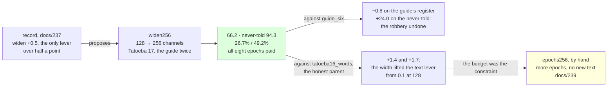

# 238 · Widened to 256 — the other register comes back, and every epoch pays

In Phient's world, a word (w) is a seed: what it relates to, under what conditions (c), grows from it. The Phical paradigm, X ⇒ Y, drives and composes Phient's Phasor Language Models: Phinet, Phiano, PhiTon. Phical stores no point: a word is 32–64 relations, each a complex phasor on a closed circle; meaning is a side effect of pairs of words moving under a condition, and they move by the error of what was expected — toward what came, away from what did not.

docs/236 found every lever under a point at 128 channels; docs/237 found the guide told alone robs the never-told register and left `widen` (+0.5, docs/227) the only lever over half a point. This is the record's proposal followed: `guide_six.ckpt` (1,898,258 lines, 60,575 words, 128 channels) resumed and widened to 256, the old channels kept bit for bit and the new born quiet (docs/210), told a seventeenth disjoint 80,000 Tatoeba sentences (`sample80k_17.txt`, seed 17) with the guide's 18,446 training sentences twice beside them, eight epochs asked for, patience two. 116,892 new lines, 2,015,150 in all; the vocabulary 60,575 → 61,504. Recorded as `widen`'s fourth row (`--record widen256,widen,238`), the never-told set scored.

## What it scored

| epoch | error (train) | dev top-1 | dev perplexity | minutes |
|---|---|---|---|---|
| told once (online) | — | 21.2% | 89.4 | 6 |
| 1 | 2.350 | 24.8% | 73.6 | 130 |
| 2 | 2.293 | 25.2% | 71.6 | 135 |
| 3 | 2.266 | 25.5% | 71.8 | 112 |
| 4 | 2.247 | 25.8% | 70.9 | 184 |
| 5 | 2.233 | 25.7% | 71.7 | 120 |
| 6 | 2.221 | 25.7% | 70.6 | 122 |
| 7 | 2.210 | 25.9% | 70.5 | 126 |
| 8 | 2.200 | 26.5% | 70.4 | 126 |

All eight epochs ran and the eighth was the best: the stop rule never fired, for the first time since docs/231. Eighteen hours, about two to an epoch at 256 channels, double an epoch at 128.

| on the guide's held-out test, read without its numbers | top-1 | top-5 | perplexity |
|---|---|---|---|
| Witten–Bell trigram, the guide alone — the bar | 26.1% | 47.5% | 72.6 |
| the trigram told this run's text, the guide and Tatoeba 17 | 25.2% | 47.3% | 83.2 |
| tatoeba16_words: 128 channels, before the guide-alone pass (docs/237) | 26.0% | 48.1% | 67.6 |
| guide_six: the guide once more, alone (docs/237) | 26.1% | 48.2% | 65.4 |
| **widen256: 256 channels, Tatoeba 17, the guide twice** | **26.7%** | **49.2%** | **66.2** |

| checkpoint | never-told Tatoeba (docs/217) |
|---|---|
| tatoeba16_words (128 channels) | 23.6% · 45.0% · 96.0 |
| guide_six (the guide alone) | 21.3% · 42.5% · 118.3 |
| **widen256** | **23.9% · 45.4% · 94.3** |

Read, straight:

- **The other register comes back.** 118.3 → 94.3: the width with text beside it undid the guide-alone pass's robbery and went two points past the 96.0 it started from. 94.3 is the best the never-told register has read, 29.2 under its first reading of 123.5 (docs/217), and the first time it has moved more than two points since docs/232.
- **Read against the right parent, the width lifted the text lever fourteenfold.** The record compares a row with the one it resumed, and this row resumed the detour, so it shows −0.8 on the guide's register and +24.0 on the never-told. The honest comparison is `tatoeba16_words`, the last checkpoint before the detour: 67.6 → 66.2 and 96.0 → 94.3, so **+1.4 and +1.7** where text beside the guide last paid 0.1 at 128 channels (docs/236). The width did at 256 what it did at 128 (docs/228, 0.9 → 1.1): it gave a lever that had gone flat something to move.
- **Every epoch paid.** 89.4 → 70.4 on the dev register, 19.0 within the run against 0.7 at 128 (docs/236), and the train error 2.350 → 2.200 where 128 moved it nine hundredths. The eighth epoch was the best and the rule never fired, so **the epoch budget, not the text, was the binding constraint** at this width. That is the next thing to measure, and it is the lever the record cannot propose (one row at +0.0, docs/213, at 64 channels): `epochs256` follows by hand, as `widen128` did at docs/227 - more epochs on the same lines, no new text (docs/239).
- **Over the bar on all three heads, and over the counts told the same text.** 26.7% against the guide-alone bar's 26.1%; 49.2% against 47.5%; 66.2 against 72.6, 6.4 under. Told the guide and Tatoeba 17 the trigram reads 83.2: the samples dilute counting, where the learner carries both registers at once.
- **The record proposed a lever that is not one, and now cannot.** Its proposal was `stride` (+0.4), but the stride is the learner's state, carried in every checkpoint since docs/235, and no run pulls it. `lever.tsv` marks `stride` and `forget` as state (read as `!`: their rows kept so a gain is read against them, never proposed), as `reader` is marked a change of measure. One test. Read so, the record proposes `text+guide` (+0.1 at 128), which `epochs256` goes before.
- **Two hours an epoch, and the checkpoint is 458 MB.** Twice the time and 1.75 times the file of 128 channels (262 MB). The disk has 37 GB of 953 free, enough for a dozen more checkpoints; the kept ones are the record's history and none is deleted.
- **A number is not told, but a word once learned stays.** The sayings still show "41c" and "103" (*i wish i* → "could 41c enough 103"): the reader has dropped tokens with digits since phiano `f9ecd57`, so the numbers are neither told nor scored, but they are in this checkpoint's vocabulary from the runs before it, phasors and all, and `speak` can still reach them. To be rid of them a resumed learner must drop the words it is no longer told - the stride decays the accumulators, not the angles. Noted as an item.
- **This run's sayings are the old seven.** Its binary predates the hundred prompts (`data/person/prompt.txt`, phiano `bf9b841`); from docs/239 the table is a hundred rows.

## Status

2026-11-24. `widen256.ckpt` (2,015,150 lines, 61,504 words, 256 channels, stride 117,000) is the newest learner and the best on the never-told register; on the guide's it is 0.8 behind the guide-alone detour and 1.4 ahead of the checkpoint before it. Recorded in `data/curriculum/instalments.tsv` by the run. Next, by hand because the record cannot propose it: `epochs256` - more epochs on the same 2,015,150 lines, nothing new told, eight asked, patience two, recorded as `epochs` (docs/239), since the eighth epoch was this run's best. After it, the record's `text+guide`: Tatoeba 18 (`sample80k_18.txt`, seed 18, drawn). Left: a word once learned and no longer told; a `text` run stopped on `heldout_dev1k.txt`; `widen` to 512 when the budget is known.
