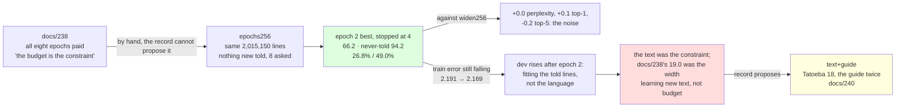

# 239 · More epochs on the same lines — the text was the constraint, not the budget

In Phient's world, a word (w) is a seed: what it relates to, under what conditions (c), grows from it. The Phical paradigm, X ⇒ Y, drives and composes Phient's Phasor Language Models: Phinet, Phiano, PhiTon. Phical stores no point: a word is 32–64 relations, each a complex phasor on a closed circle; meaning is a side effect of pairs of words moving under a condition, and they move by the error of what was expected — toward what came, away from what did not.

docs/238 widened the learner to 256 channels and every one of its eight epochs paid: the dev register fell 89.4 → 70.4 within the run, the eighth epoch was the best, and the stop rule never fired. The reading there was that **the epoch budget, not the text, was the binding constraint**, and the lever to measure next was `epochs` — the one the record cannot propose (`lever.tsv` reads its one row, docs/213 at 64 channels, at +0.0). This is that measurement, by hand as `widen128` was at docs/227: `widen256.ckpt` resumed, **nothing new told**, eight epochs asked, patience two, the never-told register scored, recorded as `epochs`'s second row (`--record epochs256,epochs,239`).

The reading of docs/238 was wrong, and this run says so in three registers at once.

## What it scored

| epoch | error (train) | dev top-1 | dev perplexity | minutes |
|---|---|---|---|---|
| told once (online) | — | 26.5% | 70.4 | 1 |
| 1 | 2.191 | 26.2% | 70.6 | 112 |
| **2** | **2.183** | **26.7%** | **70.3** | **120** |
| 3 | 2.176 | 26.4% | 70.7 | 135 |
| 4 | 2.169 | 26.4% | 70.9 | 133 |

Four of the eight ran: epoch 2 was the best and patience two stopped it after epoch 4, the first time the rule has fired since docs/233. Eight and a half hours for one tenth of a point.

| on the guide's held-out test, read without its numbers | top-1 | top-5 | perplexity |
|---|---|---|---|
| Witten–Bell trigram, the guide alone — the bar (docs/238) | 26.1% | 47.5% | 72.6 |
| widen256: 256 channels, Tatoeba 17, the guide twice (docs/238) | 26.7% | 49.2% | 66.2 |
| **epochs256: the same lines, four more epochs** | **26.8%** | **49.0%** | **66.2** |

| checkpoint | never-told Tatoeba (docs/217) |
|---|---|
| widen256 | 23.9% · 45.4% · 94.3 |
| **epochs256** | **23.9% · 45.5% · 94.2** |

This run told nothing, so the counting models had nothing to count: the floor, the phient counts, the Witten–Bell trigram and the counted phasors all read 0.0% and the trigram's perplexity 1.0 on an empty table. The bar above is docs/238's, carried over - the guide's held-out test is the same sentences.

Read, straight:

- **Four more epochs on the same lines bought nothing.** 66.2 → 66.2 on the guide's register, 94.3 → 94.2 on the never-told, +0.1 top-1 and −0.2 top-5: every number inside the wobble of a single epoch. The record reads the row at +0.0, which is what `epochs` read at 64 channels too (docs/213). The lever is the same at both widths, now measured twice, and the record will not propose it again.
- **The learner overfits, and this is the first run in the record that shows it plainly.** The train error fell about nine thousandths an epoch throughout (2.191 → 2.169) while dev perplexity rose after epoch 2 (70.3 → 70.7 → 70.9) and dev top-1 wobbled 26.2 / 26.7 / 26.4 / 26.4. Error going down while the held-out register goes up is the learner fitting the 2,015,150 lines it has been told rather than the language behind them. Dropout 0.1 and silence 0.2 did not hold it off; the stop rule did, which is what the rule is for.
- **So docs/238's 19.0 points were the width learning new text, not an unspent budget.** The eighth epoch being the best there says the run had not finished learning *that* text (Tatoeba 17 and the guide twice, 116,892 new lines); it does not say more epochs over the same lines are worth anything, and here they are worth a tenth of a point on dev and nothing anywhere else. **New text is the constraint at 256 channels**, which is what the record proposes.
- **The two registers moved together, for once by the same nothing.** The proposer's register line reads "+0.1 beside +0.0": the never-told set gained a hair more than the guide's. Every run since docs/231 has had one register pay for the other; a run that tells nothing new robs neither.
- **The hundred prompts, and the numbers out of the vocabulary for good.** This is the first run on `data/person/prompt.txt`'s hundred asked lines (phiano `bf9b841`) instead of the old seven: 99 rows, one of which said nothing at all (*having finished her work*), and **no digit artefacts** - docs/238's "41c" and "103" do not appear, though they are still in this checkpoint's vocabulary with their phasors, because none of the hundred prompts reaches them. The item docs/238 left is closed in this round rather than by this run: `phient::lineup::learner::drop_words` takes a word out of every per-word plane, its bias, clock, count and name and its place in every line told, keeping every other word bit for bit, and the example drops what the reader's own rule (`counting::not_a_word`) refuses on every resume, saying how many went. `epochs256`'s binary predates it; the run after it is the first to report them gone.
- **Where it is right and where it is still wrong.** *i wish i* → "could have gone out", *the woman who* → "lives next door to me", *many accidents are* → "caused by careless driving", *joe hurt his* → "knee playing football": the guide's own constructions, whole. Against them *the earth goes* → "to the sun" (the preposition the guide teaches is "round"), *she is used* → "to be a lot of fun" (the construction collapsed into a frequent tail), *i wish somebody* → "would unit", *every month my* → "salary is high but i don't know what to do". The failures are all one shape: a correct opening that runs into the most frequent continuation it knows.
- **458 MB again, byte for byte.** `epochs256.ckpt` is 457,727,572 bytes, exactly `widen256.ckpt`'s size: same channels, same vocabulary, nothing told. The disk has **23 GB of 953 free**, down from 37 at docs/238 — enough for a few more checkpoints and not many. None is deleted (they are the record's history); when it binds, the oldest go to `_temp` with an inventory.
- **`--propose` needs a corpus path it never reads.** The corpus argument is checked before the `--propose` branch in `examples/learner/main.rs`, so asking the record for a proposal means naming a file the proposer never opens. Fixed: the branch now comes first, since reading the record is the one thing it does.

## Status

2026-11-24. `epochs256.ckpt` (2,015,150 lines, 61,504 words, 256 channels, stride 117,000) is the newest learner and the equal of `widen256` on every register; it is kept because the record keeps what it scores, not because it is better. `epochs` is measured out: two rows, +0.0 at 64 channels and +0.0 at 256, and the record proposes it no more.

Next, as the record proposes: **`text+guide` resuming `epochs256`** - Tatoeba 18 (`sample80k_18.txt`, seed 18, drawn) with the guide's 18,446 training sentences twice beside it, eight epochs, patience two, recorded as `text+guide` (docs/240). Its last application paid 0.1 at 128 channels (docs/236) against 0.7 before it, so the width is what it is being asked to use.

Left: a `text` run stopped on `heldout_dev1k.txt` with `--watch` (coded, never yet exercised); `widen` to 512, now that the epoch budget is known not to be the constraint; the disk.
