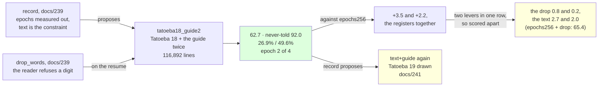

# 240 · Tatoeba eighteen, and 1,377 words out of the vocabulary — 3.5 after 0.1

In Phient's world, a word (w) is a seed: what it relates to, under what conditions (c), grows from it. The Phical paradigm, X ⇒ Y, drives and composes Phient's Phasor Language Models: Phinet, Phiano, PhiTon. Phical stores no point: a word is 32–64 relations, each a complex phasor on a closed circle; meaning is a side effect of pairs of words moving under a condition, and they move by the error of what was expected — toward what came, away from what did not.

docs/239 measured the epochs lever out at 256 channels and said new text was the constraint. This is the record's proposal followed: `epochs256.ckpt` resumed, an eighteenth disjoint 80,000 Tatoeba sentences (`sample80k_18.txt`, seed 18) told with the guide's 18,446 training sentences twice beside them — 116,892 new lines, 833,940 words of which 36,892 the guide's; 2,132,042 lines in all. Eight epochs asked, patience two, the never-told register scored, recorded as `text+guide`'s ninth row (`--record tatoeba18_guide2,text+guide,240`).

It is also the first run to carry `Learner::drop_words`, and on the resume it **dropped 1,377 words the reader no longer tells** — the guide's unit and exercise numbers, learned before the reader began refusing a token with a digit in it (docs/235) and carried in every checkpoint since. The vocabulary went 61,504 → 60,127 before this run's own text took it to 61,094. **Two things moved at once**, so the run is read twice below.

## What it scored

| epoch | error (train) | dev top-1 | dev perplexity | minutes |
|---|---|---|---|---|
| told once (online) | — | 23.7% | 76.9 | 9 |
| 1 | 2.289 | 26.0% | 67.1 | 161 |
| **2** | **2.246** | **26.6%** | **66.8** | **170** |
| 3 | 2.220 | 26.4% | 67.0 | 171 |
| 4 | 2.203 | 26.7% | 67.1 | 181 |

Four of the eight ran, epoch 2 the best, patience two stopping it at 4 — the same shape as docs/239 and eleven and a half hours of it.

| on the guide's held-out test, read without its numbers | top-1 | top-5 | perplexity |
|---|---|---|---|
| the most told word (floor) | 4.6% | 12.5% | — |
| phient counts (the word before) | 16.2% | 36.5% | — |
| Witten–Bell trigram, told this run's text — the counting bar | 25.2% | 47.3% | 83.6 |
| phiecs phasors (counted: a running mean) | 11.7% | 26.6% | — |
| Witten–Bell trigram, the guide alone — the standing bar (docs/237) | 26.1% | 47.5% | 72.6 |
| epochs256: before this run (docs/239) | 26.8% | 49.0% | 66.2 |
| epochs256 with the 1,377 words dropped, nothing told | 26.9% | 49.1% | 65.4 |
| **tatoeba18_guide2** | **26.9%** | **49.6%** | **62.7** |

| checkpoint | never-told Tatoeba (docs/217) |
|---|---|
| epochs256 | 23.9% · 45.5% · 94.2 |
| epochs256 with the words dropped | 23.9% · 45.6% · 94.0 |
| **tatoeba18_guide2** | **23.7% · 45.6% · 92.0** |

So the row's 3.5 is **0.8 the drop and 2.7 the text**, and the never-told's 2.2 is **0.2 the drop and 2.0 the text**: `epochs256` resumed with the drop and nothing told reads 65.4 and 94.0, in eleven minutes, the measure only. The dropped words were worth more to the guide's register than to the other, which is where they were learned.

Read, straight:

- **3.5 where the lever last paid 0.1, and 2.7 of it the text's.** `text+guide` was at its floor at 128 channels (docs/236) and this is its ninth application: 66.2 → **62.7** (2.7 of it the text's, 0.8 the drop's, scored apart below) on the guide's register, 94.2 → **92.0** on the never-told, the two moving together (+3.5 beside +2.2) as they have in every text instalment since docs/231. The guide's register is now **9.9 under the standing bar** and top-5 is over it by 2.1; counting told this run's text reads 83.6, 21 behind, the samples diluting it where the learner carries both registers at once.
- **Two levers in one row, so they were scored apart.** The drop and the text landed together and the record credits the row to `text+guide`, so `epochs256` was resumed with the drop, told nothing, and measured: **65.4 and 94.0**. The drop is worth **0.8** on the guide's register and **0.2** on the never-told; the text is worth **2.7** and **2.0**. Read so, `text+guide` paid 2.7 where its last application paid 0.1 - twenty-seven times, not thirty-five - and the record's row is a tenth of a point of top-1 and a tenth of top-5 too generous. The 1,377 words were costing what a word that can never be right costs: a place in the top-5 and a share of the normalisation, the test having been read without numbers since docs/237. **A measurement run is cheap** (eleven minutes against eleven hours) and the next confounded row should get one before it is read.
- **The width wanted text, as docs/239 said.** Four epochs on the same lines moved nothing; 80,000 new sentences on the same width moved 3.5. The constraint reading holds, and the epoch shape is identical - epoch 2 the best, the rule firing at 4 - so **the budget is not what to spend next; the text is**.
- **The online pass fell behind, then overtook.** Told once, the dev register read 76.9 against the 70.4 `epochs256` left it at: the drop and 80,000 unfamiliar sentences unsettle it before an epoch has looked at them twice. By epoch 1 it was at 67.1, under where it started, and it ended 3.6 better.
- **The sayings are the guide's own English now.** *i wish i* → "had a car", *cheaper and more* → "expensive than buses", *two people were* → "taken to the hospital", *the strike started* → "three months ago", *we used to live* → "in a small village in the south", *do you know* → "where tom is going to be". No digits anywhere, for the first time in the record. Against them *the earth goes* → "to the sun" still (the guide teaches "round"), *many accidents are* → "caused by careless of of", *i prefer driving* → "to" and nothing, and five prompts the learner answers with nothing at all.
- **The counts' column shows what counting is.** Told this run's text, the word-before chain says "to do that tom and mary said that" after almost every prompt - Tatoeba's commonest names and frames, one word at a time, until the pair rule stops it. The learner's column beside it is the measure of the difference the record exists to make.
- **The well is finite.** 1,443,000 of the raw file's 2,040,024 English sentences are told or held out; **597,024 are left**, about seven more instalments of 80,000. `sample80k_19.txt` (seed 19) is drawn and disjoint.
- **458 MB and 23 GB.** `tatoeba18_guide2.ckpt` is 457,959,864 bytes, 232 KB over its parent for 967 more words. The disk stands where docs/239 left it; none of the checkpoints is deleted.

## Status

2026-11-25. `tatoeba18_guide2.ckpt` (2,132,042 lines, 61,094 words, 256 channels, stride 117,000) is the newest learner and the best on both registers: 62.7 on the guide's held-out test, 92.0 on the never-told. Recorded in `data/curriculum/instalments.tsv` by the run.

Next, as the record proposes: **`text+guide` again, resuming `tatoeba18_guide2`** - Tatoeba 19 (`sample80k_19.txt`, seed 19, drawn) with the guide's sentences twice beside it, eight epochs, patience two (docs/241). Left: a `text` run stopped on `heldout_dev1k.txt` with `--watch`; `widen` to 512; the 597,024 sentences the well still holds; the disk.
