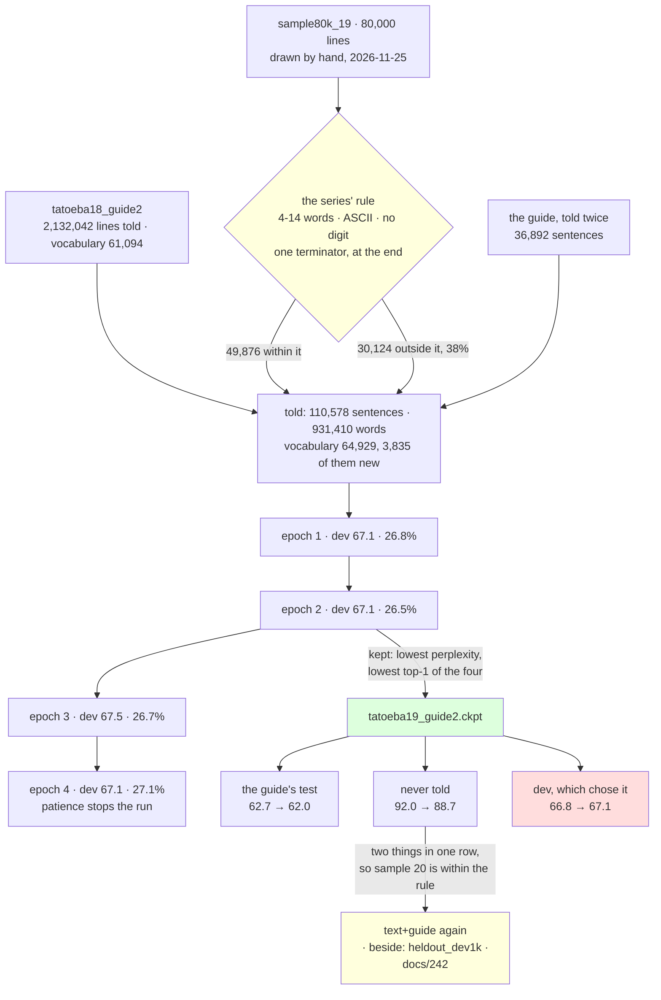

# 241 · Tatoeba nineteen, and the sample drawn outside the rule — 3.3 on the register nothing was watching

In Phient's world, a word (w) is a seed: what it relates to, under what conditions (c), grows from it. The Phical paradigm, X ⇒ Y, drives and composes Phient's Phasor Language Models: Phinet, Phiano, PhiTon. Phical stores no point: a word is 32–64 relations, each a complex phasor on a closed circle; meaning is a side effect of pairs of words moving under a condition, and they move by the error of what was expected — toward what came, away from what did not.

docs/240 scored the drop and the text apart and said the text was worth 2.7. This is the record's proposal followed: `tatoeba18_guide2.ckpt` resumed, a nineteenth disjoint 80,000 Tatoeba sentences (`sample80k_19.txt`, seed 19) told with the guide's 18,446 training sentences twice beside them — 110,578 lines, 931,410 words of which 36,892 the guide's; 2,242,620 lines in all, the vocabulary 61,094 → 64,929. Eight epochs asked, patience two, recorded as `text+guide`'s tenth row (`--record tatoeba19_guide2,text+guide,241`).

It is also the run that was lost once. The machine restarted at 06:36 on 2026-11-26 under the first attempt and took eleven hours with it, because `--save` wrote only when every epoch was done; the save is atomic now and keeps the best epoch as it is found, so a cut-short run costs the epoch and not the run (`examples/learner/epoch.rs`). The run below is the restart, from the same parent, and nothing was recorded for the attempt that never scored.

## What it scored

| epoch | error (train) | dev top-1 | dev perplexity | minutes |
|---|---|---|---|---|
| told once (online) | — | 21.7% | 85.0 | 11 |
| 1 | 2.298 | 26.8% | 67.1 | 240 |
| **2** | **2.233** | **26.5%** | **67.1** | **283** |
| 3 | 2.202 | 26.7% | 67.5 | 154 |
| 4 | 2.183 | 27.1% | 67.1 | 116 |

Four of the eight ran, epoch 2 kept, patience two stopping it at 4 — the third run in a row of that shape. **The minutes are the machine, not the model**: the same work took 283 minutes and then 116, because other work was on the machine early and gone later.

| on the guide's held-out test, read without its numbers | top-1 | top-5 | perplexity |
|---|---|---|---|
| the most told word (floor) | 4.6% | 14.8% | — |
| phient counts (the word before) | 16.5% | 36.6% | — |
| Witten–Bell trigram, told this run's text — the counting bar | 25.3% | 47.5% | 84.7 |
| phiecs phasors (counted: a running mean) | 11.6% | 26.3% | — |
| Witten–Bell trigram, the guide alone — the standing bar (docs/237) | 26.1% | 47.5% | 72.6 |
| tatoeba18_guide2: before this run (docs/240) | 26.9% | 49.6% | 62.7 |
| **tatoeba19_guide2** | **27.2%** | **49.8%** | **62.0** |

| checkpoint | never-told Tatoeba (docs/217) |
|---|---|
| tatoeba18_guide2 | 23.7% · 45.6% · 92.0 |
| **tatoeba19_guide2** | **24.2% · 46.2% · 88.7** |

## The sample was drawn outside its own rule

Samples 15 to 18 were drawn under a rule nobody had written down. Every one of their 240,000 lines obeys it: four to fourteen words, ASCII, no digit anywhere, no quote mark, one terminator and that at the end, so the reader's cut at the full stops leaves the line whole. `sample80k_19.txt` was drawn by hand on 2026-11-25 and **30,124 of its 80,000 lines — 38% — fail that rule**:

| the rule, read off samples 15-18 | sample 18 | sample 19 |
|---|---|---|
| four to fourteen words | 80,000 | 57,090 |
| ASCII | 80,000 | 78,042 |
| no digit | 80,000 | 77,101 |
| no quote mark | 80,000 | 77,529 |
| one terminator, at the end | 80,000 | 71,386 |
| **within the rule** | **80,000** | **49,876** |

The learner's own reader then dropped 6,314 of the 80,000 (73,686 Tatoeba sentences told, not 80,000: a sentence of fewer than four words is not told, and a token with a digit in it is not a word), and the rest it was told longer and holed — 931,410 words against the series' 833,940 for the same count of lines. **So the instalment carried two things again, a fortnight after docs/240's drop**: more text, and text of another kind.

The rule is `scripts/draw_instalment.py` now, which accepts every line of samples 15-18 and rejects 30,124 of sample 19's. It drew `sample80k_20.txt` under it.

The confound runs the good way, which is the awkward part. The never-told register moved **3.3** — the largest a text instalment has ever paid, against the 2.7 docs/240 separated out as the text's — and the vocabulary took 3,835 new words where the last instalment's capped sample brought 967. Two readings fit: longer sentences teach more than short ones, or new words do. docs/242 separates them, because sample 20 is back within the rule: another 3.3 means the words, a fall towards 2.5 means the length — and if it is the length, **"longer text" is a lever to name and pull on purpose**, not an accident to apologise for.

## The register that chose the epoch could not tell the epochs apart

| register | before | after | |
|---|---|---|---|
| the guide's held-out test (2,171 sentences) | 62.7 | **62.0** | better |
| never told, `heldout2k.txt` (1,932 sentences) | 92.0 | **88.7** | better |
| the guide's dev (1,085 sentences) — **which stops the run and keeps the epoch** | 66.8 | 67.1 | worse |

Three of the four epochs read 67.1 on dev. The run kept epoch 2, whose dev top-1 of 26.5% was **the lowest of the four** — epoch 4 read 27.1% — because keeping is on perplexity and at full precision epoch 2's 67.1 was a hair under epoch 1's. At 1,085 sentences the register cannot resolve its own epochs, so which one is kept is a coin landing inside a tenth of a point; and over the instalment as a whole it was the one register of three that said the text had not paid.

What is not a fix: keeping the epoch on the test register, or on `heldout2k.txt`, either of which would fit the learner to the thing it is measured by. What is: **look, and let nothing read it.** `--beside dev2.txt` prints a second register's perplexity in the epoch table and no rule touches it. The 1,000 never-told sentences of `heldout_dev1k.txt` have been drawn and disjoint since 2026-11-23 and had never once been used; docs/242 will be the first run to say, epoch by epoch, where it was going on text it was never told. Measuring them costs nothing an epoch can notice — on a 16-channel proof the epochs ran 4.2 and 4.1 seconds with the column against 4.5 without.

Read, straight:

- **3.3 on the never-told register, the lever's best yet, and it cannot be credited cleanly.** 92.0 → **88.7**, where the nine text instalments before it paid between 0.1 and 2.7. The guide's own register moved 62.7 → **62.0** and top-1 27.2%, 1.9 over counting told the same text and 1.1 over the standing bar's top-1, with top-5 2.3 over it. But 38% of the text was outside the rule the series had been drawing under, so the row is `text+guide`'s by name and something else's in part.
- **The stop rule is measuring at the edge of its resolution.** Three epochs at 67.1 and the worst top-1 of them kept. The dev register is half the guide's held-out split, 1,085 sentences; the instalment's real movement was 3.3 on a register the run never looked at. Nothing reads `--beside`, and nothing should: a register that chose an epoch would be a register the learner had been fitted to.
- **The online pass fell further behind than ever, then overtook.** Told once, dev read **85.0** against the 66.8 it resumed from — the deepest knock in the record, where docs/240's was 76.9 — and 3,835 unfamiliar words is the obvious reason. By epoch 1 it was back at 67.1.
- **Counting went backwards as it was told more.** The trigram told this run's text reads 84.7 against docs/240's 83.6: Tatoeba's longer, dirtier sentences dilute counts that are scored on the guide. The learner carries both registers at once and improved on both, which is the whole of the difference the record exists to measure.
- **The sayings answer three questions they had been failing.** *the earth goes* → "round the sun", which the guide teaches and docs/240 still got wrong as "to the sun"; *many accidents are* → "caused by people driving too fast" where docs/240 said "caused by careless of of"; *i prefer driving* → "to the left", where it had said "to" and stopped. Also *two people were* → "seriously injured in the accident", *we used to live* → "in a small town", *but each and* → "every are not normally used in the past". Five of the 76 prompts it still answers with nothing, *i have been waiting* and *what do you suggest* among them. The counts' column beside it says "to do that he was a lot of the same way to" after almost every prompt.
- **The well is three instalments deep, not seven.** 322,921 sentences were left **under the rule** before this draw and 242,921 after it: `sample80k_20.txt`, `_21`, `_22` and then the rule or the corpus has to change. docs/240's 597,024 counted the uncapped pool — which is the pool sample 19 was drawn from, and is the same mistake in another place.
- **486 MB, and 28 MB of growth for 3,835 words.** `tatoeba19_guide2.ckpt` is 486,362,168 bytes against its parent's 457,959,864 — 28.4 MB for 3,835 more words, where docs/240's 967 words cost 232 KB. Four times the words, a hundred and twenty times the bytes, so it is the pairs and not the words that are growing. 95 GB free of 953; none of the checkpoints is deleted.

## Status

2026-11-27. `tatoeba19_guide2.ckpt` (2,242,620 lines, 64,929 words, 256 channels, stride 117,000) is the newest learner and the best on both scored registers: **62.0** on the guide's held-out test, **88.7** on the never-told. Recorded in `data/curriculum/instalments.tsv` by the run.

Running, as the record proposes: **`text+guide` again, resuming `tatoeba19_guide2`** — Tatoeba 20 (`sample80k_20.txt`, seed 20, drawn within the rule by `scripts/draw_instalment.py`) with the guide's sentences twice beside it, eight epochs, patience two, and `--beside tatoeba/heldout_dev1k.txt` so the never-told register is read at every epoch (docs/242). It answers the confound: 3.3 again is the words, 2.5 is the length.

Left: `widen` to 512; the 242,921 sentences the rule still holds; a `text` run stopped on `heldout_dev1k.txt` with `--watch`, which is now the obvious next measurement rather than a spare one; the checkpoints' growth.
