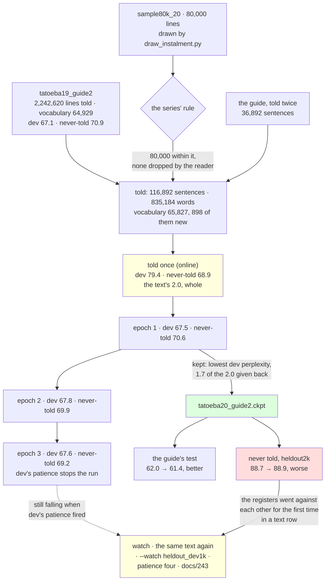

# 242 · Tatoeba twenty, within the rule — the text paid 2.0 and the epochs gave 1.7 of it back

In Phient's world, a word (w) is a seed: what it relates to, under what conditions (c), grows from it. The Phical paradigm, X ⇒ Y, drives and composes Phient's Phasor Language Models: Phinet, Phiano, PhiTon. Phical stores no point: a word is 32–64 relations, each a complex phasor on a closed circle; meaning is a side effect of pairs of words moving under a condition, and they move by the error of what was expected — toward what came, away from what did not.

docs/241 found that `sample80k_19.txt` had been drawn outside the rule its four predecessors obey, and that it paid 3.3 on the never-told register — the most a text instalment ever had. Two readings fitted: the new words, or the longer sentences. This run was drawn to separate them, and it half did — it is not the words. What it found while doing so is larger than the question it was asked, and it is in the second register nobody had ever read. `tatoeba19_guide2.ckpt` resumed, a twentieth disjoint 80,000 Tatoeba sentences (`sample80k_20.txt`, seed 20) drawn **by `scripts/draw_instalment.py` under the rule**, told with the guide's 18,446 training sentences twice beside them — 116,892 lines, 835,184 words of which 36,892 the guide's; 2,359,512 lines in all, the vocabulary 64,929 → 65,827. Eight epochs asked, patience two, recorded as `text+guide`'s eleventh row (`--record tatoeba20_guide2,text+guide,242`).

It is also the first run to read a second register at every epoch and let nothing act on it (`--beside tatoeba/heldout_dev1k.txt`, docs/241). That column is what the run turned out to be about.

## The draw is the series' draw

| | sample 18 | sample 19 (by hand) | **sample 20** |
|---|---|---|---|
| lines | 80,000 | 80,000 | **80,000** |
| within the rule | 80,000 | 49,876 | **80,000** |
| words | 571,577 | 712,451 | **572,798** |
| words a sentence | 7.14 | 8.91 | **7.16** |
| told by the learner's reader | 80,000 | 73,686 | **80,000** |

Sample 20 is sample 18's draw to within a fifth of a percent, and the reader dropped not one of its lines where it dropped 6,314 of sample 19's. The 116,892 told are 80,000 + 36,892 exactly. Whatever this instalment did or failed to do is the series' own text doing it.

## What it scored

| epoch | error (train) | dev top-1 | dev perplexity | never told, `heldout_dev1k` | minutes |
|---|---|---|---|---|---|
| `tatoeba19_guide2`, before a word was told | — | 26.5% | 67.1 | 70.9 | — |
| told once (online) | — | 23.4% | 79.4 | **68.9** | 7 |
| **1** | 2.268 | 26.6% | **67.5** | 70.6 | 118 |
| 2 | 2.201 | 27.1% | 67.8 | 69.9 | 143 |
| 3 | 2.174 | 26.4% | 67.6 | **69.2** | 167 |

Three of the eight ran, epoch 1 kept, patience two stopping it at 3. Epoch 2 had the better dev top-1 (27.1% against 26.6%) and epoch 3 the better never-told perplexity; keeping is on dev perplexity, so epoch 1 it was. **That is the second run in a row in which the kept epoch is not the one the other numbers prefer.**

The first row is not from this run: the parent was reloaded afterwards and told nothing, to give the `--beside` column a level to be read against rather than only a movement. It reads 67.1 on dev and 62.0 and 88.7 where its own run left it — **the reload is faithful to the tenth on all three** — and 70.9 on `heldout_dev1k`, which had never been measured on it.

| on the guide's held-out test, read without its numbers | top-1 | top-5 | perplexity |
|---|---|---|---|
| the most told word (floor) | 4.6% | 12.5% | — |
| phient counts (the word before) | 16.5% | 36.3% | — |
| Witten–Bell trigram, told this run's text — the counting bar | 25.1% | 47.1% | 84.8 |
| phiecs phasors (counted: a running mean) | 11.6% | 26.3% | — |
| Witten–Bell trigram, the guide alone — the standing bar (docs/237) | 26.1% | 47.5% | 72.6 |
| tatoeba19_guide2: before this run (docs/241) | 27.2% | 49.8% | 62.0 |
| **tatoeba20_guide2** | **27.6%** | **50.1%** | **61.4** |

| checkpoint | never told, `heldout2k.txt` (1,932 sentences) | never told, `heldout_dev1k.txt` (1,000) |
|---|---|---|
| tatoeba18_guide2 (docs/240) | 23.7% · 45.6% · 92.0 | — |
| tatoeba19_guide2 (docs/241) | 24.2% · 46.2% · **88.7** | 25.7% · 48.6% · **70.9** |
| **tatoeba20_guide2** | 24.1% · 46.4% · **88.9** | 25.2% · 48.3% · **70.6** |

Both files are checked disjoint from every numbered sample — 1,520,000 lines — and from each other, so "never told" is a property and not a hope. They are different difficulties, though, and must never be read against each other — `heldout_dev1k` is within the rule and `heldout2k`, drawn 2026-11-07 before there was one, has 242 of its 2,000 lines outside it — but each read against itself across the two checkpoints says the same thing: **the instalment delivered nothing to never-told English.** `heldout2k` is 0.2 worse, `heldout_dev1k` 0.3 better and worse on both heads.

## Not the words

The answer docs/241 was waiting for is **no**. A within-rule instalment of the series' own shape moved the never-told register **−0.2**: 88.7 → **88.9**, worse, with top-1 24.2% → 24.1%. Sample 19's 3,835 new words were not what bought its 3.3, because sample 20's 898 bought nothing at the checkpoint — and nothing is not a smaller version of 3.3, it is the other side of zero.

| instalment | within the rule | never-told gain | the guide's test gain |
|---|---|---|---|
| tatoeba16_guide2 | yes | +0.8 | +0.1 |
| tatoeba18_guide2 | yes | +2.2 | +3.5 |
| tatoeba19_guide2 | **no**, 38% outside | **+3.3** | +0.7 |
| **tatoeba20_guide2** | **yes** | **−0.2** | +0.6 |

So the row does not simply fail to answer the question — it breaks the within-rule series too. The guide's register took its usual 0.6, in line with the 0.7 and 0.1 the lever paid before it; the never-told register went backwards, which it had never done in a `text+guide` row. **Every earlier `text+guide` row scored on both moved them together**; only the guide told alone had ever moved them against each other (docs/237). The proposer says so of its own accord: *registers: `tatoeba20_guide2` moved the never-told register against the guide's (−0.2 beside +0.6)*.

Two readings are left and this row cannot split them. Either the length was the lever and short clean Tatoeba has stopped teaching, or twenty instalments have taken what the within-rule distribution has to give and sample 19 reached outside it for the rest. They differ in what to do next — draw longer text on purpose, or stop drawing.

And a third thing is now in the way of both, which is what the rest of this document is about: **the comparison of instalment against instalment is made at the kept epoch, and the kept epoch is not where the text's teaching is.** This instalment taught 2.0 and delivered 0.3. Until that is understood there is no honest way to say sample 19's text was worth 3.3 and sample 20's worth nothing — only that 3.3 and nothing is what survived the epochs in each case. From here the `--beside` column gives every run its online-pass reading for free, so instalments can be compared where the text is still in them.

## The epochs buy the guide and sell English

Read the two registers down the epoch table rather than across it:

| | the parent | told once | **epoch 1, kept** | epoch 2 | epoch 3 |
|---|---|---|---|---|---|
| the guide's dev, **which keeps the epoch** | 67.1 | 79.4 | **67.5** | 67.8 | 67.6 |
| never told, `heldout_dev1k`, **which nothing reads** | 70.9 | **68.9** | 70.6 | 69.9 | 69.2 |

The two registers run opposite each other for the whole length of the run. The online pass — the 80,000 new sentences told once, the guide twice among them — **takes 2.0 off never-told English** (70.9 → 68.9) and puts **12.3 on the guide's dev** (67.1 → 79.4). Then the epoch loop re-reads those same lines three times and does the exact reverse: it takes 11.9 back off dev and **puts 1.7 of the 2.0 back on never-told English**. What reaches the checkpoint is dev 67.5 — a little worse than the parent's 67.1 — and never-told 70.6, which is 0.3 of the 2.0 the text was worth.

That is the whole of this run in two lines. **The text taught English and the epochs untaught it**, and the epochs were running because a register made of 1,085 guide sentences said to keep going.

The record already held this between runs and nobody had seen it within one. `guide_six` (docs/237) told the guide alone and took 2.2 off the guide's register while putting **22.3** on the never-told one; the proposer has refused to propose `guide` ever since. What the new column shows is that a run with 80,000 fresh Tatoeba sentences in it does the same thing in miniature — and that the epochs, not the telling, are where it happens. The guide is 36,892 of the 116,892 lines told and the learner has seen two and a third million; three further passes over that mixture are three further passes in which the only register being watched is the small one.

Which makes the stop rule the thing to change, not the text. A run of other text should be stopped by the register that text moves; docs/223 and 235 said so, `--watch` has been coded since and has never once been pulled. **docs/243 pulls it**: `watch` is a lever in `data/curriculum/lever.tsv` now, and the run is this run again — same parent, same `sample80k_20.txt`, same guide twice, no new text spent — with the epochs stopped on `heldout_dev1k.txt`.

Its first two epochs can be predicted from the table above, which is the point of writing the prediction down. The stop rule starts from the register's reading before the epochs, 68.9, and epochs 1 and 2 read 70.6 and 69.9; so patience two would stop at epoch 2 and keep the online pass itself. **Patience is raised to four for that run**, because a patience of two on a register the first epochs are *below* cannot see a recovery — never-told fell 70.6 → 69.9 → 69.2, about seven tenths an epoch, and would cross 68.9 around epoch 5. Two things change in that row rather than one, and it is named in the record as `watch` and read as such; the question it answers is whether the epochs ever repay what they take, and if they do not, the epoch loop is the next thing to go.

Read, straight:

- **The text was worth 2.0 on never-told English and 0.3 of it reached the checkpoint.** The online pass took `heldout_dev1k` 70.9 → **68.9**; the three epochs put 1.7 back, ending at 70.6. On the guide's registers the same run is a normal one: 62.0 → **61.4** on the held-out test, 27.6% / 50.1% — 2.5 and 3.0 over the counting bar told the same text, 1.5 and 2.6 over the standing bar. **It is the first `text+guide` row to move the two registers against each other**, which until now only the guide told alone had done (docs/237), and the proposer says so unprompted.
- **Sample 19's 3.3 was not its new words.** 898 words here against 3,835 there, and −0.2 against +3.3 at the checkpoint. It was the longer sentences, or it was the last of what the within-rule well holds — but the row above also means the two instalments were compared at a place where most of the text's teaching has already been spent, so neither reading is settled and both must be re-asked at the online pass.
- **The draw rule works.** 80,000 of 80,000 within it, 572,798 words against sample 18's 571,577, and the reader dropped none where it dropped 6,314 of sample 19's. One line of script has made the series' text reproducible, which is what let the two instalments be compared at all.
- **The epoch loop is what spends the instalment on the guide.** It recovered 11.9 points of dev and returned 1.7 of the text's 2.0. The online pass was the best this learner read on never-told English all run, and it was the one state the stop rule was never going to keep.
- **The kept epoch is the wrong one twice running.** dev kept epoch 1; epoch 2 had the better dev top-1 and epoch 3 the better never-told perplexity, and never-told was still falling when dev's patience ended the run. docs/241 saw the register fail to resolve its epochs; this run shows it resolving them backwards.
- **The reload is faithful.** `tatoeba19_guide2` told nothing reads 67.1 on dev, 62.0 on the guide's test and 88.7 on `heldout2k` — its own run's numbers to the tenth — which is what makes the 70.9 trustworthy as a baseline and settles docs/236's open worry about a reload reading differently.
- **The sayings hold where docs/241 gained and add the guide's own construction.** *i prefer driving* → "to travelling by train", which is the guide's `prefer X to Y` and better than docs/241's "to the left"; *the earth goes* → "round the sun" and *many accidents are* → "caused by people driving too fast" both held; new: *i tried to* → "warn him but he wouldn't listen to me", *some students were* → "suspected of cheating in the exam", *somebody has invented* → "a new type of washing machine", *if it stopped* → "raining we could go out". Still broken: *the advantage of* → "the car is alleged to e", *i wish somebody* → "would unit", *the younger you are* → "the best". **The same five of the hundred prompts answer with nothing** — *i have been waiting*, *if i had known*, *do you ever have*, *having finished her work*, *what do you suggest* — unchanged from docs/241, and each of them wants a continuation the next word cannot start. The counts told the same text still say "to do that tom and mary said that" after almost every prompt.
- **496 MB, 9.4 MB of growth for 898 words.** `tatoeba20_guide2.ckpt` is 496,209,290 bytes against its parent's 486,362,168: 10.5 KB a word where docs/241's 3,835 words cost 7.4 KB each. The pairs go on growing faster than the words, as docs/241 said. **84 GB free of 953**, down from 95: when it binds the oldest checkpoints go to `_temp` with an inventory, none deleted.
- **The well is three instalments deep.** 242,921 sentences left under the rule, unchanged by this run and unchanged by docs/243, which tells sample 20 again rather than drawing sample 21.

## Status

2026-11-27. `tatoeba20_guide2.ckpt` (2,359,512 lines, 65,827 words, 256 channels, stride 117,000) is the newest learner and the best on the guide's held-out test, **61.4**. The never-told best on `heldout2k` is still its parent's **88.7**; and on `heldout_dev1k` the best this learner ever read was the online pass's **68.9**, a state **no checkpoint holds**, because the stop rule kept the epoch that had given 1.7 of it back. Recorded in `data/curriculum/instalments.tsv` by the run.

Running: **`watch`**, the lever the record did not propose and this run's own column argues for — `tatoeba19_guide2` resumed, `sample80k_20.txt` told again with the guide's sentences twice beside it, eight epochs, **the epochs stopped on `tatoeba/heldout_dev1k.txt`** instead of the guide's dev, **patience four** because a patience of two on a register the first epochs sit below cannot see a recovery (docs/243). The record proposes `text+guide` again (+0.6, its own register guard flagging the divergence); that would spend sample 21 on a row with the stop rule that just gave back 1.7 of 2.0. No new text is spent, and the question is whether the epochs ever repay what they take.

Left standing: **242,921 sentences under the rule**, three instalments, untouched by this run and by docs/243. The two readings of sample 19 — the length, or the end of the within-rule well — are both still open and are to be re-asked at the online pass, where the text's teaching is still whole.
