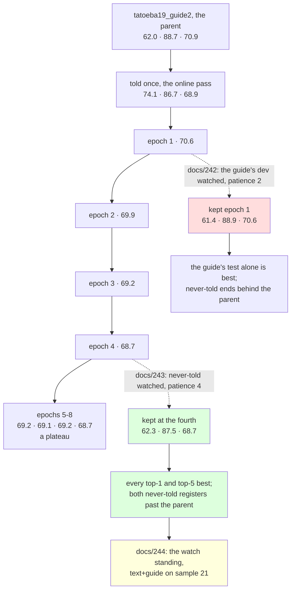

# 243 · The epochs repay, at the fourth - the stop rule was the thing

The learner is told English the way a person is: a grammar guide, then ordinary
sentences, an instalment at a time, each run resuming the last one's checkpoint
so nothing it has learned is thrown away. Nineteen instalments of Tatoeba have
been told that way, and the twentieth (docs/242) was the first to read a second
never-told register at every epoch while letting nothing act on it. That column
said the two registers were running opposite each other, and that the run was
keeping an epoch chosen by the register that moved least. This instalment pulls
the lever that column argues for: **the same parent, the same text, the epochs
stopped on the never-told register instead of the guide's dev.**

It is the first `watch` row in the record, and `--watch` had been coded since
docs/235 without once being pulled.

## The same run, cut in a different place

Nothing was drawn and nothing new was told. `tatoeba19_guide2` was resumed and
`sample80k_20.txt` told again with the guide's 18,446 twice beside it - the same
116,892 sentences, the same 835,184 words, the same seed - with two things
changed: the epochs are measured and kept on `tatoeba/heldout_dev1k.txt`, and
patience is four rather than two, because a patience of two on a register the
first epochs sit *below* cannot see a recovery.

The two runs turn out to be **the same trajectory**. The online pass reads
24.9% and 68.9 in both, to the tenth. Epochs 1, 2 and 3 read 70.6, 69.9 and
69.2 in both, and their train errors are 2.268, 2.201 and 2.174 in both. The
telling is deterministic, now shown three times, and the whole difference
between docs/242 and docs/243 is **where the knife falls**.

| epoch | error (train) | never told, top-1 | never told, perplexity | minutes |
|---|---|---|---|---|
| `tatoeba19_guide2`, before a word was told | — | 25.7% | 70.9 | — |
| told once (online) | — | 24.9% | **68.9** | 8 |
| 1 · *docs/242 kept this one* | 2.268 | 25.2% | 70.6 | 132 |
| 2 | 2.201 | 25.6% | 69.9 | 133 |
| 3 · *docs/242's patience fired here* | 2.174 | 25.7% | 69.2 | 127 |
| **4** | 2.157 | **25.9%** | **68.7** | 127 |
| 5 | 2.145 | 25.6% | 69.2 | 144 |
| 6 | 2.135 | 25.7% | 69.1 | 131 |
| 7 | 2.127 | 25.7% | 69.2 | 135 |
| 8 | 2.122 | **25.9%** | **68.7** | 210 |

Nineteen hours, eight epochs of eight, patience four never firing.

## The answer is yes, at the fourth

docs/242 asked whether an epoch exists that holds the guide's test near 61 *and*
never-told perplexity under 88.7. **It does, and it is epoch 4.**

| | the guide's held-out test | never told, `heldout2k` | never told, `heldout_dev1k` |
|---|---|---|---|
| `tatoeba19_guide2`, the parent | 27.2% · 49.8% · 62.0 | 24.2% · 46.2% · 88.7 | 25.7% · 48.6% · 70.9 |
| told once (online) | 24.2% · 46.0% · 74.1 | 23.7% · 45.5% · **86.7** | 24.9% · 48.0% · 68.9 |
| `tatoeba20_guide2`, kept epoch 1 | 27.6% · 50.1% · **61.4** | 24.1% · 46.4% · 88.9 | 25.2% · 48.3% · 70.6 |
| **`tatoeba20_watch`, kept at the fourth** | **27.7% · 50.3%** · 62.3 | **24.4% · 46.8% · 87.5** | **25.9% · 48.8% · 68.7** |

The watched run is **the best top-1 and the best top-5 of every state on every
one of the three registers**, and the best never-told perplexity any checkpoint
has reached. Both never-told registers end past the parent - 88.7 → 87.5 and
70.9 → 68.7 - where its dev-stopped sibling ended 0.2 *behind* the parent on one
and 0.3 ahead on the other.

The whole price is **0.9 of perplexity on the guide's held-out test**, 61.4 →
62.3, which is 0.3 behind the parent's 62.0. On that same register its top-1 and
top-5 are the better of the two. So the guide's test loses on perplexity and
gains on both accuracies, which is worth saying plainly: the two measures of one
register disagree about which checkpoint is better.

## It was not a trade. It was impatience

docs/242 read the column and called the epoch loop a trade: the text teaches
2.0 of never-told perplexity in one pass, the epochs give 1.7 of it back, and
what you buy with it is twelve points of the guide's test. That reading was as
far as three epochs could see.

With eight, the epochs **repay all of it**. The online pass takes the register
70.9 → 68.9, the text's 2.0; epoch 1 hands 1.7 of it straight back; and then
epochs 2, 3 and 4 earn it again, reaching 68.7 - **2.2 under the parent, and
0.2 past what the one pass had taught.** Nothing is sold. The epochs are simply
slower than one pass at delivering what one pass teaches, and docs/242 stopped
two epochs before the delivery because it was watching a register that could
not see it.

And then they stop. From epoch 4 on the register reads 68.7, 69.2, 69.1, 69.2,
68.7: a plateau, not a descent. Four epochs is what this instalment is worth,
eight is enough to prove it, and there is no reason to think sixteen would pay.

## The log could not say which epoch, and now it can

Epochs 4 and 8 both read 68.7 and the table prints a tenth, while the stop rule
compares at full precision. The run kept one of them and **the log did not say
which**: `epoch::run` knew the number and threw it away, answering with the
learner alone. It answers with the epoch now - 0 for the online pass, which is
what a run whose epochs all read worse keeps - and `main.rs` prints `kept epoch
4 at …` or `kept the online pass at …` in place of `kept the best epoch at …`.

So this document cannot name its own kept epoch beyond "4 or 8", and it is the
last one that will have to say so. Both read the same to a tenth, so no number
above is in doubt; what was in doubt is whether a reader could check.

## What it answers with

## What the hundred prompts say

Four answer with nothing, against docs/242's five: *i have been waiting*, *if i
had known*, *she has been working* and *having finished her work*. Two of
docs/242's blanks are filled - *do you ever have* → "a problem", *what do you
suggest* → "i do" - and *she has been working* went blank where it had said
"hard", so it is not a clean gain.

What is new is the guide's own metalanguage. *cheaper and more* → "expensive are
comparative" and *longest and most* → "enjoyable are superlative forms", where
docs/242 gave "expensive are you" and "of the time": the lesson sentences are
being learned **as lessons**. *the younger you are* → "the easier it is to
learn" for "the best", *the advantage of* → "living alone" for "the car is
alleged to e", *the strike started* → "three weeks ago" for "three times a
week". Against that, *the internet has* → "been the way to the station" is worse
than "changed", and *some cars have* → "four houses" worse than "four doors".
*i wish somebody* → "would unit" survives a fifth instalment.

## Read, straight

- **The epoch loop does not sell English. It is slow at buying it.** All 2.0 of
  the text's teaching comes back by epoch 4, and 0.2 more.
- **The stop rule was the whole defect.** Two runs, one trajectory, identical to
  the tenth; the only difference is which register chose the epoch, and it is
  worth 1.4 of never-told perplexity and every accuracy on every register.
- **Four epochs is this instalment's worth.** Epochs 5 to 8 are a plateau at
  68.7-69.2. Patience four never fired, so nothing was stopped early.
- **One register's two measures disagree.** The guide's test prefers epoch 1 on
  perplexity and epoch 4 on top-1 and top-5. A single number chose the epoch for
  twenty instalments.
- **The record's `gain` column now measures the register the run no longer
  optimises.** With the watch standing, `gain` reads the guide's test while the
  stop rule reads never-told, and the proposer ranks levers on `gain`. It
  already reports this row as moving the registers against each other (+1.2
  beside -0.3) - correctly, and with no idea which direction is the good one.
  **That is what docs/244 has to settle**, on a second row, before the proposer
  is changed to rank on the never-told column.
- **This instalment spent nothing.** It left the well where docs/242 did, at
  242,921 Tatoeba sentences under the series' rule. Drawing `sample80k_21.txt`
  for docs/244 takes it to **162,921, about two instalments**: 80,000 of 80,000
  within the rule, 571,782 words, 7.15 a sentence against sample 20's 7.16.

## Status

`tatoeba20_watch.ckpt` is 496,209,290 bytes - to the byte the size of its
dev-stopped sibling, same vocabulary of 65,827, same text, no new words. 79 GB
free of 953, down from 84; none deleted.

The record proposes `text+guide` again, resuming `tatoeba20_watch` - it takes
the newest row as the parent, which here means it prefers the watched checkpoint
by recency rather than by judgement, and happens to agree with this document.
docs/244 pulls that proposal on `sample80k_21.txt` **with the watch standing**,
recorded as `text+guide` under the name `tatoeba21_watch`, because a run is
named by what it does besides (docs/235). The question it answers: does the
watched stop rule still pay on new text, or was epoch 4 a property of telling
sample 20 twice?
