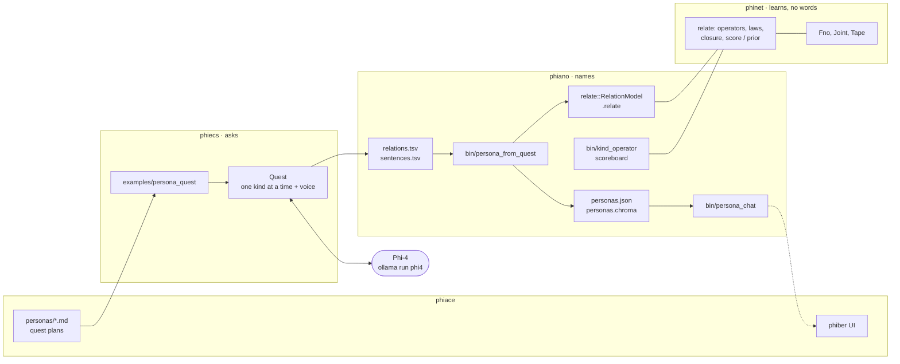
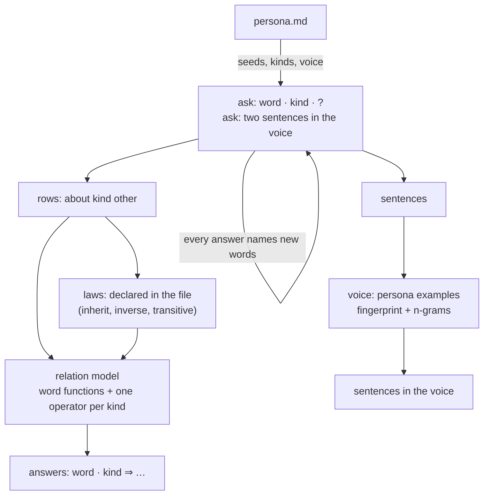

# 98 · The system, drawn and judged; personas as quest plans

In Phient's world, a word (w) is nothing but what it relates to, under what
conditions (c). The Phical paradigm, X ⇒ Y, drives and composes Phient's Phasor
Language Models: Phinet, Phiano, PhiTon. Phical stores no point: a word is 32–64
relations, each a complex phasor on a closed circle with a count; meaning is a
side effect of pairs of words moving under a condition.

## 1. The size is set by the dimensions

The user's target (2026-09-29): **about 4% of Phi-4**. Phi-4 is 14B
parameters, so 4% is **~560M**. What sets the size is the number of
dimensions — channels per token — because the table of word functions is
most of the model:

size ≈ tokens × dimensions × 2 (source and target side) + operators

| dimensions per token | 100k tokens (Phi-4's vocabulary scale) | share of Phi-4 |
|---|---|---|
| 64 (today's base) | 12.8M | 0.09% |
| 256 | 51M | 0.37% |
| 1,024 | 205M | 1.5% |
| 2,048 | 410M | 2.9% |
| **~2,800** | **~560M** | **4%** |

Operators are small beside this (33k numbers for all six kinds today,
docs/95). How far below 4% the model can go is not something to fix in
advance: it is where the scoreboard stops improving as dimensions are added
(docs/90 §6) — the curve decides it.

## 2. The system

## 3. Judged

| part | state | measured |
|---|---|---|
| quest (phiecs) | works on Phi-4; one kind at a time returns the asked format | 400 questions, ~30 s each, 1,148 rows (docs/95) |
| relation model (phinet::relate) | works | told MRR 0.52–0.81; held out within kind 0.127 vs prior 0.065 (docs/95) |
| laws, counted | real but soft in Phi-4's answers | inheritance 25–39% |
| laws, declared as structure | designed (docs/97), **not built** | — |
| persona from quest | **built today**, end to end on a stand-in oracle | quest → 126 rows + 12 sentences → persona → reply; no Phi-4 run yet |
| voice (sentences) | built; Phi-4 not yet asked | — |
| dimensions past 64 | registry built (docs/91), **not wired** | — |
| generation / chat quality | persona_chat works on book personas | KN panel 84.6% ± 3.0 (docs/87); quest personas unmeasured |
| code (compiler laws) | designed (docs/97 §2), **not built** | — |
| phiace UI | personas not yet shown there | — |

The pieces that learn and measure are in place; the pieces that make the
model follow laws, grow its dimensions and write code are drawn, not built.

## 4. Personas are quest plans

`phiace/personas/*.md` (Rustacean, Pythonista, Naturalist, Jane Austen): a
frontmatter block the quest reads (phiecs `persona::Persona`) and a body for
people. `examples/persona_quest` runs a file (one quest per seed, one kind
at a time, two sentences per word in the voice; a finished seed is
skipped); `bin/persona_from_quest` turns the folders into a shared lexicon,
a persona per file and a `.relate` model per persona; `persona_chat` talks as
it (`PHIANO_PERSONAS`). phiecs 34 tests (2 persona, 1 voice).

## 5. Next

1. Run Naturalist from the night's tables (its seeds are the night's) and
   Rustacean on Phi-4.
2. Declared laws as structure (docs/97 §1), read from the persona file.
3. Dimensions past 64 wired, and the scoreboard against dimensions — the
   curve that says where below 4% the model stops improving.
