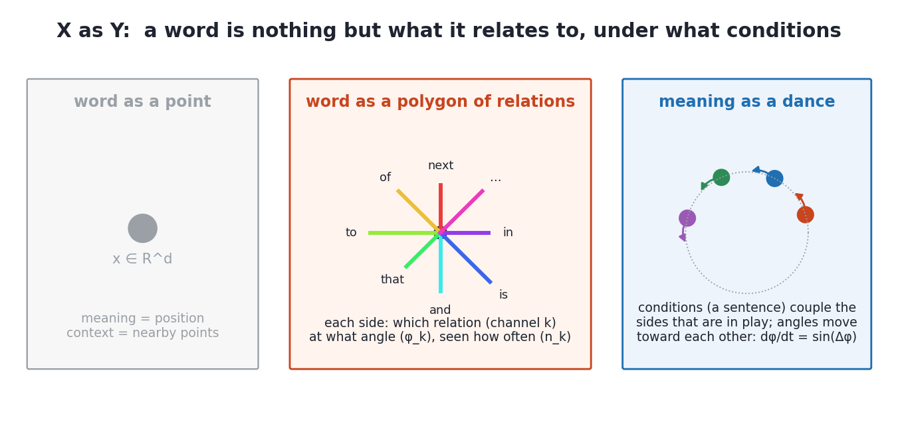
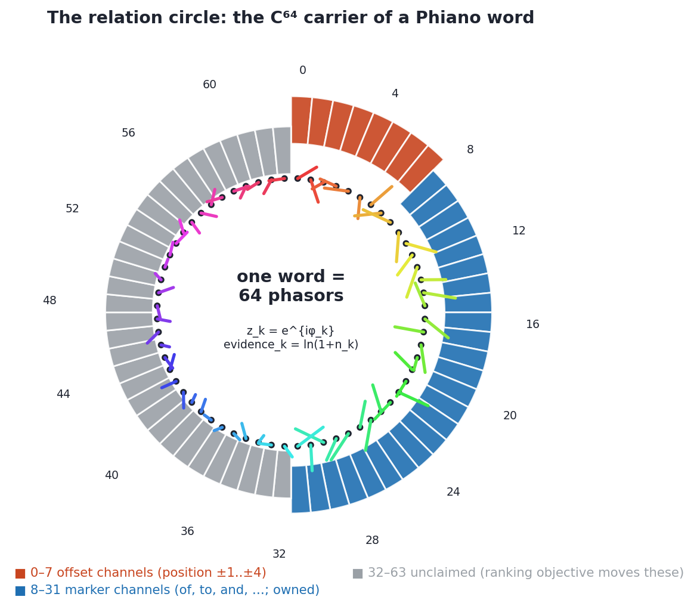
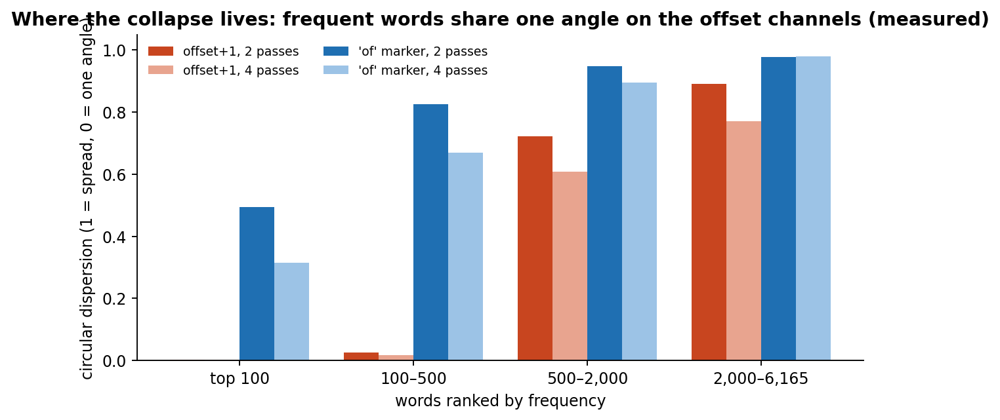
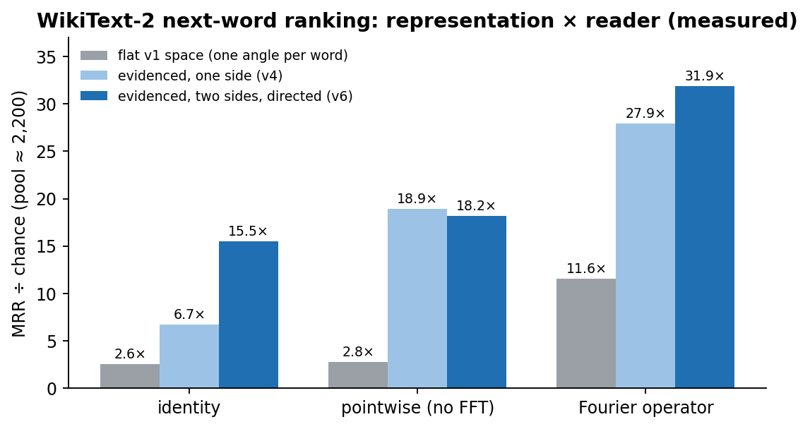
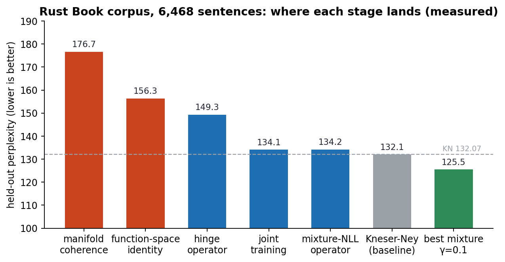
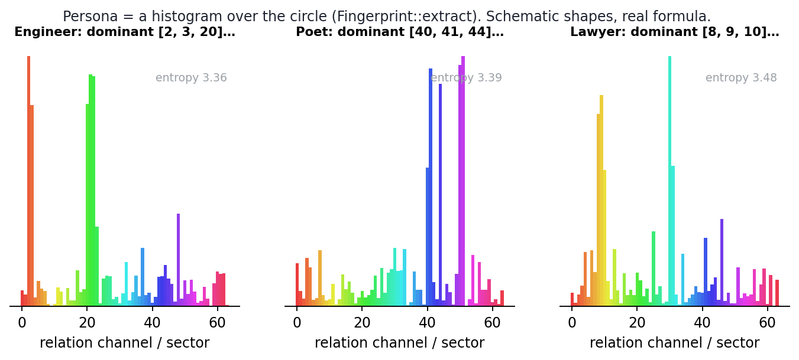

# Phiano 1

## X as Y: Words as Phase Oscillators on a Closed Relation Circle

**Phiano Project** · `gemphi/phiano` · September 2026 · Paper 1 of 3 (Phiano 1 · Phinet 2 · Phical 3) · revision 7

---

> **The paradigm.** In Phient's world, a word *w* is nothing but what it relates to, under what conditions *c*. That sentence is the whole engine in play. We call it the Phical paradigm, **X ⇒ Y**, and it is what drives and composes Phient's Phasor Language Models — Phinet, Phiano and PhiTon among them. Most large language models store a word as a point in a high-dimensional space and put the rest of the work into matrix-multiplication optimisation; the optimisations are necessary only to the paradigm that justifies them. Phical deliberately stores no point at all. A word is a set of 32–64 possible relations — positions, grammatical markers, and channels the training objective is free to claim — and each relation is a complex phasor: an angle on a closed circle (a sphere, once evidence is its latitude), with a count of how often that relation has been observed and played out. Meaning is not a location. It is a side effect of the interaction of pairs of words: put two words under a condition, and the sides that condition selects move toward each other. Everything the model knows is the history of those movements, and nothing else is in play.

---

### Abstract

Phiano represents a word as a *polygon of relations*: one unit complex number per **relation channel** (64 channels) giving the angle that word presents to the world under that relation, plus an integer per channel counting how often the relation has been observed. The channels are the conditions: eight positional offsets (+1…+8 words ahead), twenty-four grammatical markers learned from the corpus (*the, to, a, in, of, that, and, …*), and thirty-two channels left for whatever objective claims them. Learning is a Kuramoto step restricted to the channel a sentence exercises, with a same-channel repulsion. Reading is an evidence-weighted complex inner product.

This revision adds what the first draft lacked: the paradigm stated first and formalised; one sentence traced through a trained lexicon, angle by angle, with real evidence counts; the complete channel table as learned from the Rust Book corpus; a **measured defect and its fix** — the hundred most frequent words shared a single angle on every offset channel (dispersion 0.003); frequency-weighted repulsion alone did not cure it (0.004), a source/target split alone did not (0.08), and the two together hold it at 0.39–0.56 across passes, so every channel now has two sides (format v5) and relations are directed; the numbers that reproduce on the current code (balanced similarity 44.5 % → 51.8 %; composition 3.4× null through the family channel and 2.1× through the pair's own after the split, antonyms 9.7×; the first draft's 55.8 % / 3.0× were from an earlier code state); Searle's conditions as the second half of *X as Y*; the abstraction levels 0–4; related work with the real citations; and the persona system with thirty-two scenarios. With the two sides read *directed* — a context from source sides ranked against target sides — the lexicon's own algebra predicts the next word at 15.5× chance on WikiText-2 with no operator at all (one-sided: 6.7×), and the Fourier operator reaches 31.9× (was 27.9×). Held-out perplexity remains 176.7 → 134.2 against Kneser-Ney 132.1 on the one-sided harness, and the phase term still adds a sixth of a point over n-gram tables on a six-thousand-sentence corpus.

---

## 1. The paradigm, formally



*Figure 1. Left: the view Phiano rejects. Middle: a word as a polygon whose sides are relations. Right: meaning as the coupled motion of those sides under the conditions a sentence sets.*

Let R be a finite set of relations (|R| = 64) and C a set of conditions. Phiano's claim is that a word w is fully given by a map

```
w :  R × C  →  S¹ × S¹ × N,        w(k, c) = ( src_w[k], tgt_w[k], n_w[k] )
```

two angles (§1 below: as source and as target) and an evidence count for each relation k, where the condition c is what *selects* k: in the current lexicon a condition is a pair of positions in a sentence and the marker words between them, and the selection is `RelationVocab::channel(tokens, i, j)`. Nothing else is stored. Two consequences follow immediately and both are borne out by the measurements below.

A relation has a direction — *a* relates to *b* — so each side of the polygon is really two angles: the one the word shows as the **source** of the relation, `src_w[k]`, and the one it shows as the **target**, `tgt_w[k]`. §4 is the measurement that made this necessary.

First, **similarity is agreement of sides**, not distance of points: `sim(a, b) = Σ_k w_k ev_a(k) ev_b(k) · ½[cos(src_a[k] − src_b[k]) + cos(tgt_a[k] − tgt_b[k])] / Σ_k w_k ev_a(k) ev_b(k)`. Two words are alike to the extent that they turn the same angles toward the same relations, in both roles, weighted by how much either has been seen under them.

Second, **learning is a dance**: when a sentence places a before b under condition c selecting k, a's source side and b's target side move toward each other by `sin(tgt_b[k] − src_a[k])`, and a third word drawn in proportion to its frequency^0.75 is pushed away on k. Nothing is "assigned" to a word; it is only ever moved.

The closed geometry matters. The circle is the smallest closed space with a continuous symmetry; the complex unit circle is the circle with a multiplication. On it, binding is rotation, unbinding its inverse, composition the sum of rotations, and the Fourier transform the natural analysis (Paper 2). A word is then a point of the 64-torus (S¹)^64 — a space you cannot fall off — and Paper 3 closes each factor into a Riemann sphere so that evidence, too, has a place to live.

### 1.1 "In what conditions": Searle

The second half of the paradigm is Searle's. A speech act has *conditions of satisfaction*: an assertion is satisfied by the world being as stated, a directive by the hearer's doing, a commissive by the speaker's doing, an expressive by sincerity, a declaration by the utterance itself. Phinum's `SearleClassifier` reads a sentence's syntax key into one of these five and then into 16, 32 or 64 sub-variations — the same Q64 lattice the channels sit on. A speech act is therefore a *condition* in exactly the sense of §1: it selects which sides of a word are in play. "Close the door" and "the door is closed" share every word-relation on the offset channels and differ in the act; the act is not stored in the word, it is the condition under which the word's sides are read. Searle's *Background* — the pre-intentional know-how a speaker brings — is, in this reading, the evidence counts: how often each side has been exercised, which is what the log-evidence weights encode.

### 1.2 Levels 0–4

The user's design has five abstraction levels with magnitudes growing by powers of two (64 = 2⁶ variations per layer). In the current code these are: level 0, the word (a polygon); level 1, the phrase (an edge: two polygons under one condition); level 2, the sentence (a path: a sequence of conditions); level 3, the story (a surface: sentences sharing vertices); level 4, the concept (a region: an attractor basin). Phical's topology module (Paper 3 §1.1) implements each as a shape with invariants. Composition depth in §6 is the same ladder read operationally: level d is a bind-sum-unbind nested d deep, and the measured recovery halves per level.

---

## 2. The representation, as stored



*Figure 2. One word is 64 phasors. Channels 0–7: offsets +1…+8. Channels 8–31: marker words, learned. Channels 32–63: unclaimed. Drawn length is ln(1+n).*

`SpectralPhasor` in `src/phasor.rs`:

| field | type | meaning |
|---|---|---|
| `phase[k]` | u8 × 64, packed `[u64; 8]` | **source** side: the angle on channel k when this word is the one relating (256 quanta, 2π/256 ≈ 0.0245 rad) |
| `tgt[k]` | u8 × 64, packed `[u64; 8]` | **target** side: the angle when this word is the one related *to* (v5; a v4 file reads back with both sides equal) |
| `evid[k]` | u32 × 64, packed `[u64; 32]` | times relation k has been observed for this word (v6; was u16, and *the* saturated it) |
| `amplitude`, `band_n`, `count` | f64, u32, u32 | legacy salience, Phical's sub-band, token count |

`evidence(k) = ln(1 + evid[k])` is the only non-linearity in the read path. `on(a, b, k) = cos(src_a[k] − tgt_b[k])` is one side compared and is *directed*: "a then b". `similarity_with` compares source with source and target with target — two words are alike when they present the same sides in both roles. `shared_relation_with` returns the channel on which two words agree most, evidence-weighted. `bind(a, r)[k] = a[k] + r[k]` and `unbind` its inverse, exact on the circle; superposition of several bound terms is not exact, and §6 measures its crosstalk.

### 2.1 The channel table, as learned

`RelationVocab` fixes channels 0–7 as offsets and learns the markers as the most frequent between-words of the training corpus, up to `MARKER_CHANNELS_MAX = 24`. On the Rust Book corpus (10,315 training sentences, 6,165 words, trained in 1.8 s), after two passes:

| ch | relation | dispersion | words with evidence | ch | relation | dispersion | words with evidence |
|---|---|---|---|---|---|---|---|
| 0 | offset+1 | 0.928 | 6,165 | 16 | is | 0.931 | 1,321 |
| 1 | offset+2 | 0.926 | 5,526 | 17 | this | 0.916 | 894 |
| 2 | offset+3 | 0.915 | 4,371 | 18 | for | 0.924 | 1,047 |
| 3 | offset+4 | 0.912 | 6,081 | 19 | code | 0.914 | 657 |
| 4 | offset+5 | 0.910 | 5,970 | 20 | as | 0.933 | 803 |
| 5 | offset+6 | 0.895 | 5,782 | 21 | with | 0.958 | 918 |
| 6 | offset+7 | 0.910 | 5,487 | 22 | can | 0.904 | 641 |
| 7 | offset+8 | 0.905 | 5,052 | 23 | you | 0.978 | 735 |
| 8 | the | 0.858 | 2,754 | 24 | it | 0.908 | 792 |
| 9 | to | 0.911 | 1,831 | 25 | an | 0.956 | 721 |
| 10 | a | 0.929 | 1,753 | 26 | value | 0.884 | 520 |
| 11 | in | 0.912 | 1,706 | 27 | use | 0.927 | 601 |
| 12 | of | 0.919 | 1,482 | 28 | type | 0.866 | 494 |
| 13 | that | 0.918 | 1,411 | 29 | on | 0.898 | 666 |
| 14 | and | 0.928 | 1,768 | 30 | be | 0.936 | 580 |
| 15 | we | 0.887 | 1,090 | 31 | will | 0.934 | 614 |

Channels 32–63: no evidence, dispersion 1.0 (unclaimed; the ranking objective moves them). Dispersion is `1 − |mean resultant|` over the words with evidence: 1 is uniform, 0 is one angle. Every channel looks healthy at this resolution. §4 shows why that is misleading.

The markers are the corpus's own: *code, value, type, use* are markers here because this is the Rust Book; on WikiText-2 they are not. A lexicon's `.chroma` v4 file carries its marker table, so two lexicons agree on what a channel means only if they share it — which is why personas (§7) are not portable across lexicons.

### 2.2 Channel ownership

The ranking objective (`Trainer::update_channels`) may only move `unclaimed()` channels. Before this rule the ranking gradient overwrote the marker channels and composition fell to null; with it, similarity and composition improve together (§5).

### 2.3 C64 and Q64

The circle is read at two resolutions, both in code. **C64** is the continuous carrier: 64 channels of `Complex64`, where Kuramoto steps, gradients and Fourier modes live. **Q64** is the 64-point lattice on the same circle: `SECTOR_RESOLUTION = 64`, `Hexagram::from_phase` (6 bits), `Phinum64`. Juncture: `q = ⌊64φ/2π⌋`, `φ = 2π(q+½)/64`, error ≤ π/64 per channel with the half-step (the code's `phase_angle()` omits it; one-line fix). No `Q64` symbol exists in source; the name is this paper's, for what three modules already share. Paper 3 develops it.

---

## 3. One sentence, traced

`cargo run --release --bin trace` (`src/bin/trace.rs`) trains the lexicon and prints what it knows about a sentence. The trace below is from the one-sided (v4) lexicon, so that §4 can show what was wrong with it; the sentence is in the training set, and §3.3 shows one that is not.

### 3.1 Pairs and their conditions

For "the borrow checker ensures that references are always valid", every pair within the window, the channel the condition selects, the agreement of the two words on that channel, and their evidence there:

```
the        -> borrow     offset+1   cos +0.964   evidence 35336 / 182
the        -> checker    offset+2   cos +0.933   evidence 23950 / 52
the        -> ensures    offset+3   cos -0.803   evidence 13052 / 10
the        -> that       offset+4   cos +0.981   evidence 23546 / 6704
borrow     -> checker    offset+1   cos +0.999   evidence   182 / 66
borrow     -> ensures    offset+2   cos -0.882   evidence    88 / 24
borrow     -> references offset+4   cos +1.000   evidence   142 / 360
checker    -> references that       cos +0.098   evidence     8 / 40
ensures    -> that       offset+1   cos +1.000   evidence    80 / 9068
ensures    -> references that       cos +0.672   evidence    76 / 40
ensures    -> are        that       cos +0.858   evidence    76 / 154
that       -> references offset+1   cos +0.989   evidence  9068 / 494
references -> are        offset+1   cos +0.999   evidence   494 / 2044
are        -> valid      offset+2   cos +1.000   evidence  1624 / 188
always     -> valid      offset+1   cos +0.999   evidence   216 / 380
```

Read this as the paradigm in numbers. *checker → references* is not read on an offset channel — the word *that* stands between them, so the condition is "that", and on that channel the two barely agree (+0.098; *checker* has been seen under "that" eight times). *ensures → references* under the same condition agrees at +0.672. The pair *the → ensures* on offset+3 is at −0.803: the lexicon has learned that *ensures* does **not** sit three words after *the* — a negative side, learned by the repulsion term, with only ten observations behind it on *ensures*'s side.

### 3.2 A word's polygon

```
borrow     dominant offset+1 (ln-evidence 5.21)
           offset+1:182@0.71  offset+2:88@4.76  offset+3:42@3.51  offset+4:142@4.00
           offset+5:118@3.31  offset+6:108@4.12  the:66@4.42  to:8@1.57  a:20@3.95  in:6@4.34
reference  dominant offset+1 (ln-evidence 6.79)
           offset+1:888@0.86  offset+2:290@4.71  offset+3:92@3.46  offset+4:660@3.98
           the:140@5.40  to:292@1.89  a:356@2.01  in:46@2.77
the        offset+1:35336@0.98  offset+2:23950@4.81  offset+3:13052@3.44  to:2558@1.96  in:2774@2.85
function   offset+1:2590@0.74   offset+2:1362@4.84   offset+3:406@3.36   the:824@5.33  a:374@1.82
```

(`relation:count@angle`.) *borrow* and *reference* agree on the sides "to" (1.57 vs 1.89) and "a" (3.95 vs 2.01 — not so much), and their evidence-weighted similarity is +0.250, against +0.244 for the old one-angle resonance. *borrow* / *ownership* comes out at **−0.195** where the old reading gave +0.078, and *mutable* / *immutable* at −0.115 against +0.186: words that occupy the same *slots* but never the same *sides* now read as opposed. Whether that is what one wants from "similarity" depends on the task; it is what the paradigm predicts.

But look at the angles down the columns: every one of these four words sits at ≈0.8 on offset+1, ≈4.8 on offset+2, ≈3.4 on offset+3, ≈4.0 on offset+4. Their offset polygons are the same polygon. §4 is about that.

### 3.3 A held-out sentence

"RefCell<T> in Chapter 15 to allow us to mutate…", never trained on:

```
refcellt  -> in       offset+1  cos +1.000     chapter -> allow   to        cos -0.831
refcellt  -> chapter  in        cos -0.985     15      -> allow   to        cos  0.000
refcellt  -> 15       in        cos +0.989     to      -> us      offset+2  cos +1.000
```

`15 → allow` under "to" is exactly 0.000: *15* has no evidence on the "to" channel, and `on` reports an angle that was never moved. The lexicon distinguishes "these disagree" from "I have never seen this", which a dense embedding cannot.

---

## 4. The collapse — a measured defect, and the fix that worked



*Figure 3. Circular dispersion of the offset+1 and "of" channels by frequency tier, **before** the fix. The global figure (0.93) was the average of a collapsed head and a spread tail.*

| words by frequency | one side, 2 passes | one side, 4 passes | **two sides + freq^0.75 negatives**, src / tgt, 2 passes | same, 4 passes |
|---|---|---|---|---|
| top 100 | **0.003** | **0.003** | **0.391 / 0.562** | 0.383 / 0.541 |
| 100–500 | 0.026 | 0.016 | 0.329 / 0.917 | 0.275 / 0.873 |
| 500–2,000 | 0.723 | 0.609 | 0.787 / 0.940 | 0.634 / 0.906 |
| 2,000–6,165 | 0.890 | 0.770 | 0.966 / 0.963 | 0.935 / 0.905 |

With one angle per word per channel, the hundred most frequent words sat at one angle on offset+1, and the collapse spread down the ranking with passes. The same-channel repulsion of the first draft kept the *tail* dispersed and the *average* healthy; it did not touch the head.

**Why.** One phase per word makes "a then b" and "b then a" the same constraint, so attraction on every adjacent pair is a Kuramoto system on the connected co-occurrence graph, whose fixed point is total synchronisation; the frequent words, adjacent to everything, reach it first. Repulsion only slows it. This is the degeneracy word2vec avoids with two vectors per word.

**What did not work alone.** Frequency^0.75 negatives with a symmetric push: 0.003 → 0.004. The source/target split with the old capped negative pool: 0.003 → 0.082 (src) / 0.072 (tgt), still sliding with passes.

**What worked.** Both: two sides per channel (`tgt: [u64; 8]`, format v5) *and* negatives drawn ∝ count^0.75, uncapped. The head holds at 0.4–0.6 across passes. The frequent words' source sides stay the most similar tier — they really do share successors — and that is now a fact about the corpus, not an artefact of the rule. *the/a* similarity falls from +0.77 to +0.40, which is the collapse leaving. The analogy `a:b :: c:?` is now read directed, `tgt_d = src_c + (tgt_b − src_a)`, because under the split that is what a relation is.

`docs/69_two_sides.md` is the log.

---

## 5. Measurements on the current code

All from `cargo run --release --bin promoted` / `phinet` / `evaluate` / `phinet_residual` on `data/rust_book_corpus.txt` (12,894 sentences; 80/10/10 split seed 42), one seed each; treat differences under ~2 % as noise. **The first draft quoted 51.7 % → 55.8 % and 3.0× from `docs/64`; those were an earlier code state. What follows reproduces today.**

### 5.1 Similarity and composition

| metric | control (relations off) | one side (v4) | **two sides (v5)** |
|---|---|---|---|
| pair-vs-random, dense resonance | 44.5 % | 37.1 % | 37.0 % |
| pair-vs-random, evidence-weighted **balanced** | — | 51.8 % | **51.8 %** |
| pair-vs-random, evidence-weighted, raw | — | 31.4 % | 36.8 % |
| best single relation | — | 22.6 % | 27.0 % |
| composition a:b::c:?, family channel, vs decoy null | 0.6× | 4.1× | 3.4× |
| … antonym / comparative families | — | 1.9× / 2.6× | **9.7× / 8.2×** |
| composition, pair's own channel | — | 0.9× | **2.1×** |
| held-out perplexity via `evaluate` (v4) | 233.5 | 182.2 | not re-run |

Three honest readings. Turning relations on *hurts* the old dense reading (44.5 → 37): the dense average now averages over sides that mean different things; the evidence-weighted reading gets it back and more (51.8), and the split does not move it. The split moves what the collapse was hiding: raw similarity (+5 points), the best single relation (+4), the pair's own channel from null to 2.1×, antonyms and comparatives from 2× to 8–10×. It gives up 0.7× on the family channel overall. The operator numbers in §5.2–5.3 were measured on the one-sided lexicon and are not yet re-run.

### 5.2 Next-word ranking on WikiText-2



*Figure 4. Pool ≈ 2,240, chance MRR 0.0037. Bars: what a word is. Groups: how the context is read.*

| reading of the two-sided lexicon | identity | pointwise | Fourier operator |
|---|---|---|---|
| one side (v4, for reference) | 6.7× | 18.9× | 27.9× |
| source sides only | 4.7× | 12.2× | 26.5× |
| target sides only | 5.5× | 8.7× | 29.0× |
| both sides, 128 samples | 5.5× | 10.7× | 27.9× |
| **directed: source context → target table** | **15.5×** | **18.2×** | **31.9×** |

Sixty-four evidenced channels instead of one angle took the identity reader from 2.6× to 6.7×; the split, read the way a relation *is* — a context's source sides against a candidate's target sides — takes it to 15.5× with no learned parameters at all, and the operator on top of that to 31.9×. Reading only the source side of a two-sided lexicon is *worse* than a one-sided lexicon (4.7× vs 6.7×): a one-sided phase was doing both jobs badly, a source side does one job. Any code comparing a context to a word's source side is now a bug. `docs/70_issues_closed.md`.

### 5.3 Perplexity



*Figure 5. Rust Book split. Every bar is a measurement.*

The phase side is a language model of Kneser-Ney's strength (134.2 vs 132.1) — on the one-sided lexicon. On the two-sided lexicon the same harness reads **142.8 directed / 144.1 source** for the mixture-likelihood operator (153.4 / 157.5 hinge; 158.5 / 155.8 identity): the split, which won ranking on the frequent pool, *loses* ten points of full-vocabulary perplexity, because a rare word's target side moves only when that word is the later word of a pair and perplexity is a sum over exactly those words. Tying the target side to the source side below 16 observations — the obvious repair — was measured and made every number worse (146.0 mixture); it ships disabled. Mixed with the n-gram tables everything reads 125.5 against a unigram-under-trigram of 125.6: on this corpus the phase term is redundant with the tables for what they can predict. `docs/71`.

---

## 6. Composition depth

`src/phinet/compose.rs` builds `Σ_j bind(word_j, role_j)` over a window and asks whether a constituent can be recovered by unbinding. 704 composable words, chance MRR 0.0101: 19×, 10×, 5×, 2× at levels 1–4 by phase subtraction alone. Recovery halves per level — the crosstalk of superposition on a 64-sample circle — and a cleanup operator (Paper 2 §5) trained on levels 1..3 reads 66×, 52×, 45×. Depth is bought by training; the order of purchase (a curriculum) changes the price by a few percent.

### 6.1 One pair key everywhere

Until this revision the composition bench keyed a pair by its offset alone while the trainer and `relational_score` keyed it by `RelationVocab::channel(tokens, i, j)` — the rarest marker word standing between the two, else the offset. Two definitions of "the condition between two words" is one too many for a paradigm that says a word *is* its conditions. `Composition` now takes a `PairKey`: `Offset` (the old bench, kept so the numbers stay comparable) or `Channel(&RelationVocab)` — the trainer's own key, so what is composed is what was coupled. A test (`pair_key_is_one_definition`) pins the composition's key to `RelationVocab::channel` on a marker-bearing sentence.

Measured on the Rust Book (`bin/pair_key`, source-side functions, same 704 words): with the channel key and every filler that qualifies (19.9 per word) recovery collapses to 6×/5×/2×/1× — a word bound to twenty conditions is a superposition of twenty, and the 64-sample circle cannot hold it. Keeping the **four best-evidenced** channels per word (`MAX_FILLERS = 4`, the same budget the offset key had by construction) gives 52×/36×/13×/8× phase-only and 81×/66×/57×/3× after cleanup, against the offset key's 59×/19×/8×/3× and 80×/61×/31×/1×. The trainer's key is worse at level 1 by a little and better at depth by a lot — a pair read under its actual condition survives superposition longer than a pair read under its distance. The lesson is the paradigm's own: a word is 32–64 relations, but a *composition* can carry only the few it has evidence for.

---

## 7. Personas — the same circle, read as a distribution



*Figure 6. Three schematic fingerprints; the formula is the real one.*

A persona is `Fingerprint` (`src/persona/fingerprint`): a normalised histogram over sectors of the circle built from examples of the persona's text, plus its entropy and mean length. In the paradigm's terms, a persona is *which conditions a speaker puts words under*, aggregated.

### 7.1 How the system learns a persona

1. `Persona::from_examples` runs `trainer.train_sentence` on every example — the §1 dance, so the persona's text moves the shared lexicon.
2. `Fingerprint::extract` maps each sentence to a wave and a sector, and each content word to its sector with weight `0.3/(1 + amplitude)`: rare words count more, so a persona is a matter of *choice*, not frequency.
3. Normalise; entropy is `diversity`.
4. `likelihood(text)`: normalised weighted log-probability of the text's sectors under the histogram. `World::match_text` re-extracts every persona from its stored examples against the *current* facet before comparing, so an older persona is not disadvantaged by a lexicon that kept learning.
5. `Impersonator`: RiverFlows from the 16 dominant sectors, score `0.4·quality + 0.6·fit`, retrain on the best eight, up to four rounds or Δ < 0.001.
6. `PersonalityMapper`: warm > 0.4 → passionate/direct; cool > 0.4 → analytical/contemplative; green > 0.3 → balanced/adaptive; ≥ 4 dominant → eclectic.

Phinet 2 §6.7 adds the persona as a *tethered copy of the word table*: the persona then changes what words mean *to it*, and deleting the copy is exact unlearning.

### 7.2 Thirty-two persona scenarios

Each is executable against the current `World`/`Persona` API or the Phinet 2 extension; "expect" is what the code computes.

1. **Two engineers, one company.** 200 commit messages each; `compare` ≈ 0.9 and the top differences are domain words — the fingerprint separates *what*, not *how*.
2. **Author attribution.** Three novelists × 50 paragraphs; `match_text` on a held-out one. Confidence `(best − second)/best` drops under 0.1 on dialogue, whose sectors are shared.
3. **One sentence.** A histogram with a handful of bins; likelihood of anything else near the floor. The system does not pretend to know a person from one line.
4. **The child.** A corpus in developmental order; re-extract every 500 sentences and plot entropy — it rises as vocabulary spreads across sectors.
5. **The specialist.** Radiology reports: low entropy, three dominant sectors, "analytical, contemplative". Same person's tweets: entropy doubles.
6. **Drift.** Keep training the lexicon on unrelated text; because fingerprints are re-extracted from examples, the persona follows the lexicon.
7. **Hostile prompt.** From a sector the persona never uses: the fit term pulls the flow back within two rounds; quality drops; visible in the per-round log.
8. **A choir.** Three personas on one prompt; their output centroids sit in their dominant sectors — checkable by eye.
9. **Subtraction.** `difference_vector(poet, lawyer)` by |Δ| gives the sectors that *make* a poet; feed those back to sharpen.
10. **Bilingual.** Two disjoint clusters, high entropy, "eclectic". The system has no notion of language, only of *where on the circle*.
11. **Persona as prior.** Phinet 2 tethered copy changes the top-1 next word on the persona's text and rarely elsewhere — to be measured; the harness exists.
12. **Forgetting.** Remove examples; the shared lexicon keeps the drift. No unlearning in Kuramoto; the tethered copy is the fix.
13. **Impostor.** A good imitation of *vocabulary* scores high; the fingerprint does not measure syntax. Honest limit.
14. **From a codebase.** One crate's doc-comments; dominant sectors are its nouns; "explain X" comes out in that register.
15. **Temperament flip.** Add 100 technical sentences to a warm persona; the label changes when cool mass passes 0.4 of the top five.
16. **Pairs as relations.** A difference vector's centroid is a point on the circle; bind it to a third persona to move it — an experiment.
17. **Support agent.** 1,000 tickets: one dominant sector, converges in a round. Low-entropy personas are cheap.
18. **Historical.** Letters from one century; `Hexagram::from_phase(centroid)` gives a 6-bit Q64 name for the style.
19. **Noise.** 20 % random words: likelihood falls roughly linearly, confidence faster.
20. **Speech acts.** `SearleClassifier` per example: a 70 %-directive persona vs a 70 %-assertive one can share every sector — a second, orthogonal fingerprint, and the "conditions" half of the paradigm made visible.
21. **Author age.** Early vs late work; the difference vector shows sectors gained. No claim about why.
22. **Merging.** Average two histograms: ≈ 0.9 to both parents, strongly to neither. Personas blur, not add.
23. **From one word.** Every sentence containing "borrow" as a persona: the ownership register; "why does this fail" yields borrow-checker prose. This is the mechanism behind `define` chains.
24. **Anonymous reviewer.** Five candidates, short texts: confidence < 0.2. The system says it is guessing.
25. **Live.** Re-extract per chat turn; entropy vs turn shows a conversation narrowing.
26. **On the sphere (Paper 3).** Centroid and spread → a cap on S²; two personas are "the same" when caps overlap.
27. **Conditioned composition.** Bind the prompt to the centroid before `RiverFlow::trace` — one line, and the flow *starts* in the persona's territory.
28. **Quality gate.** Reject impersonations under quality 0.5 regardless of fit; weights in `config/constants.rs`.
29. **Cross-lexicon.** Extract on A, match on B: fails unless the relation tables match. This is why v4 files carry theirs.
30. **Entropy as health.** Entropy rising after every retraining means the lexicon is forgetting the examples; the tethered copy is the fix.
31. **Group.** A team as one persona, each member as another; `compare(team, member)` ranks representativeness.
32. **The system's own.** Feed generated output back as a persona and match it: matching nothing means the impersonator averages; matching one means the fit weight is too high.

---

## 7.3 The Difference Engine reading: score a word relationally

The closed sphere is a *volume of meaning*, and a word is read inside it relationally, not by a coordinate. `Facet::relational_score(ctx, cand)` is that reading made operational: every context word `c_j` is a **wheel**; the condition between `c_j` and the candidate's position — the offset, or the marker word between them — is the **gear** that selects channel `k_j`; and the candidate's target wheel on that channel is read against `c_j`'s source wheel, `on(c_j, cand, k_j)`. Each wheel is timed by its own evidence and turns the next through its gear, which is what Babbage's engine did with carries: no wheel knows the sum, the sum is the state of all of them after the turn. Nothing is averaged into a context vector first, and a pair without evidence is silent rather than neutral — the score is exactly what the corpus has shown.

Ada Lovelace drew the line this section sits on. Of Babbage's two machines she wrote that "while the Difference Engine can merely tabulate, and is incapable of developing, the Analytical Engine can either tabulate or develope", and that the latter "weaves algebraical patterns just as the Jacquard-loom weaves flowers and leaves" (Notes on Menabrea, 1843, Note A; the excerpts are kept verbatim in `data/corpora/lovelace/notes_excerpts.md`). In her terms `relational_score` *is* the Difference Engine: fixed gears, a fixed train of wheels, and it can only tabulate what the corpus set into them. The Analytical Engine around it is the **store** (the two-sided lexicon), the **mill** (the Fourier operator, Paper 2), and the **cards** (the training objectives and the learned scorer's weights, §7.4) — and Lovelace's other point, that the objects operated upon need not be numbers, is the paradigm: the engine weaves relations. Her limit stands too — "it has no pretensions whatever to originate anything" — and every number in this paper is a measurement of how well the machine follows the analysis it was ordered to perform.

This reading is what the learning machine (§7.4) found to be the strongest feature the generator has after the n-gram count, and what closed the proposal problem of `docs/72`: proposals made from the operator's *average* were dominated first by frequent words and then, prior-corrected, by the rare tail; proposals made relationally are real neighbours (distinct-token ratio 0.996). What no proposal survives is the trigram sampler they are fed into — a proposed word enters the tables cold and the next step has no continuation — so the relational *score* ships inside every step (+0.70) and proposals ship off. Score relationally; do not propose from outside the sampler's reach.

## 7.4 The learning machine: nothing hand-tuned in the scorer

The generator's candidate scorer was six constants chosen by hand. `src/learn` replaces it with a log-linear model over eight features whose weights are fit by convex descent on the negative log-likelihood of the true next word among the n-gram's candidates, on the validation split, evaluated on the test split (`bin/learn`; `data/learned.json`; `Generator::new` loads it). The fitted weights are the value audit:

| feature | weight | what it says |
|---|---|---|
| ln count | +1.51 | the n-gram count |
| phase_align (single phase vs target) | +0.02 | the old manifold reading: **nothing** |
| resonance (flow's collective phase) | +0.03 | **nothing** |
| function_word | +0.30 | function words are more likely, not less (the hand scorer penalised them ×0.4) |
| repeat | +0.55 | fit on text; replaced at decode time by a stated sampling constraint |
| operator_cos (directed Phinet operator) | +0.61 | adds value on held-out text |
| relational (§7.3) | +0.70 | the paradigm's own reading: the strongest feature after the count |
| relational_pairs | +0.50 | and more evidenced pairs is better |

Held-out perplexity among the candidates: counts only 8.44, the hand scorer 12.44 (worse than counting), learned 7.28. In generation, judged by a Kneser-Ney model neither system can see: hand 13.6, learned 12.1, with the engine's own evaluator agreeing (0.730 → 0.735). The one constant left in the learned path is `REPEAT_DECODE_PENALTY`, and it is labelled a decoder constraint, not a model parameter. `docs/73`.

## 7.5 The Liskov readings: substitution and the end game

Barbara Liskov (as Barbara Huberman) wrote her 1968 Stanford thesis on a program to play chess end games — the killer heuristic comes from it — then built the Venus operating system at MITRE (1972) as levels of abstraction each testable against the one below, and in 1987 stated the substitution principle: a subtype may stand in wherever its supertype is expected without changing what the program does (record and mapping in `data/corpora/liskov/notes.md`). Two of these are now readings in the machine, measured on the Austen voice lexicon (`bin/liskov`).

**Substitution.** A word *b* may stand in for *a* wherever every relation the context demands of *a* still holds of *b*. `Facet::relational_fit(toks, i, cand)` reads a candidate at a position against every neighbour in the relation window, each pair under the condition the sentence puts between them, on the side the direction demands. This is not similarity — `similarity` asks whether two words present the same sides, a point-like reading — and the measurement separates them: put the best stand-in (never the original) into her sentence and a Kneser-Ney model of Austen reads 238 for the Liskov stand-in against 254 for the most similar word, which is what a random pool word reads (254). The point-like reading is indistinguishable from chance at substitution; the relational one is not. On cloze the relational fit alone (4.1× chance) trails word frequency (5.8×), and the learned scorer's own trade between the two (its `ln_count` and `relational` weights, nothing refit) reads 6.1× — the store and the Difference Engine again, and the cards deciding the mix.

**The end game.** A move is judged by the mate it moves toward. `Generator::with_goal(word, weight)` adds `weight · calls_for(cand, goal)` to every candidate's logit until the goal is said, where `calls_for` is the candidate's source side read against the goal's target side over the evidenced offset channels. Forty held-out prompts, each with a goal word its sentence reaches later, thirty tokens: no pull reaches the goal 2/40 in 23.5 tokens; pull 2 reaches 6/40; pull 4 reaches 5/40 in 8.8 tokens at a perplexity cost of 12.4 → 13.3. The pull works and is small — a trigram sampler can only be steered among the continuations it has — and the honest reading is that goal-directed composition needs the sampler replaced, not the pull raised. The killer heuristic (try first the candidate that won a sibling hypothesis) belongs in the beam and is not implemented.

**Cloze** — recover a masked content word from a pool of 622 (seen ≥ 40 times), 200 held-out positions, chance MRR 0.0113:

| reading | MRR | × chance |
|---|---|---|
| most frequent word | 0.0655 | 5.8× |
| relational, left context only (`relational_score`) | 0.0221 | 2.0× |
| relational, both sides (`relational_fit`) | 0.0463 | 4.1× |
| `relational_fit` × ln(1 + pairs) | 0.0527 | 4.7× |
| learned trade: w_count·ln count + w_relational·fit (weights from `learned_austen.json`) | 0.0691 | 6.1× |

**Substitution** — the best stand-in (never the original) put into her sentence, judged by Kneser-Ney (geo. mean over 200 sentences; lower = she minds less):

| sentence | perplexity |
|---|---|
| as written | 173.0 |
| `relational_fit` stand-in (Liskov: every demanded relation holds) | 237.9 |
| most similar word (`similarity`: the same sides, a point-like reading) | 253.9 |
| random pool word | 254.3 |

- time → **benwick** (fit) / impossible (similar) — *chapter 11 the time now approached for lady russells return the day was even fixed and anne being engaged to join her as soon as she was resettled was looking forward to an early removal to kellynch and beginning to think how her own comfort was likely to be affected by it*
- quite → **before** (fit) / like (similar) — *i was quite surprizedvery glad i am sure but really quite surprized*
- seeing → **anything** (fit) / imagine (similar) — *the expectation of seeing her however was enough to make her interested in the engagement for though she could now meet edwards mother without that strong anxiety which had once promised to attend such an introduction though she could now see her with perfect indifference as to her opinion of herself her desire of being in company with mrs*
- hardly → **might** (fit) / elinors (similar) — *she had hardly been able to speak a word and every look and action had shewn how deeply she was suffering from consciousness*
- must → **feel** (fit) / shall (similar) — *weston laughing affectedly i must protest against that*
- probably → **lived** (fit) / point (similar) — *you have probably entirely forgotten a conversation it is not to be supposed that it could make any impression on youa conversation between us one evening at barton parkit was the evening of a dancein which i alluded to a lady i had once known as resembling in some measure your sister marianne*
- good → **mrs** (fit) / thousand (similar) — *her recent good offices by anne had been enough in themselves and their marriage instead of depriving her of one friend secured her two*
- two → **each** (fit) / power (similar) — *two maids and two men indeed*

**Endgame** — 40 prompts (three words of a held-out sentence) with a goal word that sentence reaches later; 30 tokens, temperature 0.3, learned scorer; the pull is `weight · calls_for(cand, goal)` added to every logit until the goal is said:

| pull weight | reached | tokens to goal (mean, when reached) | KN perplexity | distinct |
|---|---|---|---|---|
| 0 | 2/40 | 23.5 | 12.4 | 0.896 |
| 0.5 | 5/40 | 17.0 | 12.7 | 0.910 |
| 1 | 4/40 | 13.0 | 12.6 | 0.907 |
| 2 | 6/40 | 16.2 | 12.9 | 0.908 |
| 4 | 5/40 | 8.8 | 13.3 | 0.893 |

- pull 0 · *chapter 11 the* → lady: Party to the house and they were all that she had been long enough to make the best of it and as soon have done for himself in at the.
- pull 0 · *i was quite* → sure: Of your sister is an excellent young man and she was not only so much to be in the same time and he had not elinor appear to have been.
- pull 0 · *the expectation of* → enough: What had passed away in such an idea of the house and he was not very likely to be in town but she had never been able to give her.
- pull 2 · *chapter 11 the* → lady: Party to the other day you know and when he was gone this was too much to be in the same time it is so very kind and he was.
- pull 2 · *i was quite* → sure: Of your sister is to be in love with him and his wife but not at all to go away again it was the first place been so much in.
- pull 2 · *the expectation of* → enough: Mr elliot was in the world and as to be done without any affection and almost made me quite by chance they have no doubt of its being very much.


---

## 8. Related work, honestly

*You shall know a word by the company it keeps* (Firth 1957) and the distributional hypothesis (Harris 1954) are the X-as-Y paradigm in prose; Phiano's departure is to keep the company **structured** — by relation and condition — rather than pooled into a vector. Word2vec (Mikolov et al. 2013) supplies negative sampling, the `count^0.75` distribution, and — crucially, §4 — the two-vector asymmetry Phiano still lacks. Holographic reduced representations (Plate 1995) and hyperdimensional computing (Kanerva 2009) supply bind/unbind by circular convolution, which on the unit circle is phase addition; ComplEx (Trouillon et al. 2016) shows complex embeddings capturing asymmetric relations by exactly the conjugation Phiano's `on` uses. Rotary position embedding (Su et al. 2021) encodes offset as a phase rotation — Phiano's offset channels are the same idea with the rotation *learned per word* instead of fixed per dimension. The Kuramoto model (Kuramoto 1975; Strogatz 2000) is the learning rule and also, §4, the reason it synchronises. Searle (1969, 1983) supplies conditions of satisfaction and the Background. Fourier neural operators (Li et al. 2020) are Paper 2. Kneser-Ney (1995) is the baseline every perplexity here is measured against.

---

## 9. What is broken or open

- **Closed:** the §4 collapse (v5 two sides); the Q64 half-step; `is_standing_wave_node`; `band_n` as a counter — `Phical::quantum` clamps it to 13 under every Phical/Phiton formula; `evid` saturation — 32-bit lanes, format v6; the operator in `generate.rs` — `OperatorGuide`, `OPERATOR_WEIGHT = 0.5`, directed reading; `cosine_table` on all cores. Logs: `docs/69`, `docs/70`.
- **Measured and honest:** the perplexity harness reads both ways (§5.3): directed beats source on the two-sided lexicon, both trail the one-sided lexicon by ~10 points on the tail, and the tie repair is refuted. Generation with the operator (`bin/generate_eval`, 60 held-out prompts, Kneser-Ney judge): re-weighting the n-gram's candidates changes nothing (13.6 → 13.7); letting the operator *propose* candidates is sixty times better than an untrained operator (181 vs 10,728) and still wrecks the text (frequent target sides win, continuations halve); proposals ship off. Beam search now gives the guide each hypothesis's history.
- **Closed since rev 6:** the pair key (§6.1, one definition, measured); a hard stop in `generate.rs` that ended any composition at four consecutive function words — long compositions came back three words long; the run now demands a content word instead (`FUNCTION_STREAK_LIMIT`), and 60-token compositions reach 60 tokens (`bin/austen`, paper 5).
- **Open:** more evidence per rare target side (wider window for rare words); prior-corrected proposals with frequency-decayed pseudo-counts; WikiText-2 at the mixture objective; the stub files `src/phinet/{tensor,operator}.rs` on disk asking to be deleted.
- The earlier series' 140×–16,000× speedup tables were not reproduced here and should not be cited as measurements.

---

## 10. Code map

| path | what |
|---|---|
| `src/phasor.rs` | SpectralPhasor with source and target sides, evidence, similarity_with, on (directed), bind/unbind |
| `src/relational.rs` | RelationVocab: offsets, markers, ownership, `channel(tokens, i, j)` |
| `src/trainer/mod.rs` | couple_relations (the dance), update_channels, train_corpus_ranking |
| `src/storage.rs` | .chroma v4, v1 reader |
| `src/bin/trace.rs` | §3 and §4: one sentence, the channel table, dispersion by tier |
| `src/bin/promoted.rs` | §5.1 |
| `src/phinet/*`, `src/bin/phinet*.rs` | §5.2–6 |
| `src/persona/*`, `src/phinum/searle.rs` | §7, §1.1 |
| `src/generate.rs` | `OperatorGuide`: the operator in generation; I Ching novelty gate; `FUNCTION_STREAK_LIMIT` |
| `src/phinet/compose.rs`, `src/bin/pair_key.rs` | §6, §6.1: `PairKey::{Offset, Channel}` |
| `src/learn/*`, `src/bin/learn.rs` | §7.4: features, `Tuner`, `corpus_positions` |
| `src/bin/austen.rs`, `data/corpora/**` | paper 5: the Jane Austen persona; Lovelace and Liskov records |
| `src/bin/liskov.rs` | §7.5: `relational_fit`, `calls_for`, `Generator::with_goal` |
| `src/learn/{mod,features}.rs`, `src/bin/learn.rs` | the learning machine: log-linear scorer, tuner, fitted weights |
| `src/facet/mod.rs::relational_score` | the Difference Engine reading |
| `src/bin/{phinet_sides,generate_eval}.rs` | the perplexity harness under both readings; generation measured |
| `docs/64–73` | the measurement logs; 69 the two-sided fix, 70 the closed issues, 71 perplexity and generation measured |
