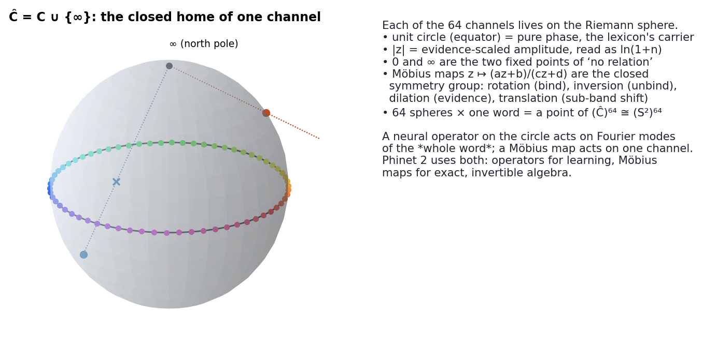
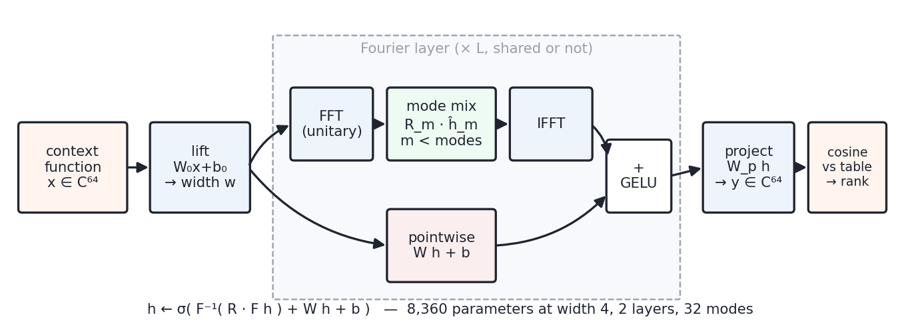
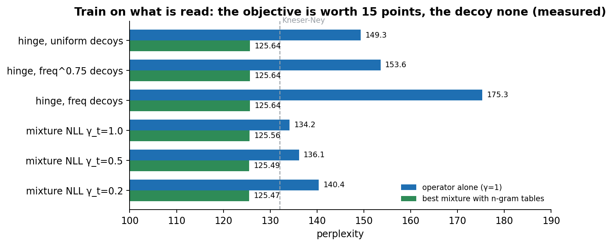
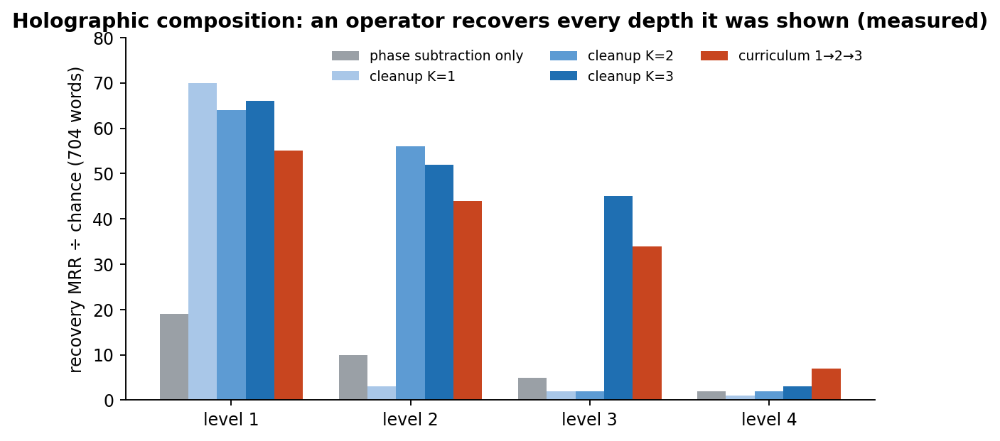
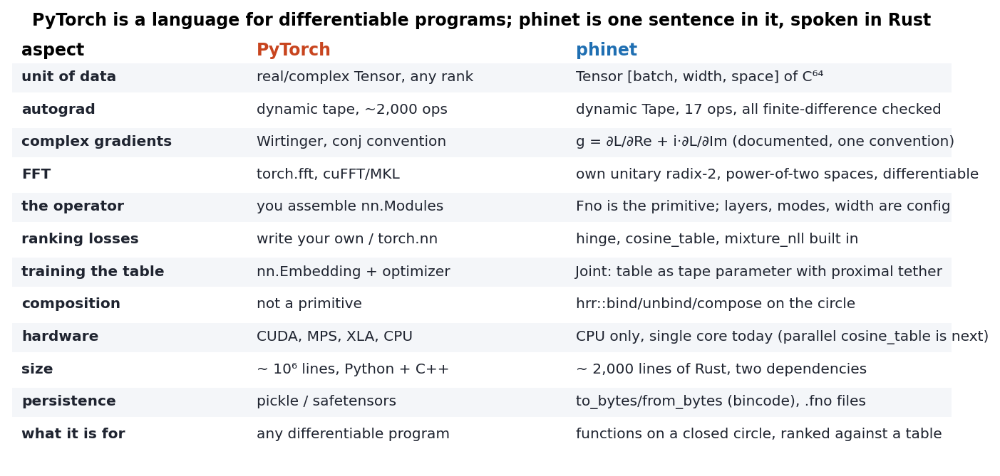

# Phinet 2 — Phase Operators

## Neural Operators on Closed Geometries, with Language as the Worked Example

**Phiano Project** · `gemphi/phinet` · September 2026 · Paper 2 of 3

---

> **The paradigm.** In Phient's world, a word *w* is nothing but what it relates to, under what conditions *c*. We call it the Phical paradigm, **X ⇒ Y**; it drives and composes Phient's Phasor Language Models — Phinet, Phiano, PhiTon. Phical stores no point: a word is 32–64 relations, each a phasor on a closed circle with a count of how often it has been played out, and meaning is the side effect of pairs of words moving under a condition. Everything below is one way of writing that down (Paper 1 §1 states it formally).

---

### Abstract

A neural operator learns a map between *functions*, not between vectors; a Fourier neural operator (FNO) learns it as a filter on the spectrum of the function. Phinet is a small, dependency-light Fourier tensor engine in Rust — a complex tensor, a reverse-mode tape with a differentiable unitary FFT, an FNO, ranking and likelihood objectives, joint training of the operator with the table of items it ranks, and holographic bind/unbind — built for one purpose: to learn operators on functions defined on a **closed geometry**, where Fourier analysis is exact because the domain has no boundary.

This paper gives the mathematical setting (why any closed geometry — circle, torus, sphere — is the natural home of an oscillator theory, and why the Riemann sphere is the closed form of a single complex channel), the engine (17 tape operations, one gradient convention, every gradient finite-difference checked), the objectives (hinge, mixture negative log-likelihood, joint with a proximal tether), and every measurement: next-word ranking 11.6× → 27.9× chance on WikiText-2 on the one-sided lexicon and 31.9× on the two-sided lexicon read directed (where the identity alone reads 15.5×), perplexity 149.3 (hinge) → 134.2 (likelihood) against Kneser-Ney 132.1, holographic recovery 19× → 66× chance at depth 1 and 5× → 45× at depth 3, one shared operator within 2–8 % of specialists, and the residual result — that on a small corpus the operator adds a sixth of a point over n-gram tables. We then specify **Phase Operators**, the Phinet 2 extension: Möbius maps as the exact per-channel algebra, stereographic lift of the evidenced circle to the sphere, a spherical-harmonic FNO, and a Riemann-zeta mode prior, together with the experiments that would validate each.

---

## 1. Closed geometries and why oscillators want them

An oscillator is a point on a circle. A system of N oscillators is a point on the N-torus. Anything you can say about the system with the tools of Fourier analysis, you can say *exactly* on a closed geometry and only approximately on an open one, because on a compact manifold without boundary the eigenfunctions of the Laplacian form a complete orthonormal basis: `e^{ikθ}` on the circle, `e^{i(k·θ)}` on the torus, `Y_lm` on the sphere. Convolution is diagonal in that basis. So a *learned convolution* — the thing an FNO is — is a learned diagonal, one complex weight per mode, and its parameter count is the number of modes you keep, not the size of the input.

Language is such a system whenever a word is taken to be *what it relates to*: each relation is a phase, the phases live on a circle, and a word is a point of (S¹)^64 (Paper 1). Composition is rotation on the torus; the "meaning" of a context window is a sum of rotated points, i.e. a function on the circle sampled at 64 points; predicting the next word is asking which point of the table that function is closest to. That is an operator problem, and the closed geometry is what makes it a *Fourier* operator problem.



*Figure 1. A single channel's closed home. The unit circle is the equator; `0` and `∞` are the two ways of having no relation; evidence lifts a point off the equator. The 64 lattice points of Q64 are marked.*

### 1.1 The Riemann sphere as the closed form of one channel

A phasor `z = e^{iφ}` lives on the circle; the natural *closed* space containing the circle and the evidence-scaled point `ρ e^{iφ}` for every ρ ≥ 0 is not the plane but its one-point compactification, the Riemann sphere `Ĉ = C ∪ {∞} ≅ S²`, reached by stereographic projection

```
σ(x + iy) = ( 2x/(1+x²+y²),  2y/(1+x²+y²),  (x²+y²−1)/(1+x²+y²) )
```

This is the sense in which "Riemann naturally applies". Three consequences are used in this paper:

- The **Möbius group** `z ↦ (az+b)/(cz+d)`, `ad−bc ≠ 0`, is the full group of conformal bijections of Ĉ. Rotation `z ↦ e^{iα}z` is bind; `z ↦ e^{−iα}z` is unbind; dilation `z ↦ ρz` is an evidence change; inversion `z ↦ 1/z` swaps the two "no relation" poles. Every one of them is exact and invertible, and they compose by 2×2 matrix multiplication — the cheapest possible algebra.
- **Latitude is evidence.** With `ρ = ln(1+n)`, a word seen never on channel k sits at the south pole, one seen often near the equator or above it. A word is then a point of `(S²)^64`, and a *persona* (Paper 1 §7) is a spherical cap.
- **Spherical harmonics** are the closed basis on S²; an FNO on the sphere mixes `Y_lm` coefficients rather than `e^{ikθ}` coefficients, and can represent maps that depend on evidence and phase jointly. §7 specifies it.

None of this replaces the circle for what the circle already does; it gives the circle a boundary-free place to put evidence.

---

## 2. The engine



*Figure 2. One Fourier layer. The spectral branch is a learned diagonal on `modes` low frequencies; the pointwise branch is a `width × width` complex linear map; the two are summed and passed through GELU. 8,360 parameters at width 4, 2 layers, 32 modes.*

`phinet` (`gemphi/phinet`, deps `num-complex`, `serde`, `bincode`, ~2,000 lines):

| module | contents |
|---|---|
| `tensor` | `Tensor [batch, width, space]` of `Complex64`; `Tape` with `add, add_bias, mul, scale, linear, mode_mix, fft, ifft, gelu, gather, unit, cosine, cosine_table, hinge, mixture_nll, mean_real`; `Adam`. The FFT is unitary radix-2, so `ifft(fft(x)) = x` to 1e-15 and the operator's spectral weights are on the same scale as its pointwise ones. |
| `operator` | `Fno`, `FnoConfig {space, width, layers, modes, margin, lr}`, `Example`, `MixtureExample`, `train_epoch`, `train_epoch_with(sampler)`, `train_epoch_mixture`, `FrequencySampler`, `rank`, `cosine`, `to_bytes/from_bytes`, `attach_param`, `reset`, `mask_modes`. |
| `joint` | `Joint`: the table of functions is a parameter on the same tape, updated with a proximal tether `λ‖T − T₀‖²` toward its initial value. |
| `hrr` | `role(seed)`, `bind`, `unbind`, `compose` — holographic reduced representations on the circle. |

**Gradient convention.** For a real loss L and complex value z = x + iy, the tape propagates `g = ∂L/∂x + i·∂L/∂y`. Every op's backward is checked by central finite differences in the test suite (`cargo test`, 10 tests + 1 doc test); the mixture NLL and cosine-table gradients were the last two added and both pass.

**Forward.** `h = gelu(lift(x))`; per layer `h ← gelu( ifft(R ⊙ fft(h)) + W h + b )` (no GELU on the last); `y = proj(h)`; `y` is compared to the table by cosine.

**What PyTorch has that phinet does not:** everything else. §8 is the comparison.

---

## 3. Objectives

Three losses, in the order they were needed.

**Hinge (ranking).** `max(0, margin − cos(y, t_true) + cos(y, t_decoy))`, one uniform decoy per example. Fast (20 s/epoch on the Rust Book corpus), and it is what took ranking from 11.6× to 27.9× chance. Frequency-proportional decoys (`FrequencySampler`, α = 0.75 and 1.0) were tested and *refuted*: 149.3 → 153.6 → 175.3 perplexity. The decoy is not the bottleneck.

**Mixture negative log-likelihood.** The reader in the harness is `p(w) = k + coef·(γ·softmax(β·cos(y, T))[w] + (1−γ)·unigram[w])` under the trigram affine `(k, coef)` of that position; train on `−log p(true)` directly with the n-gram constants fixed. Gradient reaches the operator only through the mass the tables fail to place. This is "train on what is read", and it is worth 15 perplexity points on its own (149.3 → 134.2) without touching the lexicon. Cost: 7 min/epoch, because it is a full-vocabulary softmax with gradients into every word.

**Joint.** Table as parameter, `tether = 0.02`, table Adam at ¼ of the operator's rate. Without the tether it memorises (149 → 157); with all words as targets, 134.1. Pool-only targets hurt (149 → 168).



*Figure 3. The objective, not the decoy, is what moves perplexity. All measured; single seed.*

---

## 4. The residual result

| γ_train | operator alone | best mixture | valid MRR |
|---|---|---|---|
| 1.0 | 134.16 | 125.56 @ γ=0.1 | 0.1486 |
| 0.5 | 136.14 | 125.49 @ γ=0.1 | 0.1329 |
| 0.2 | 140.39 | 125.47 @ γ=0.1 | 0.0962 |

Unigram under the trigram affine alone: 125.64. Lowering γ_train makes the operator specialise in what the unigram misses — its own perplexity worsens, its MRR falls by a third, and the mixture improves by a sixth of a point. On 6,468 sentences the tables cover almost everything a 64-sample cosine can express about the next word. This closes the question *on this corpus*. The experiment that reopens it is WikiText-2 at the mixture objective, which needs `cosine_table` on more than one core first.

---

## 5. Composition: the operator as cleanup

`hrr::compose` sums `bind(word_j, role_j)`; `unbind` recovers a constituent plus crosstalk. An FNO trained to map `unbind(c, r)` → the clean word is a **cleanup memory**, and its depth is a training decision:



*Figure 4. 704 held-out words, chance MRR 0.0101. An operator recovers every depth it was trained on at 45–70× chance and is at chance one deeper. Curriculum buys 7× at the untrained level 4.*

One operator, LM epochs interleaved with three cleanup levels, same total epochs as each specialist: LM MRR 0.1450 vs 0.1479, recovery 0.635/0.513/0.419 vs 0.664/0.531/0.456, perplexity 149.22 vs 149.30. **Nothing the one task learns breaks the other.** 8,360 parameters carry next-word prediction and three levels of holographic cleanup on the same circle.

---

## 6. Phase Operators — what Phinet 2 adds

Everything above is implemented and measured. What follows is specified, with the test that would validate it.

### 6.1 Möbius layer (`Tape::mobius(x, abcd)`) — **implemented**

Per sample, `w = (az+b)/(cz+d)` with the four complex coefficients a `[1,1,4]` parameter. Rotation, dilation and inversion are special cases, so the op *contains* bind/unbind exactly. Gradients in `z` and in all four coefficients are finite-difference checked (`tensor::mobius_tests`); identity and rotation-equals-bind are tested. The exact, non-differentiable version (matrix group, composition, inverse) is `phi_cal::mobius`. Still to run: initialise to identity, train on level-1 cleanup, and read the inverse role rotation off `a/d`.

### 6.2 Stereographic lift — **exact version implemented** (`phi_cal::sphere::{stereo, unstereo, lift}`)

Maps the evidence-scaled point `ρ e^{iφ}`, `ρ = ln(1+n)`, to S²: never-seen is the south pole, phase is longitude, evidence is latitude; round trip tested to 1e-12. The differentiable tape op is not yet written. Validation still to run: the identity reader on lifted points must reproduce the `similarity_with` ranking before any training.

### 6.3 Spherical FNO (`SphFno`)

Replace `fft/ifft` on 64 samples of S¹ with a spherical harmonic transform on a 64-point Fibonacci lattice of S² (golden-angle spacing — the same `GOLDEN_ANGLE` Phical uses for standing-wave nodes), band-limited at `l ≤ 7` (64 coefficients). Mode mixing is then a learned diagonal on `(l, m)`. Validation: on the WikiText-2 ranking task with evidence lifted to latitude, beat 27.9× chance; if it does not, evidence is fine where it is.

### 6.4 Riemann-zeta mode prior — **implemented as a projection** (`zeta_weights(modes, s)`, `Fno::scale_modes`)

Weight mode `m` by `m^{−s}/ζ(s)` after each step. At `s = 0` it is the current operator; larger `s` is a smoothness prior. The name is honest: it is the zeta function used as a spectral weighting, nothing deeper. `s` is fixed, not learned. Validation still to run: sweep `s` on the LM task and report whether perplexity moves.

### 6.5 Parallel transport along a sentence (`transport(path)`)

A sentence is a path of words on the torus; transporting a word's phasor along the path by the successive role rotations gives a *context-relative* reading of it. This is `compose` unrolled — and, since Möbius maps compose by matrix product, `phi_cal::mobius::Mobius::then_after` chained over a sentence *is* the transport. The winding number (`phi_cal::winding`, implemented and tested) is its topological invariant. Validation still to run: does the winding number as a feature to the LM reader change anything?

### 6.6 Cross-channel coupling (`K_kl`)

Today channel k talks only to channel k. A learned 64×64 sparse coupling lets "of" inform "to". This is the one proposal that changes the lexicon's learning rule rather than the operator; it should be measured by offset-channel dispersion (must stay ≥ 0.85) and balanced similarity (must not fall under Paper 1 §5.1's 51.8 %).

### 6.7 Persona as a tethered table

`Joint` with the table copied per persona, tether 0.02 toward the shared table, trained on the persona's text only. The persona then changes what words *mean to it*, not only which sectors it favours; deleting the copy is exact unlearning. Validation: top-1 next-word agreement with the shared table inside vs outside the persona's text.

### 6.8 Sixty-four spectral gates (`phinet::hexagram`) — **implemented, measured**

A function on the 64-sample circle has six octaves of spectrum (modes 1, 2–3, 4–7, 8–15, 16–31, 32). A hexagram is six lines; line *j* yang passes octave *j*, yin drops it. `apply(f, id)` is fft → gate → ifft: exact, idempotent, and ䷀ (111111) is the identity while ䷁ (000000) keeps only the mean. `hexagram_of(f)` names a function by the Q64 sector of its centroid; `changing_lines(a, b)` walks between two; `novelty(f, id) = 1 − cos(f, H f)` says how much a gate changes a function; `lines(f)` reads the octave energies. In `phiano::generate` the `OperatorGuide` carries `novelty: Option<(id, every)>` — every *n*-th token the operator's prediction passes through the named gate before scoring — which is novelty on demand in composition, named and reversible.

What the gates are not, measured on the Rust Book (`bin/hexagram_eval`): a way to predict the next word's hexagram. The operator's predicted hexagram matches the true next word's 0.9% of the time, the identity 5.8%, the previous word's 3.6%, the King Wen successor 1.1% — all at or under chance (1.6%) except "the most frequent hexagram, always" at 12.8%, which is only the skew of centroid sectors. Sixty-four operations are a keyboard, not an oracle; the I Ching's own claim to foresight is refuted on this data, and the module keeps the operations.

---

## 7. Where Phinet stands against PyTorch



*Figure 5. The honest column is the right one. Full comparison and 32 worked examples in the companion guide.*

PyTorch is a general language for differentiable programs; phinet is one program in that language — an FNO on the circle with ranking heads — written in Rust so that it runs inside the lexicon's process with no Python, no CUDA, two dependencies and a file format. Anyone who needs a second architecture should write it in PyTorch. Anyone who needs *this* architecture inside Phiano, with the table and the operator on one tape and every gradient checked, has it here.

---

## 8. What is broken or open

- `cosine_table` now runs on all cores (rayon; 86 → 51 ms per step on two cores at 20 × 6,221 × 64). The WikiText-2 mixture run is cheaper per core, not free.
- The operator is in `generate.rs` and measured (`docs/71`): re-weighting the n-gram's candidates changes nothing the Kneser-Ney judge can see; proposing candidates from the operator is far better than an untrained operator and still degrades text, because next-word likelihood trains it to predict frequent target sides. Proposals need a prior correction; they ship off.
- On the two-sided lexicon the mixture-likelihood operator reads 142.8 (directed) against 134.2 one-sided: better ranking, worse tail perplexity (`docs/71`).
- On the two-sided lexicon the operator adds less over the identity than before (15.5× → 31.9× on WikiText-2, against 6.7× → 27.9× one-sided): the directed reading does exactly what the operator was approximating. `docs/70`.
- §6.1, 6.2 (exact), 6.4 and the winding half of 6.5 are implemented and unit-tested; none of the *experiments* in §6 has been run. The operator numbers in §3–5 were measured on the one-sided lexicon (Paper 1 §4) and are not yet re-run on v5.
- Single seed everywhere; differences under 2 % are noise.
- `Fno::train_epoch_mixture` holds the n-gram constants fixed by design; a version that learns the affine jointly is one line and was not tried.

---

## 9. Code map

| path | what |
|---|---|
| `phinet/src/tensor.rs` | Tensor, Tape, Adam, finite-difference tests |
| `phinet/src/operator.rs` | Fno and the three training loops |
| `phinet/src/joint.rs` | Joint, IndexExample |
| `phinet/src/hrr.rs` | bind / unbind / compose / role |
| `phinet/src/hexagram.rs` | §6.8: the 64 spectral gates |
| `phiano/src/phinet/*` | function spaces, LM scorer, joint write-back, compositions |
| `phiano/src/bin/phinet*.rs` | the measurements in §3–5 |
| `phidoc/docs/phinet/` | the PhiDoc pages (`@phiace/puijs`) |
