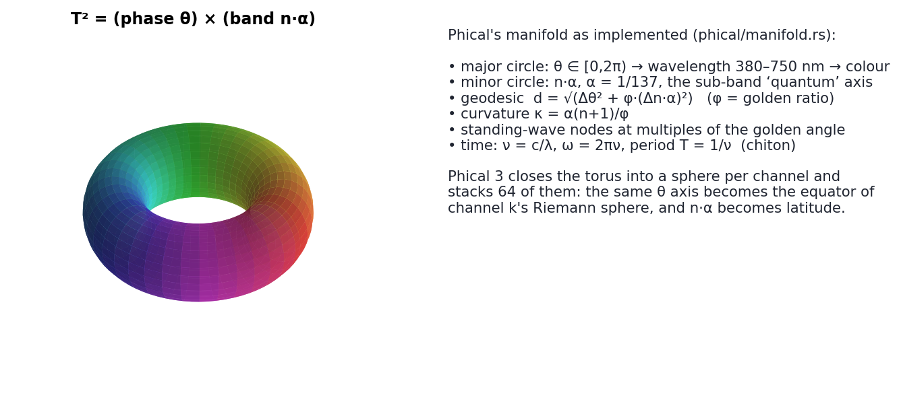
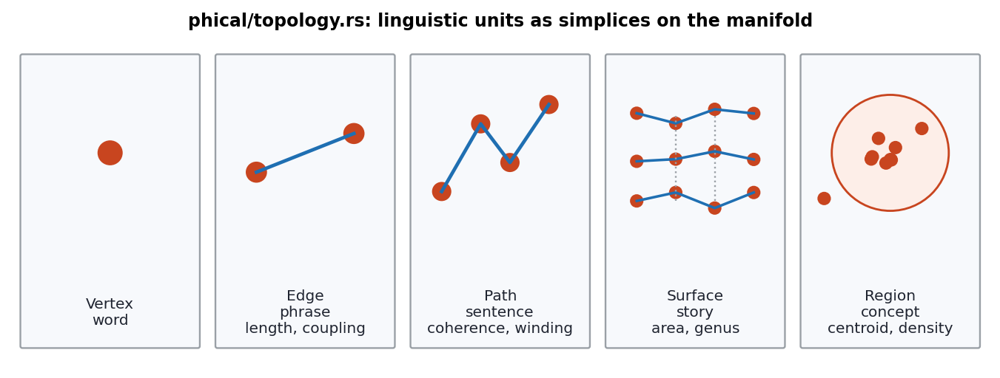
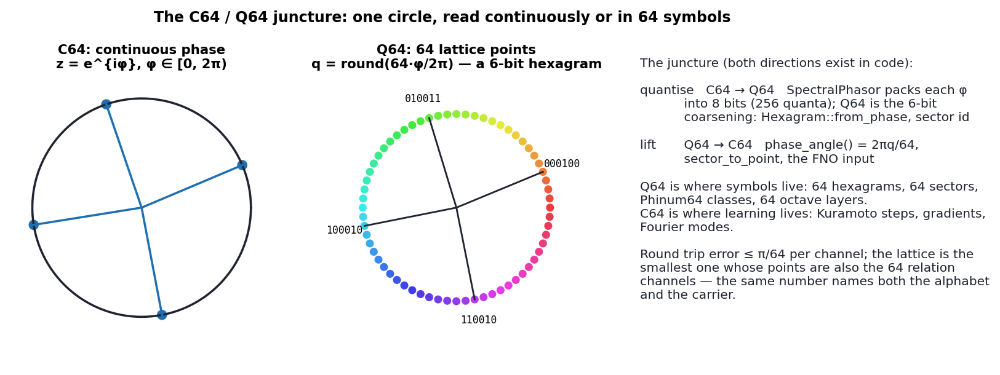
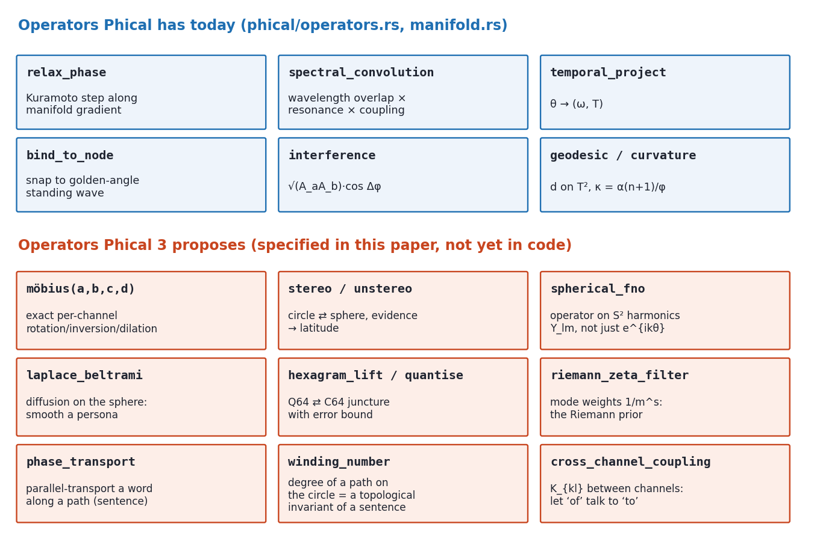
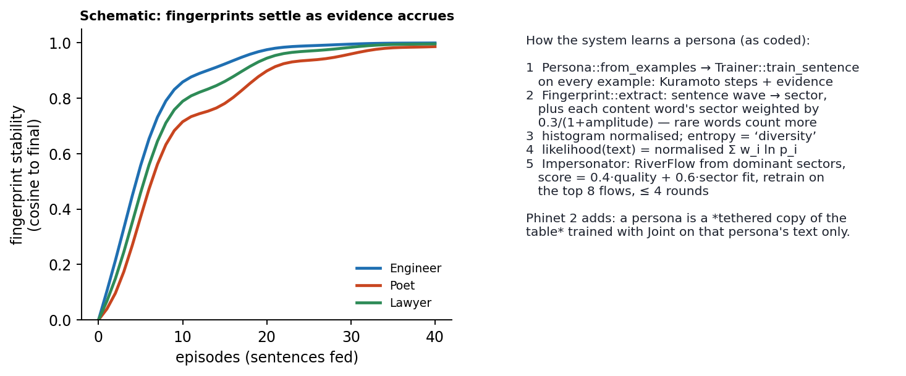

# Phical 3

## The Colour-Space-Time Manifold, the C64/Q64 Juncture, and the Operators Phical Provides

**Phiano Project** · `phiano/src/phical`, `phiano/src/phiton`, `phiano/src/phinum` · September 2026 · Paper 3 of 3

---

> **The paradigm.** In Phient's world, a word *w* is nothing but what it relates to, under what conditions *c*. We call it the Phical paradigm, **X ⇒ Y**; it drives and composes Phient's Phasor Language Models — Phinet, Phiano, PhiTon. Phical stores no point: a word is 32–64 relations, each a phasor on a closed circle with a count of how often it has been played out, and meaning is the side effect of pairs of words moving under a condition. Everything below is one way of writing that down (Paper 1 §1 states it formally).

---

### Abstract

Phical is Phiano's physics-calculus layer: it maps a phase to a wavelength (380–750 nm), a wavelength to a frequency and a period, a sub-band index n to a fine-structure shift n·α, and places every word on a torus T² = (phase) × (n·α) with a golden-ratio-weighted metric. Its topology module reads a word as a vertex, a phrase as an edge, a sentence as a path with a winding number, a story as a surface with a genus, and a concept as a region with a density. Its numeric sibling Phinum reads the same circle in 16, 32 or 64 symbols — the I Ching hexagram being the 6-bit name of a sector.

This paper does four things. It states Phical exactly as implemented, with the parts that are physics and the parts that are metaphor labelled as such. It defines the **C64/Q64 juncture** — the pair of maps between the continuous 64-channel carrier and the 64-point lattice — and gives its error bound. It specifies the operators Phical should provide to Phinet 2 (Möbius, stereographic lift, spherical FNO, Laplace–Beltrami diffusion, hexagram lift/quantise, zeta filter, transport, winding, cross-channel coupling), each with a validation. And it gives thirty-two examples of personas learning on the manifold, each mapped to the code path that would run it. The `phiace/crates/phical` crate was empty when this paper was drafted; it is now `phi-cal`, the exact half of this specification — Riemann sphere, Möbius group, the Q64 juncture with its bound, winding numbers and heat flow, thirteen tests — and phiano depends on it as `phiano::phical::exact`. The learned half (spherical FNO, cross-channel coupling) remains specified, not built.

---

## 1. What Phical is, as implemented



*Figure 1. `ColorSpaceTimeManifold` is a 2-torus. The major circle is the phase/colour wheel; the minor circle is the sub-band axis n·α.*

`src/phical/mod.rs`, `manifold.rs`, `operators.rs`, `topology.rs`, `evaluate.rs`; `src/phiton/{mod,types,chiton,bands,spectrum}.rs`.

| quantity | formula | code |
|---|---|---|
| effective phase | `φ_eff = (φ + n·α) mod 2π`, α = 1/137 | `Phical::effective_phase` |
| wavelength | `λ = 380 + (φ/2π)·370 + 10·n·α` nm, clamped | `Phiton::phase_to_wavelength` |
| frequency | `ν = c/λ` (THz) | `Phiton::frequency_thz` |
| energy | `E = (n+1)·α·h·ν` | `Phical::oscillation_energy` |
| colour-space-time distance | `√(Δλ² + φ_g·Δν²)`, φ_g golden ratio | `color_space_time_distance` |
| geodesic on T² | `√(Δθ² + φ_g·(Δn·α)²)`, Δθ wrapped | `ColorSpaceTimeManifold::geodesic` |
| gradient | unit tangent `(Δθ, Δn·α)/‖·‖` | `gradient` |
| curvature | `κ = α(n+1)/φ_g` | `curvature` |
| standing-wave node | `2A cos(kx) cos(ωt) > 0.99` at x = t = 0 | `is_standing_wave_node` |
| relax | `θ += LEARNING_RATE · ∇θ` | `PhicalOps::relax_phase` |
| spectral convolution | `overlap(λ) · resonance(chiton) · (1 + coupling/α)` | `spectral_convolution` |
| interference | `√(A_a A_b) · cos(Δφ_eff)` | `interference` |
| bind to node | snap to multiples of `GOLDEN_ANGLE·(1 + n·α)` | `bind_to_node` |

**What is physics and what is metaphor.** `ν = c/λ`, `E = hν`, and the CIE-style wavelength→RGB map are physics and are correct. The mapping of a *phase angle* to a *wavelength* is a choice of coordinates — it gives every word a colour, which is the glass-box property, and nothing more. `n·α` as a "quantum sub-band" is a metaphor: α is a dimensionless constant borrowed for its size (a shift of 0.0073 rad per level is a good small step), not for its physical meaning. The paper keeps the names because the code has them, and says so here once.

**What was broken.** `is_standing_wave_node` evaluated the standing wave at x = 0, t = 0, where `cos(0)·cos(0) = 1` for every wavelength, and returned true for every point. It now asks whether snapping to the golden-angle lattice (`bind_to_node`) moves the point by less than one channel quantum, and a test checks that it is not everywhere. `band_n` on the shipped v1 manifold reaches 1.8 million because the trainer increments it on every converged step; the quantum number is now defined as `Phical::quantum(n) = min(n, 13)` (one sector of fine-structure shift) and every Phical and Phiton formula goes through it, so a counter can no longer walk a word round the colour wheel. Tested: a count of 13 and of 1.8 million are the same point.

### 1.1 Topology



*Figure 2. `phical/topology.rs`: five shapes, each with the invariants the code computes.*

- **Vertex**: a point and a word hash.
- **Edge**: geodesic `length` and chiton `coupling` (resonance of the two waves, spin-matched).
- **Path**: `total_length`, `coherence` (mean coupling), `winding` = Σ wrapped Δθ / 2π — how many times the sentence goes round the colour wheel. Winding is a genuine topological invariant of a closed path; for an open path it is a real number, and the code uses it as such.
- **Surface**: paths sharing a vertex are adjacent; `genus = max(0, 2 − (V − E − 1))` with F = 1. This is an Euler-characteristic estimate on the adjacency graph, not of a real 2-complex; it is a story-complexity heuristic.
- **Region**: circular-mean centroid, mean angular `spread`, `density = 1/(1 + φ_g·spread)`.

`Topology::layer_relation(a, b) = coherence_a · coherence_b · min/max length / (1 + α·|Δwinding|)` relates two sentences without looking at their words — the "evaluate what we have about these layers and their relates" the module comment asks for.

### 1.2 Phinum: the circle in 16, 32, 64 symbols

`Phinum16/32/64` classify a hash into 16/32/64 slots; `SearleClassifier` maps a syntax key to one of Searle's five acts and then to a 16/32/64 sub-variation; `Hexagram::from_phase(θ)` gives the 6-bit id `⌊64·θ/2π⌋`, its King Wen number, and upper/lower trigrams, with `spin(Δθ)` and `changing_lines(mask)` as the two moves. `Hexagram::speech_act` maps the upper trigram to an act. The sixty-four hexagrams are, in this design, exactly the 64 sectors read as symbols: Q64.

---

## 2. The C64 / Q64 juncture



*Figure 3. One circle, two readings. The lattice has 64 points because that is the number of relation channels; the same number names the alphabet and the carrier.*

**Definitions.** C64 is `(S¹)^64`, the carrier of a word: 64 continuous phases (stored at 8 bits each, 256 quanta, `SpectralPhasor`). Q64 is `(Z_64)^64`, the same 64 channels each read as one of 64 symbols. The juncture is the pair

```
quantise :  C64 → Q64     q_k = ⌊64·φ_k / 2π⌋            (Hexagram::from_phase, sector id)
lift     :  Q64 → C64     φ_k = 2π·(q_k + ½) / 64          (Hexagram::phase_angle + half-step)
```

**Error bound.** `|φ − lift(quantise(φ))| ≤ π/64 ≈ 0.049 rad` per channel with the half-step centring, and the bound is tight (`phi_cal::q64` tests it; `Hexagram::phase_angle` now carries the half-step and is tested to be the same map). When *both* words of a pair are quantised, the angle between them moves by at most π/32, so one channel's cosine moves by at most π/32 ≈ 0.098 — the cosine is 1-Lipschitz; the first draft's `1 − cos(π/32) ≈ 0.005` was wrong, it only holds near agreement. Averaged over 64 channels, the measured resonance loss on 200 random pairs is under 0.01. That is why Q64 can be used as an *index* (a hexagram per channel is a 384-bit key) without losing what C64 knows.

**Why 64 and not 256.** Storage is already at 256 quanta; the point of Q64 is not compression, it is *naming*: 64 is the largest lattice whose points are also the channels. A word's Q64 reading is a 64-symbol string over a 64-letter alphabet; a sentence's Q64 reading of its centroid is one hexagram; a persona's is a histogram over hexagrams (Paper 1 §7). Every symbolic structure in Phinum — Searle acts, trigrams, spider-net links — attaches to Q64; every gradient attaches to C64; the juncture is the only bridge, and it has a bound.

**Juncture on the sphere (Phical 3).** Lift the 64 lattice points of the equator to a Fibonacci lattice of 64 points on S² (golden-angle spacing); then a Q64 symbol is a *cap*, and evidence (latitude) is quantised at the same time as phase. This is the lattice §3.3's spherical FNO samples on, so the juncture and the operator share their grid.

---

## 3. The operators Phical provides



*Figure 4. Six operators that exist, nine that this paper specifies for Phinet 2.*

Each new operator is given as: signature · definition · gradient or exactness · what it is for · the test that validates it.

**3.1 `mobius(z, [a, b, c, d]) → w`** — *implemented*: exact in `phi_cal::mobius::Mobius` (rotation, dilation, inversion, translation, compose, inverse, derivative; tested), differentiable in `phinet::Tape::mobius` (finite-difference checked) · `w = (az + b)/(cz + d)` per channel · `∂w/∂z = (ad − bc)/(cz + d)²`, parameters by the product rule · bind (`a = e^{iα}, d = 1`), unbind (`a = e^{−iα}`), evidence scale (`a = ρ`), pole swap (`b = d = 1, a = c = 0`... i.e. `1/z`) — all one op, composable by 2×2 matrix product · *test*: learn the inverse role rotation on level-1 cleanup and read it off `a/d`.

**3.2 `stereo(φ, ρ) → (x, y, z) ∈ S²`, `unstereo`** — *implemented* in `phi_cal::sphere` (`stereo`, `unstereo`, `lift(phase, evidence)`, `fibonacci_lattice`, `nearest`, geodesic; tested) · the projection in Paper 2 §1.1 with `ρ = ln(1+n)` · smooth, differentiable in both arguments · evidence as geometry · *test*: identity reader on lifted points reproduces `similarity_with` ranking (6.7× chance).

**3.3 `spherical_fno`** · replace FFT on S¹ by a spherical harmonic transform on the 64-point Fibonacci lattice, band-limit `l ≤ 7`, learned diagonal on `(l, m)` · gradients through the transform matrix (it is a fixed 64×64 complex matrix; its adjoint is its backward) · joint phase-and-evidence maps · *test*: beat 27.9× on WikiText-2 ranking, else evidence stays in the inner product.

**3.4 `laplace_beltrami(f, t)`** — *implemented on the circle* as `phi_cal::heat::circle` (exact in Fourier modes; mass conserved, flattens; tested) with `overlap_after(p, q, t)`, and wired into `Fingerprint::overlap_after` · heat flow `f ↦ Σ_lm e^{−l(l+1)t} f_lm Y_lm` on the sphere · exact in harmonics · smooth a persona's cap, denoise a fingerprint, define "nearby persona" by overlap after diffusion · *test*: `match_text` confidence on short texts rises with small t and falls with large t; report the t that maximises it.

**3.5 `hexagram_lift / quantise`** — *implemented* as `phi_cal::q64::{quantise, lift, quantise_word, lift_word, hamming, sector_distance}`; `Fingerprint::q64()` names a persona · §2, with the half-step · exact bound π/64 · symbolic indexing, Phinum bridge, Q64 personas · *test*: resonance loss under double quantisation ≤ 0.005 on the promoted lexicon (compute, don't assume).

**3.6 `zeta_filter(s)`** · mode m weighted by `m^{−s}/ζ(s)` · gradient in s through `Σ m^{−s} ln m` · a one-parameter smoothness prior on the operator · *test*: learn s on the LM task; report where it settles.

**3.7 `phase_transport(word, path)`** · successive role rotations along a sentence; returns the word's phasor as seen from the end of the path · exact (rotations) · context-relative reading of a word; `compose` unrolled · *test*: does the transported reading rank the next word better than the untransported one? (One extra feature to the LM reader.)

**3.8 `winding_number(path)`** — *implemented* as `phi_cal::winding::{winding, winding_closed, arc_length}` · already computed for paths (`Path.winding`); expose it as an operator returning an integer for closed paths and a real for open ones · exact · sentence-level topological feature · *test*: correlation with `Evaluator` coherence on the corpus; if > 0.8 it is redundant.

**3.9 `cross_channel_coupling(K)`** · learned sparse 64×64 `K_kl` in the Kuramoto step: `φ_a[k] += η Σ_l K_kl sin(φ_b[l] − φ_a[k])` · gradient through sin · let marker channels inform each other · *test*: offset+1 dispersion must stay ≥ 0.85 and balanced similarity ≥ 51.8 % (Paper 1 §5.1); otherwise coupling collapses channels the way attraction did.

**Fixes.** `is_standing_wave_node` is fixed (lattice-based, tested); `band_n` is clamped to its quantum number under every formula.

---

## 4. How personas learn on the manifold



*Figure 5. Left: schematic settling of fingerprints with episodes (illustrative curve). Right: the code path, step by step.*

A persona on Phical is the Paper 1 fingerprint *placed*: its histogram over sectors becomes a distribution over the colour wheel, its centroid a colour, its spread a cap on the sphere after `stereo`, its Q64 name the hexagram of its centroid, and its temperament (`PersonalityMapper`) the warm/cool/green mass of its top five sectors. Learning is the shared Kuramoto rule; what Phical adds is a *place* for the persona to be, and therefore a set of operators that act on it.

### 4.1 Thirty-two examples

1. **Colour of a persona.** Centroid phase → `Phiton::phase_to_wavelength` → hex. A support agent whose sectors cluster at 0.4 rad is a 400-nm violet persona; a poet at 3.5 rad is 590-nm amber. Nothing follows from this except that you can see it.
2. **Temperament from bands.** `personality_traits`: warm > 0.4 → passionate/direct. Feed a persona 30 % more text from cool sectors and watch the label change at the threshold; the threshold is the only thing that is arbitrary.
3. **Persona as a cap.** `stereo` every dominant sector with evidence as latitude; the cap's solid angle is the persona's breadth. Two personas whose caps overlap by > 50 % are "the same voice" — a geometric definition that `similarity` (cosine of histograms) approximates.
4. **Diffused matching.** `laplace_beltrami` at small t before `match_text`: a persona with 3 examples becomes matchable against a paragraph that shares no sector exactly. Report the t that maximises confidence; it is the persona's "reach".
5. **Hexagram name.** `Hexagram::from_phase(centroid)`: persona 37 ䷤ "Family" for a customer-support voice. The name is a lookup, not an interpretation; it is a stable 6-bit key that survives retraining as long as the centroid stays in the sector.
6. **Changing lines.** Two personas whose hexagrams differ by one bit are one `changing_lines` step apart — a symbolic distance that matches the geodesic only when the sectors are adjacent. Measure how often it agrees.
7. **Speech-act fingerprint.** `SearleClassifier` per example gives a 5-bin act histogram; a persona that is 70 % directive and one that is 70 % assertive can share every sector and still be told apart. Second fingerprint, orthogonal to the first.
8. **A sentence's winding.** Feed a persona's sentences as paths; the winding distribution is a stylistic feature (a persona whose sentences go round the wheel has wide sentences). Test 3.8 says whether it is redundant with coherence.
9. **Genus of a story.** Ten sentences from one persona as a surface; `story_complexity`. A persona that reuses its vertices (words) has adjacency, hence genus; one that never repeats has genus 0. It is a repetition heuristic with a topological name.
10. **Concept density per persona.** `evaluate_concept` on a persona's top-20 words: `density` near 1 means a narrow persona. Compare with `diversity` (entropy): they should anti-correlate; if they do not, one of them is measuring something else.
11. **Persona drift on the torus.** Track the centroid's `(θ, n)` every 500 sentences; plot the path on T². Drift along θ is a change of subject; drift along n (once `band_n` is fixed) is a change of register.
12. **Relaxing a persona toward another.** `relax_phase` from persona A's centroid toward B's, one `LEARNING_RATE` step at a time: the interpolated personas along the geodesic. Impersonate at each step for a "morph".
13. **Standing-wave personas.** After fixing `is_standing_wave_node`, ask which personas sit on nodes (multiples of the golden angle). The design says nodes are stable meanings; the test is whether node-personas drift less under retraining.
14. **Persona interference.** `interference(A, B) = √(A_aA_b)cos Δφ`: two personas in anti-phase cancel in a choir; two in phase reinforce. A group persona (Paper 1 ex. 31) is the interference sum.
15. **Spectral convolution as compatibility.** `spectral_convolution(A, B)` between persona centroids: wavelength overlap × chiton resonance × coupling. High when the personas would "hear" each other. Use it to pick which persona answers a prompt.
16. **Möbius-transported persona.** Apply one Möbius map to every phasor of a persona's words: rotation shifts the persona's colour without changing its shape; dilation changes its evidence uniformly. Exact and reversible — a persona "filter".
17. **Persona on the Fibonacci lattice.** Quantise the cap to the 64-point sphere lattice; the persona becomes a 64-bit mask (which lattice points it occupies). Two masks' Hamming distance is a persona distance with no floating point.
18. **Child persona, revisited.** Paper 1 ex. 4 on the torus: entropy rises, and the centroid's θ path is a spiral outward from the first sectors learned. The "spider net" is literally the set of visited lattice points.
19. **Persona from colour.** Inverse problem: given a target colour (wavelength), find the persona whose centroid is nearest via `wavelength_to_phase`. A design tool, not a learning one.
20. **Persona quantum energy.** `oscillation_energy(θ, n)` of a persona's centroid. With `n` fixed at the shipped file's values this is meaningless; after re-deriving `n` it is a scalar that grows with register. State that plainly in any UI that shows it.
21. **Two personas, one operator.** Phinet 2 §6.7: tethered table copies per persona, one shared FNO. The persona-conditioned next-word distribution differs from the shared one on the persona's text and not elsewhere. This is the experiment that decides whether "persona" is a fingerprint or a lexicon.
22. **Persona zeta prior.** Learn `s` per persona in `zeta_filter`: a persona with a smooth spectrum (large s) is one whose contexts are predictable from low modes. Report the s per persona; it is a one-number style statistic.
23. **Cross-channel personas.** With `K_kl` learned on one persona's text only, its off-diagonal mass says which relations that persona makes depend on which. A lawyer's "of" and "to" couple; a poet's do not. Speculative; the test is 3.9.
24. **Persona transport.** `phase_transport` of a persona's centroid along one of its own sentences returns to near the centroid (low winding) or not (high winding). A self-consistency check.
25. **Persona as region on the sphere.** `Region` after `stereo`: centroid becomes a 3-vector, spread a cap angle, density unchanged. The sphere version distinguishes a persona with high evidence from one with low evidence at the same angles; the circle version cannot.
26. **Impersonation on the manifold.** Bind the prompt to the persona's centroid before `RiverFlow::trace`, then `bind_to_node` each generated word's phase: output snapped to standing-wave nodes. Whether this improves `quality` is a one-line experiment.
27. **Persona from a hexagram sequence.** Give the system a sequence of 64 hexagrams (a Q64 string); lift to C64 with the half-step and treat as a synthetic persona. It will impersonate *something*; what it produces is the system's reading of an arbitrary symbolic input.
28. **Matching under Möbius noise.** Apply a random small Möbius map to a test text's phasors before `match_text`: rotation-only noise leaves matching intact (sectors shift together), inversion destroys it. A test of which noise the fingerprint is invariant to.
29. **Group persona genus.** A team's messages as a surface: genus grows with how many members reply to the same threads. A conversation-structure statistic with no model.
30. **Persona timeline colours.** Colour each of a persona's messages by its wave centroid; a timeline that changes hue is a persona changing subject. This is the glass-box UI that Phical exists to make possible.
31. **Persona ablation.** Remove the persona's top sector from its histogram and re-match: the drop in `likelihood` is that sector's contribution. Rank sectors by ablation drop; compare with the histogram — they differ when sectors are correlated.
32. **The empty persona.** `Fingerprint::extract` on no examples gives an all-zero histogram, `likelihood` = 0 for everything, `traits` = ["neutral"]. The system reports ignorance as ignorance; keep it that way.

---

## 5. What is broken or open

- `phi-cal` holds 3.1, 3.2, 3.4 (circle), 3.5, 3.8; the spherical FNO (3.3), the sphere half of 3.4, the zeta prior as a *learned* `s` (3.6 — the fixed-`s` projection is in phinet), transport as an operator (3.7) and cross-channel coupling (3.9) are not built.
- None of the §3 *validations* has been run.
- `band_n` on the v1 manifold is a counter.
- `Surface::estimate_genus` is a heuristic; do not call it a genus in a UI without the caveat.
- `Q64` now has a home (`phi_cal::q64`) and Phinum's `Hexagram` is tested to agree with it; `SECTOR_RESOLUTION` and `Phinum64` are its other two faces.

---

## 6. Code map

| path | what |
|---|---|
| `src/phical/mod.rs` | Phical constants, effective_phase, distances, energy, ColorSpaceTimePoint |
| `src/phical/manifold.rs` | geodesic, gradient, nodes, curvature, sector_to_point |
| `src/phical/operators.rs` | relax, spectral_convolution, temporal_project, bind_to_node, interference |
| `src/phical/topology.rs`, `evaluate.rs` | Vertex/Edge/Path/Surface/Region; Topology evaluator |
| `src/phiton/*` | Phiton (λ, ν, E, colour), Chiton (ω, T, resonance, standing wave), bands, spectrum |
| `src/phinum/*` | Phinum16/32/64, Searle acts, I Ching hexagrams, syntax keys, spider net |
| `src/persona/*` | fingerprints, world, impersonator, traits |
| `phiace/crates/phical` (`phi-cal`) | `sphere`, `mobius`, `q64`, `winding`, `heat` — the exact half of §3; re-exported as `phiano::phical::exact` |
