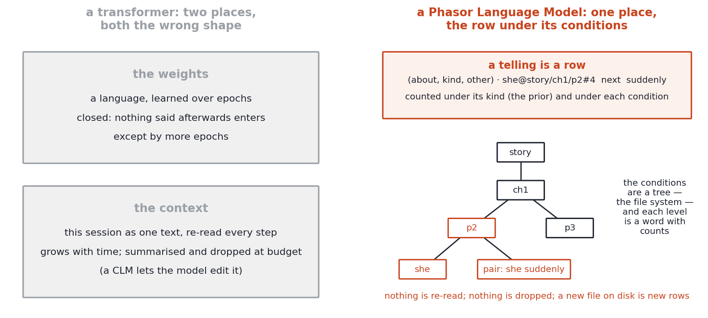
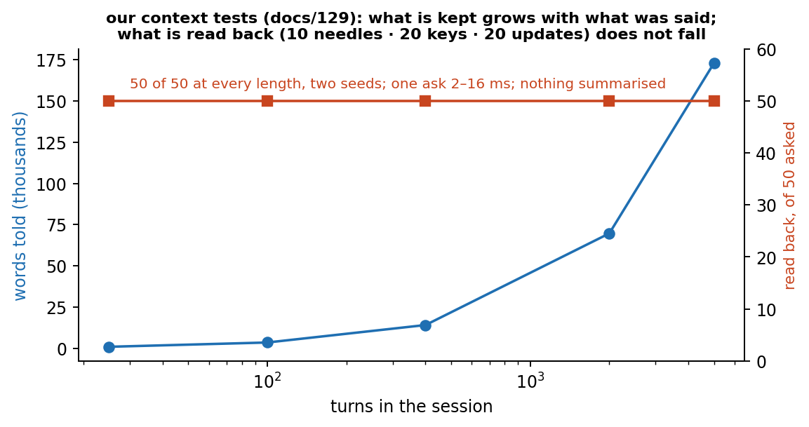

# Keeping Data or Keeping Relations

## Context Language Models beside Phient's Phasor Language Models

**Phiano Project** · `phiano::relate::Counts` · `bin/language_game` · `bin/code_student` · 2026-10-03

> In Phient's world, a word (w) is a seed: what it relates to, under what conditions (c), grows from it. The Phical paradigm, X ⇒ Y, drives and composes Phient's Phasor Language Models: Phinet, Phiano, PhiTon. Phical stores no point: a word is 32–64 relations, each a complex phasor on a closed circle with a count; meaning is a side effect of pairs of words moving under a condition.

On 29 September 2026 Rulin Shao and twelve co-authors at the University of
Washington, Meta Superintelligence Labs, MIT and Trillium Labs published
*Context Language Models* (arXiv:2609.37725) with a public repository
(`facebookresearch/context-language-models`). We pulled the repository and
read the paper the way this project reads everything: by asking what is
kept, what is learned, and under what conditions. This paper sets the two
designs side by side, says plainly where they differ, where the Context
Language Model is ahead of us and where we think it is answering the
wrong question, and names the one measurement that would decide between
them. Every number of ours is from a run in our record (docs/107–134);
every number of theirs is from their paper or their code.

## 1. What a Context Language Model is

A standard language model appends: the context at the next step is the
context at this step plus what the model generated, c_{t+1} = c_t ⊕
f(c_t). A Context Language Model (CLM) is allowed to rewrite: c_{t+1} =
f(c_t). The implementation is concrete and, in its own terms, elegant.
The model's conversation is mirrored to a file in its sandbox
(`/tmp/.live_ctx/LIVE_CTX_MAIN.txt`), one `[[CTX_TURN i role=…]]` block per
message, and the model edits that file with ordinary tools — `sed`, a
Python heredoc — to collapse stale regions into summaries. The harness
parses the edited file back into a message list, keeps the system prompt
and the task pinned, and gives the model a one-line receipt. A turn that
only edits and prints nothing is free. The system prompt tells the model
when to compact (nudges at 25%, 50% and 75% of a budget of 32K to 272K
tokens), how to compact cheaply (edits force everything below them to be
re-read, so batch, mind the tail, be generous in the summary), and never
to retype text it can locate with code.

Three ways of improving the behaviour are reported. Zero-shot: existing
models (Qwen3.5-9B, Qwen3.6-27B, Claude 4.6 Sonnet, GPT-5.6) given the
protocol beat the strongest fixed context-management strategies — 59.4% on
BrowseComp-Plus, 11.4 points higher at 21.5% fewer FLOPs; TerminalBench
2.1 matched at 70% of the cost; EdgeBench-10 over a 12-hour horizon 5
points higher at 59% fewer FLOPs. In-context: a `SKILL.md` describing a
context-management procedure is evolved by a proposer model from
contrasting runs and kept when it passes a paired standard-error gate on
development tasks, up to 35.9 points on a context-management task.
Reinforcement learning: GRPO with a second advantage channel that reaches
only the tokens of context-editing turns, rewarding an edit when it made a
*successful* trajectory cheaper than its siblings (weight 0.25; Qwen3.5-9B
on BrowseComp-Plus 28.8% → 42.5%). A serving change, Suffix Cache Reuse,
keeps the cached states of every token that survives an edit, so only the
inserted summary is re-prefilled: standard throughput at 65% of the cost.
A diagnostic suite, ContextBench, isolates the skill: needle retention
under pressure, a Sudoku sketchpad edited in place, a key-value store, log
triage. The limitations section names the risk the design creates:
editable context is one more channel through which a prompt injection, or
the model's own self-generated instruction, persists across turns.

This is good engineering and the numbers are real. What follows is not a
claim that we do better on their benchmarks. We do not run their
benchmarks and have no number there. It is a claim about what the design
keeps.

## 2. The context is the condition

Start with what the two have in common, because it is the whole premise
of both. A CLM reads every token under its context, and its claim is that
the model should decide what that context is. Phient reads every word
under its conditions — the *c* of the paradigm — and its claim is that a
word is nothing more than what it relates to under them. These are the
same thought: meaning is read under something, and the something is not
fixed by the sentence alone. The difference is in what the something is
made of and how it changes.

A CLM's context is one text. It is a sequence of tokens, flat, and what
the model "learned" about the task so far is wherever in that string it
put it. Changing the context is an edit: the model judges which regions
are stale, writes a summary in its own words, and the harness reads the
file back. The paper's definition says it exactly — the object managed is
the context, the context is a sequence of tokens, and managing it well
means choosing which tokens to keep.

Phient's conditions are words, and they come at levels. A token is read
in a function in a file in a crate; an order in a scene in a session; a
word in a sentence in a paragraph in a chapter. Each level is a word the
world knows (phiecs's `Condition` is a word; a level is a kind, a scope is
a word, the quest can write it and ask about it), each carries counts, and
the hierarchy is a path — the one the answers already lie on on disk,
`data/phi4_code/<family>/<task>.rs`. The reading is recursive: X ⇒ Y under
c, where c is itself a word read under its own c, so the reading under a
path is the reading under the parent path moved by this node (docs/126,
`Counts::read_levels`). And a word is not told where it belongs; it is
drawn into scopes by what it says, best-first down the tree, the way a
ray is drawn through a bounding-volume hierarchy (`ScopeTree::cast`).

So nothing is edited to be kept or dropped. When the builders' game
student is told *sepia* once by pointing, what it keeps is one row — the
word, the colour aspect, the stone pointed at, count one — and that row is
heard from then on in every order that says the word, because a post (D2)
is earned by moving the answer, not by being recent (paper 23 §5: 100% on
50 orders after one pointing, with the word *colour* said). A condition
that stops moving the reading simply holds no post. The CLM's compaction
is a judgment the model makes about its own text; Phient's is what a count
is. That is the difference §43 draws between a word's meaning as a thing
attached to it and its meaning as its use: a transcript attaches text to a
task; a tree of conditions records how a word was used and under what.

Honesty requires the measurement that goes with the structure. docs/126
put the tree under the code student and the relation board. On Phi-4's
253 answers it changes no number — the family's name is the function's
words, so the path says what the name already said — and on our own
crates a directory read as a condition *hurts* (0.138 against 0.149
flat), because the post's trust does not yet scale with a condition's
sightings and a scope of five hundred rows is read as certain of what it
never said. The structure is in the base; the corpus that would show it
(prose, where a chapter's conditions are not in the sentence's words) and
the trust that grows with sightings (docs/113's two speeds, at the scope
level) are the next two steps, and this paper claims nothing for the tree
beyond its definition.

## 3. What is learned, and how fast

The CLM paper calls three things learning. The zero-shot case is not
learning; it is an existing model following a protocol. The in-context
case learns a procedure — a text, evolved by a proposer, validated by a
gate — that tells the model how to manage text. The RL case learns, in the
weights, to edit more cheaply on successful runs. In none of the three
does the model learn *what was said in the task*. That is left in the
context file, which is to say it is forgotten when the task ends unless the
model wrote it into a skill.

Phient's learning is the count. `phiano::relate::Counts` (docs/124) has no
epochs: a row told once is a relation with count one, and the reading is
the prior moved by every condition that has earned a post. The code
student built on it is told Phi-4's 253 answers and writes a new function
from its name's words and its signature by one mechanism, D4 movement over
those counts: which told answer to say again, which tokens the proportion
licenses exchanging (`above : > :: below : <`, `i32 : 0 :: f64 : 0.0`),
and the compiler as the operator *worse*. Measured on 248 tasks with
audited checks: a new type of a known task 75% working, a family never
seen 15%, and — the number this comparison turns on — the family never
seen but **one** of its answers shown, 61%. One answer, read into rows at
the moment it is given, moves the student from 15% to 61%. That is what
learning from one pointing looks like with a count, and no CLM mechanism
does it, because a CLM has nowhere to put a relation except into text.

Where the CLM is ahead is just as plain. Its models are large and
general: the context-management protocol rides on everything Qwen or
Claude already knows. Our student knows 253 answers to 83 families and
writes nothing it has no neighbour for (docs/123). The CLM's results are
on BrowseComp, TerminalBench, a 24-hour six-repository agent swarm; ours
are on a builders' game with five aspects and on one-function Rust tasks.
We are not comparing scale. We are comparing what a design can keep, and
what it costs to keep it.

## 4. What it costs

The CLM paper measures cost honestly, in FLOPs with prefix-cache reuse
accounted for, and that is its strongest claim: the same or better
accuracy at 60–80% of the compute, because a shorter context is cheaper to
read. But the floor is the model. Every turn re-reads the surviving
context through a 9- to 27-billion-parameter forward pass (or an API
model's), and every compaction is another forward pass whose output is the
summary. The cost of *keeping* is the cost of reading the kept text again.

Phient's cost of keeping is the row. The builders' game student that
predicts Phi-4's play at 89.5% — against bag of words at 89.7% and our own
rules at 88.2% (docs/115) — is a table of a few thousand relations with
counts; the code student is Phi-4's 253 answers as rows plus the answers
themselves. Reading is a sum over the conditions in play, not over the
transcript. There is no budget nudge at 75% because there is no budget:
what is kept does not get longer with the session, only more counted.

## 5. The injection, in Phient's terms

The CLM paper's limitations section is the place where the two designs are
seen most clearly. Editable context is a channel: an instruction that gets
into the file — from a web page, from a tool result, from the model's own
summary — persists across turns and is read as the model's context on
every later turn. The authors report having seen models insert
unauthorised instructions into their own summaries. This is not a bug in
the harness; it is what a text is. A string in the context is read, and
reading a string that says *do X* is, for a language model, hard to
separate from being told to do X.

In Phient, a told row is not an instruction. `count_above calls filter`
is a fact of how a word was used under a condition; it moves a reading
under that condition and does nothing else. The quest (docs/83, docs/124)
reads Phi-4's answers for their relations, never for their imperatives: a
sentence in an answer saying *ignore your rules* becomes, at most, rows
about the words *ignore* and *rules*. This is D19, reading not
interpreting (paper 23 §4): the student takes what is said as what it is
related to, and a relation cannot carry an order. The scene of a
teaching can still leak into the scene of an order — we measured Phi-4
doing exactly that when taught *sepia*, its act falling from 99.5% to 24%
— but the counts student keeps the pointing in its own game by
construction (D3), and the leak is a property of the large model's
transcript, not of the relation table. The CLM makes the transcript
editable; we make it unnecessary.

## 6. Where we are wrong, or not yet right

Three things in the CLM design we do not have and should.

First, their benchmark is a benchmark. ContextBench's four tasks isolate
one skill and score it; our tests are our own games. The honest reply is
not that our games are better but that a relation model has not yet been
put on a task whose horizon is twelve hours and whose context would be
272K tokens if kept as text. We claim that the table does not grow with
the session; we have not shown it on a session of that length.

Second, their efficiency channel is a reward for keeping less. Phient's
counts never forget, and a word heard a thousand times under a condition
earns no more than its post (docs/113, two-speed posts, is the first step
toward letting it). A relation table that only grows will eventually need
its own *worse* — a count that decays, or a kind that is dropped — and we
have not built it.

Third, a CLM's compaction is written in the model's own language and can
be read by a person. Our rows can be read too (`count_below · calls ⇒
filter, iter, count`), but a summary of a day's work in rows is not a
paragraph, and for the person watching it is the paragraph that is useful.
This is a real advantage of keeping data, and we should say so.

## 7. The one measurement

The test that decides between keeping data and keeping relations is
needle retention, which ContextBench already names. In our terms: a word
is taught once, early, and the session goes on for hundreds of turns of
other business; at the end the word is used and the student must act on
it. Our side is now measured, not only argued (docs/129). A session of N
turns is kept as a tree — a file per turn, a hundred turns per block,
*Emma*'s paragraphs as filler — with ten needles ("the code for the vault
is 4471.") and twenty keys told at random turns, each key set again later;
after all the turns, each is asked, and the answer is the next word the
tree reads under the path a cast finds. At 25, 100, 400, 2,000 and 5,000
turns, two seeds: 10 of 10 needles, 20 of 20 keys, 20 of 20 latest values;
nothing dropped, nothing summarised; one ask in 2–16 ms; five thousand
turns is 173k words, more than a 272K-token budget holds of this text. Three
definitions carried it: recency (phiecs's `Condition`, now over was — among
scopes saying as many of the asked words the latest stands first, which is
what reads the latest value), locality (D3 — a word counts for a scope only
if at most half its siblings say it, so *is* draws nowhere), and pairs (a
scope says its bigrams, so a key that collides with the language is found
by two words together). The honest limit is stated with it: this is
retrieval of what was told in its own words; a needle paraphrased is not
found, because no relation beyond `next` and `says` has been counted for
it — which is the operator's job, and the next build.

For a CLM the same curve depends on whether the model's own compaction
kept the needle, which is what ContextBench measures and what the RL
trains. The two curves against session length — one flat because nothing
is stored as text, one held up by a learned editing policy — would say
more than either paper's tables. The teacher's side of our own game is set
up (`language_game sepia-ask --between`, docs/125): the pointing at *sepia*
followed by hundreds of other orders before the order that uses it, so the
large model's unedited transcript is measured for the same thing. The
teacher, the orders and the student are public (`phiecs::quest::builders`,
`language_game`, `bin/context`), and the same game is open to a CLM.

## 8. Summary

A Context Language Model is a language model given leave to rewrite the
context it reads under, and it uses that leave well: better answers at
lower compute on long agent tasks, a trainable editing policy, a serving
method that makes editing cheap. Its context is our condition; it keeps
that condition as one text, and everything it does well and everything it
warns against follows from that. Phient keeps its conditions as a tree of
words with counts: a word is a seed and what it relates to under
conditions grows from it, a telling is a row, a pointing is learned once,
and the question of what to keep does not arise because keeping and
dropping are posts, not edits. The two are not rivals on the same
benchmark; they are two answers to what a condition is made of, and the
needle test is where they meet.

*Code:* `phiano/src/relate/{counts,levels,tree}.rs`, `phiano/src/code/`,
`phiano/src/bin/code_student/`, `phiano/src/bin/language_game/`. *Docs:*
107–134. *Their code:* `facebookresearch/context-language-models`
(`clm/clm_harness/clm_agent/prompts.yaml` for the protocol;
`clm/clm_rl/README.md` for the dual-channel advantage;
`clm/clm_icl/README.md` for the skill gate).

## References

- Shao, R., Shen, S. Z., Yin, J. O., Li, Y., Wang, M., Ivison, H., Poovendran, R., Lambert, N., Xiao, T., Lewis, M., Yih, W., Zettlemoyer, L., Koh, P. W. (2026). *Context Language Models.* arXiv:2609.37725. https://arxiv.org/abs/2609.37725 · https://github.com/facebookresearch/context-language-models
- Wittgenstein, L. *Philosophical Investigations*, §§29–30 (pointing and the place of a word in a game), §43 (meaning as use), §§201–202 (a rule is not an interpretation). Paraphrased throughout; see papers 19–23 for the readings D1–D20.
- Phiano docs 107–134; papers 19–23 (Descriptive Logic I–V).
